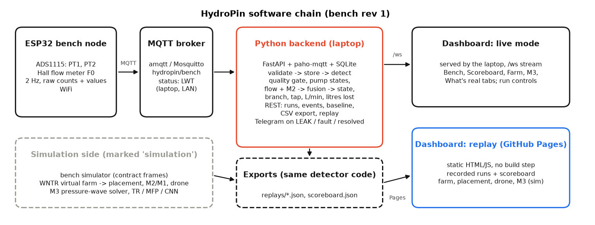
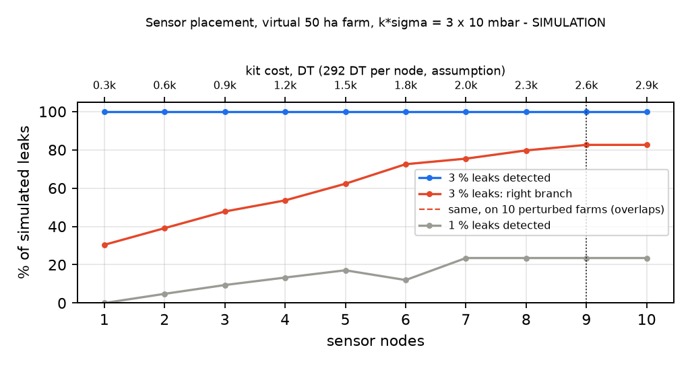
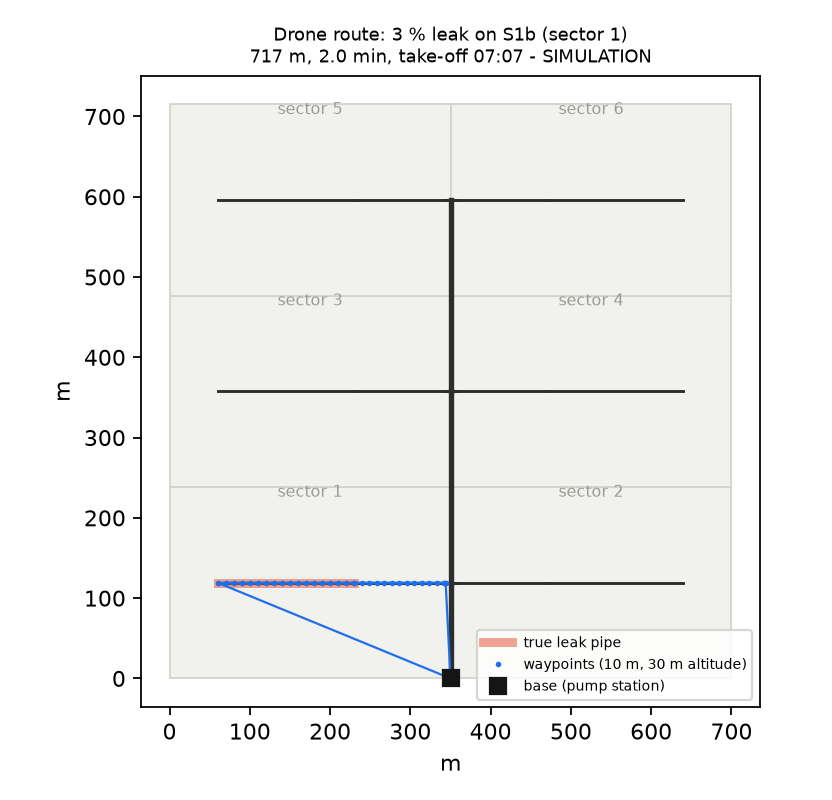

# Platform: software chain, sensor placement, drone dispatch (role 2)

*For the report (≤ 6 pages total), so this section is short. Figures are in `report/figures/`.
Everything about the farm is **simulation**; the bench chain is real code that has not yet run
on the real bench (see "Status" at the end).*

## Software chain

The ESP32 on the bench reads the two pressure transmitters through an ADS1115 and counts the
flow meter's pulses. Twice a second it publishes one JSON message on MQTT (`hydropin/bench`,
with an `offline` last-will message so a dead node shows up at once). On the laptop, one Python
process (FastAPI + paho-mqtt + SQLite) does five things for every message:

1. validates it against the frozen contract;
2. stores it;
3. runs the detector;
4. stores the detector's output;
5. pushes that output to the dashboard over a WebSocket.

The detector works in four stages: a quality gate drops bad sensors, a pump-state machine
handles start-up, the flow and M2 methods are fused into P(leak), and the result is the state,
the branch, per-tap probabilities, the leak size and the litres lost. It is a single class, and
the same code runs live, when scoring the campaign and when exporting replays, so the numbers
on the scoreboard come from exactly what ran live. The detector never sees labels or events;
those are ground truth for scoring only.

A Telegram message goes out on LEAK, on a new sensor fault and on "resolved". It is sent in a
background thread, so a network problem never slows down the incoming data.

The dashboard is a static page (HTML, CSS, ES modules, SVG) with no build step. It has two modes:

| Mode | Where it runs | What it shows |
|---|---|---|
| Live | served by the laptop | the WebSocket stream and the campaign controls (start run, leak on/off, re-baseline, CSV export) |
| Replay | GitHub Pages | recorded runs, the scoreboard, and the farm and M3 simulations |

Pages is HTTPS and cannot reach the laptop, so live mode switches itself off there.

## Sensor placement on the virtual farm

*Blueprint §II.B, `farm/placement/`, result in `dashboard/farm/placement.json`.*

**Input.** Role 5's WNTR farm: 50 ha, 6 sectors, 3 irrigation shifts, 16 realistic sensor
spots, 2,070 simulated leaks of 1, 3 and 10 % of the open-sector flow, on 10 randomised
versions of the farm. The input is the pressure change ΔP(i, s) at every spot i for every
leak s.

**Rules.**
- A chosen set of sensors **detects** a leak if one of them drops by more than k·σ
  (k = 3, σ = 10 mbar, a placeholder until the bench σ is measured).
- It **traces the leak to its branch** (main pipe or one sector) if, once the common drop is
  removed, the sensor with the largest extra drop sits on that branch. A sensor in a closed
  sector reads the main pipe, so it counts as a main-pipe sensor.

**Search.** A greedy pick, then swaps, then a small genetic algorithm (fixed seed), for N = 1–10
sensors. The best set for each N is then re-tested on 10 *other* perturbed farms (different
roughness, elevations and clogging, 1,380 new leak simulations).

**Results** (simulation):
- One sensor already detects every 3 % and 10 % leak, because a leak lowers every pressure.
  Detection is the easy part; **locating is the hard part**.
- The share of 3 % leaks traced to the right branch grows with N: 30 % with 1 sensor, 72 % with
  6 (1,752 DT), 83 % with 9 (2,628 DT).
- The numbers hold on the perturbed farms (within 1–2 points).
- 1 % leaks stay close to the noise: at most 23 % are detected from one reading.
- No layout reaches the 90 % target. Leaks on the main next to a sector head look the same as
  leaks just inside that sector. The tool therefore recommends N = 9; the business plan's
  6 nodes give 72 %.

Kit cost uses 292 DT per node (217 DT sensor node + 75 DT tapping point, master document
prices). This is an assumption until the market lead confirms the BOM.

## Locating on the farm, and the drone

*`farm/methods/`, `farm/drone/`, results in `dashboard/farm/results.json` and `drone.json`.*

**M2 on the farm.** The same idea as on the bench: remove the common mode, compare the leak's
pressure fingerprint with one learned per leak site, and turn the match into a probability per
pipe (a Gaussian likelihood at σ).
- **M1 on the farm:** a 3-layer graph convolutional network over the pipe graph, trained on
  the same farm versions.
- **Fusion:** the normalised product of the M1 and M2 maps.
- Training uses 7 farm versions; all scores are on the 3 versions it never saw.

Share of 3–10 % test leaks, 1-minute average (white noise assumed):

| Sensors | Right branch (M2 / M1 / fused) | Exact pipe, fused | Within one hop, fused |
|---|---|---|---|
| 6 | 57 % / 60 % / 60 % | 30 % | 47 % |
| 10 | 64 % / 68 % / 67 % | 50 % | 60 % |

From a single reading, M2 finds the right branch for 43 % (6 sensors) and 55 % (10 sensors).
Chart: `report/figures/farm_m1_m2_fused.png`.

**Drone dispatch (simulated, rule-based).**
1. Keep the pipes holding ≥ 90 % of the fused probability.
2. Put waypoints every 10 m along them, 30 m above ground.
3. Fly from the pump station by nearest neighbour and back, at 8 m/s plus a 10 s hover per pipe.
4. Take off at sunrise (07:07 on 27 Nov at Cap Bon), when thermal contrast is best.

For the 10 showcase leaks with 6 sensors, the true pipe is inside the route 8 times out of 10.
A median flight takes 3.4 min, well within one battery. Real flights (vendor SDK / MAVLink) and
permits are next steps.

## Status (honest)

- **Built and tested:**
  - contract, broker config, backend, bench simulator (8 scenarios plus sensor unplugs), detector;
  - replay and scoreboard export, dashboard, Pages workflow;
  - placement, farm M2, drone.
- **Not yet done on the real bench:** 10 minutes without a gap, a Telegram message received on
  a phone, the real scoreboard. The current scoreboard is from 160 simulated runs: medium and
  large leaks 60/60 on the right branch in about 9 s; small leaks (0.15 L/min, about 1.5 flow
  pulses per window) reach LEAK in 6/30 runs and at least WATCH in 25/30, the flow-meter
  resolution limit; no false alarms. In the fusion, M2 is not allowed to vote against a leak
  just because the pressures did not move (they barely do for a small leak).
