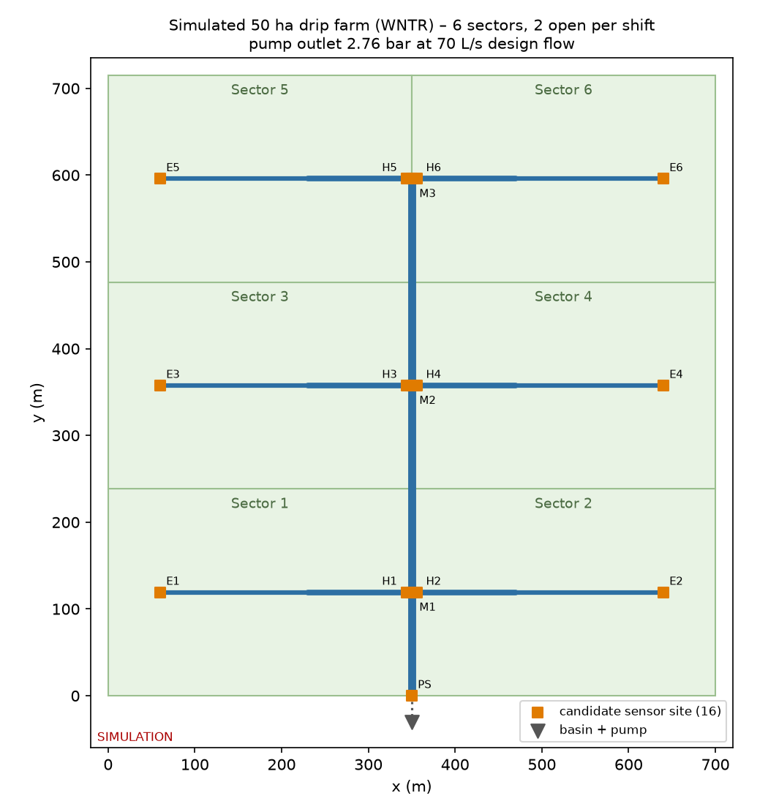
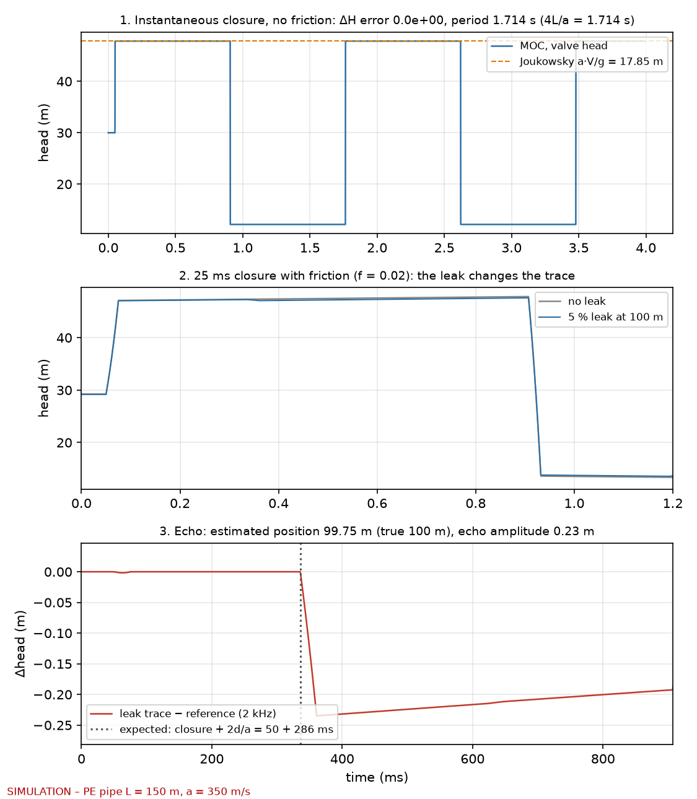
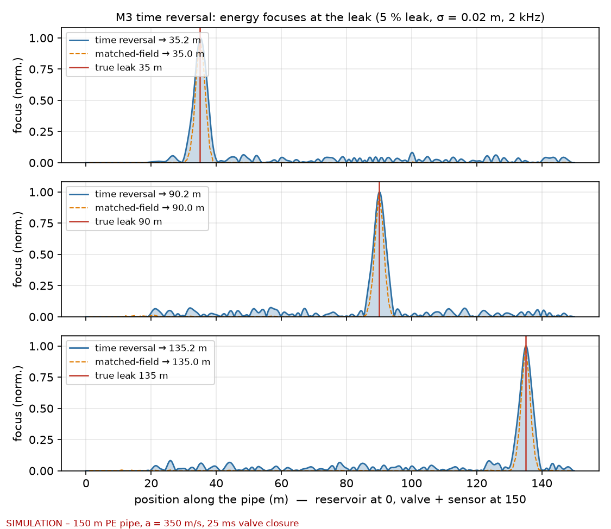

# Modelling and M3: the virtual farm and the pressure-wave method (role 5)

*All results in this section are **simulation**. Every parameter below is an assumption
unless a source is given (full list: `farm/model/params.yaml`, `m3/`).*

## The virtual farm

A WNTR (EPANET) model of a plausible Tunisian drip farm:

| Item | Value |
|---|---|
| Size | 50 ha (the business plan's reference farm), 700 × 715 m |
| Sectors | 6 sectors of ~8.3 ha in 3 rows; 2 sectors irrigate at a time (3 shifts) |
| Pipes | PVC 250 main along a farm road; PVC 160 / PE 125 sub-mains; Hazen-Williams C 140–145 |
| Pump | 3-point curve, 70 L/s at 30 m |
| Demand | pressure-dependent; drip manifolds need 12 m |
| Terrain | gentle slope, +2.9 m across the farm |
| Sensor spots | 16: pump outlet, main valve boxes, sector heads upstream of the valves, sub-main ends |

Each sector's laterals are lumped into 2 manifold demands. Laterals are detected per sector,
not localised.

**Leak dataset.**
- 23 pressurised leak sites per shift (junctions plus pipe midpoints), at 1, 3 and 10 % of the
  open-sector flow.
- Each leak is simulated on 10 randomised versions of the farm per shift: roughness ±5 %,
  elevations ±0.5 m, emitter clogging 0.8–1.0. That gives **2,070 leaks** (~30 s on 7 cores),
  plus healthy samples and 10 extra perturbed models for robustness tests.
- Sensor noise is σ = 10 mbar, a placeholder until the bench σ is measured.

**Main physics finding.** Any leak lowers every pressure by about the same amount, because the
pump slides down its curve: a 1 % leak gives about 20 mbar everywhere. Detecting is easy;
location comes from the small differences between sensors. This is why placement and M2
remove the common mode first. With 6 sensors, 72 % of 3 % leaks can be traced to the right
branch (role 2's section).

## M3: pressure waves and time reversal

**Set-up.**
- A 150 m PE pipe with a reservoir upstream, a fast valve and the sensor downstream.
- Wave speed a = 350 m/s; 25 ms closure; 2 kHz recording.
- Method-of-characteristics solver (Courant = 1) with friction, a leak orifice and PE wall creep.

The bench cannot do M3 (no kHz sampling, no fast valve, no long pipe), so M3 stays in
simulation (team decision, 21 Nov).

**Validation, done before any localisation.**

| Check | Expected | Obtained |
|---|---|---|
| Joukowsky jump a·V0/g | 17.845 m | 17.845 m |
| Oscillation period 4L/a | 1.714 s | 1.714 s |
| Grid convergence | N vs 2N within 2 % | passes |
| Leak mass balance | — | within 1e-9 |
| Echo position | within 1 m | within 0.25 m |

**Localisation.** Four locators on the same recordings:
1. **Echo timing:** distance = a·t/2.
2. **Time reversal (TR):** the leak-induced part of the trace is time-reversed and sent back
   into the intact-pipe model; energy focuses at the leak.
3. **Matched-field processing (MFP).**
4. **A 1D CNN** trained on 9,000 simulated pipes with random leak position, size, wave speed,
   friction and creep.

Accuracy (mean absolute error over 18 test traces, `report/figures/m3_accuracy.png`):

| Condition | TR | MFP | Echo | CNN | CNN, pipe calibrated once |
|---|---|---|---|---|---|
| Noise σ = 0.05 m | 0.27 m | 0.06 m | 0.82 m | 0.97 m | 0.77 m |
| Noise σ = 0.2 m | 8.2 m | 8.8 m | 34 m | 2.8 m | 1.9 m |
| Model wave speed off by 5 % | 3.1 m | 3.2 m | 3.7 m | 0.92 m | 0.72 m |
| Model wave speed off by 10 % | 23 m | 8.2 m | 24 m | 0.92 m | 0.72 m |

**Reading.**
- With a well-known pipe and low noise, the model-based methods (TR, MFP) are the most precise.
- The trained network is far more robust to noise and to a wrong wave speed, which is what a
  real buried pipe gives you.
- TR with the wave speed identified from the recording itself stays at 0.27 m at every
  wave-speed error.
- Viscoelastic creep in PE weakens the echoes; it is in the model and shown as a real-world
  risk (`report/figures/m3_viscoelastic.png`).

**Review.** Mentor Moez Louati (time reversal) reviewed and approved these M3 results before
the video.

## Twin vs real

The bench twin calibrated to role 1's measurements is a **next step**: the measurements and
healthy runs were not available before the freeze. Houda's earlier twin of the prototype bench
predicted that a leak at L1 drops P1 about twice as much as P2, and that L2 and L3 look almost
the same. That prediction is why the bench promises **which branch**, not which tap.

## Assumptions to list in the report

Farm:
- shape and size;
- sector layout and shifts;
- 1.5 mm/h application rate;
- pipe sizes and roughness;
- pump curve;
- 12 m required pressure;
- terrain slope;
- the ranges used to randomise the farm versions;
- σ = 10 mbar placeholder;
- 1-minute averaging with white noise (farm M2).

M3:
- pipe length, material and wave speed;
- closure time;
- 2 kHz sampling;
- leak orifice model;
- creep parameters;
- noise levels.
