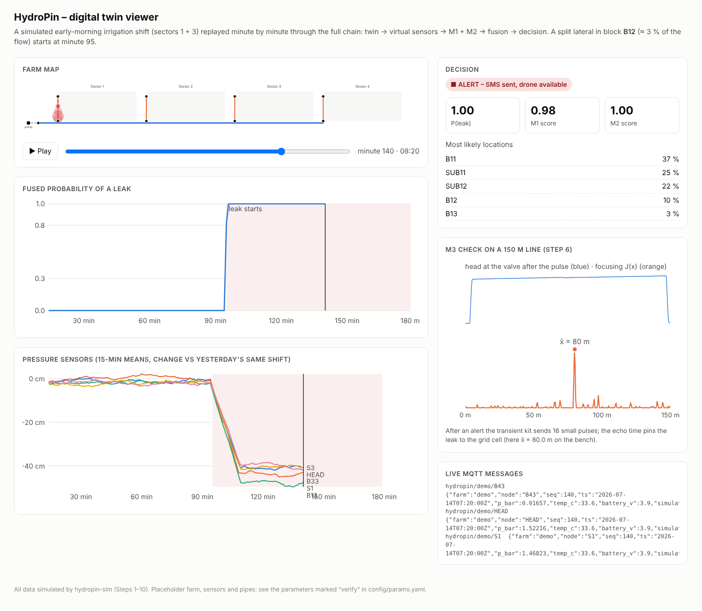

# HydroPin – simulation

A physics-based digital twin of **farm drip-irrigation networks** and of **our prototype bench**. We use it to design and test HydroPin's leak-detection methods before (and alongside) real measurements:

- **M1**: graph neural network on the pressure network
- **M2**: PCA/SVD on the pressure pattern
- **M3**: pressure waves + time reversal
- **Fusion** of the three into one decision

Every equation is in [`docs/math.md`](docs/math.md). Every result is checked against an analytical solution, a reference software or a physical law. **207 tests pass.**

## 1. See it (no install)

Open [`demo/hydropin_viewer.html`](demo/hydropin_viewer.html) in any browser. It works offline and has three tabs:

- **Farm shift:** a 4-sector farm replayed minute by minute: sensors → M1/M2 → fusion → alert. The MQTT messages are in the exact ESP32 format.
- **Prototype board:** our bench. Turn the valves, open a leak tap, and see what P1, P2 and F0 would read.
- **3D bench:** the board in 3D, with the pressure waves in slow motion.



## 2. Results

Read in this order. Each folder has its own page with the checks, figures and assumptions.

**How the water behaves**

| Topic | Key result |
|---|---|
| [Physics](results/physics/) | Darcy–Weisbach everywhere: Hazen–Williams is 65 % wrong at the end of a drip lateral |
| [Hydraulics](results/hydraulics/) | Our steady-state twin matches EPANET within 0.06 % |
| [Sensors](results/sensors/) | Sun on the sensor box is the main error: temperature compensation cuts noise from 13 cm to 1.5 cm |
| [Pressure waves](results/pressure-waves/) | Exact analytical solution reproduced to 10⁻¹⁵ m |
| [Leak echoes](results/leak-echoes/) | A 2 % leak sends back a 1.6 cm echo at the predicted time |

**How we find the leak**

| Topic | Key result |
|---|---|
| [M2 – PCA/SVD](results/m2-pca/) | 100 % of leaks ≥ 1 % detected, 1.8 % false alarms, median location error 5 m |
| [M1 – graph neural network](results/m1-gnn/) | Detects like M2 (0.5 % false alarms), locates less well with the data available |
| [M3 – time reversal](results/m3-time-reversal/) | 2 % leaks located to 0.25 m along a 150 m line, no false alarm |
| [Sensor placement](results/sensor-placement/) | 6 sensors reach 98 % of the best possible coverage |
| [Fusion](results/fusion/) | 0.3 % false alerts, 100 % alerts on leaks ≥ 5 % |

**Our prototype bench**

| Topic | Key result |
|---|---|
| [Bench twin](results/prototype-bench/) | Every part modelled, from pump to firmware: predicts P1, P2, F0 before the board is built |
| [Bench pressure waves](results/bench-waves/) | Joukowsky to 0.03 %; a valve slam stays below the sensors' limit |
| [Wiring](results/wiring/hydropin_bench_wiring.pdf) | One ESP32 (Wi-Fi), ADS1115 for the two pressure sensors, pulse input for the flow meter |

**What we learned:** detecting a leak is easy, locating it is hard. A leak lowers every pressure on the farm because the pump slides down its curve. Only about 10–30 cm of head differs between sensors. So we compare each irrigation with the last healthy one of the same shift. M2 finds the sector; M3 or the drone finds the metre.

**About M3 on the bench:** M3 is in the simulation only. The bench ADC gives a few dozen readings per second, while M3 needs kHz sampling and a fast valve on a long pipe. That's beyond the prototype budget.

## 3. Run it

Python ≥ 3.10, on Windows, macOS or Linux.

```bash
cd simulator
python -m venv .venv
# Windows: .venv\Scripts\activate    macOS/Linux: source .venv/bin/activate
pip install -e ".[dev,ml]"
pytest                          # 207 tests, a few minutes
python run/m2_pca.py            # rebuilds results/m2-pca/ (any topic, same name)
```

There is one script per results folder in `run/`. `python run/demo.py` rebuilds the viewer; run it after `run/bench_waves.py`. `python run/wiring.py` redraws the schematic and needs `pip install -e ".[wiring]"`.

## 4. Folder layout

```
demo/            the interactive viewer
results/         one folder per topic: README.md (checks, figures, assumptions) + figures
docs/            math.md (all equations) · architecture.md · prototype-bench.md · development-log.md
hydropin_sim/    the code, one sub-package per layer:
                 physics → network → steady → transient → sensors → methods → fusion/placement → viz
run/             one script per results folder
oracles/         the checks behind every results page, shared with the tests
tests/           test_<topic>.py + architecture and parameter tests
config/          params.yaml (every constant, with unit, source and range) · networks/ (bench, demo farm)
data/            simulated training dataset (M1, M2)
```

`sim.py` and `scenarios.py` are the command-line generator of bench data for the backend. They are separate from the twin.

## 5. Limits

- **The farm is a demo layout.** The bench follows our hardware list of 18 Nov 2026. Parameters marked `verify: true` in `config/params.yaml` are literature values, waiting for datasheets or bench measurements.
- **M1, M2 and fusion are trained and tested on simulated data.** The bench recordings are their first real test.
