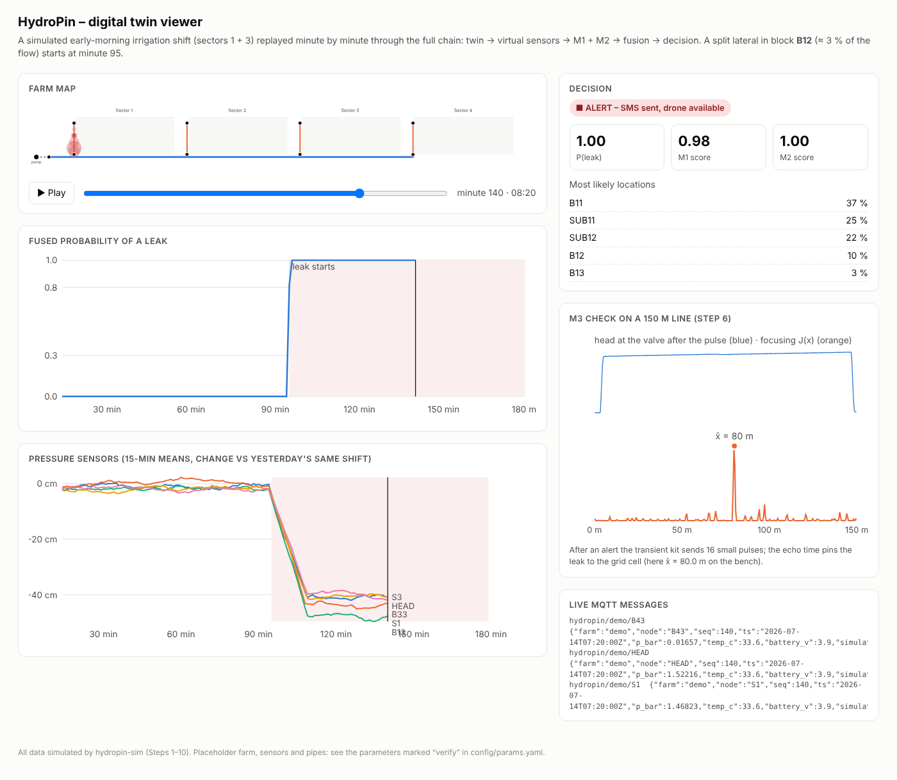

# Demo viewer and MQTT stream

> **✅ all checks pass (6/6)**  
> One simulated irrigation shift is replayed minute by minute through the whole chain. The result is a self-contained web page for the jury and the team, plus a sample of the MQTT messages in the exact format the ESP32 nodes will publish.

Back to the [overview](../README.md) · Equations: [math](../docs/math.md) · Design: [architecture](../docs/architecture.md)

## 1. What was built

| Code | What it does | Math |
|---|---|---|
| `run/demo.py` | Shift replay: twin → 9 virtual sensors + flow meter → M1, M2 every minute → fusion → decision | §3, §4, §6 |
| `demo/hydropin_viewer.html` | Interactive viewer: farm map, fused P(leak) with band, sensor changes, decision, M3 panel, live MQTT log | – |
| `run/viewer3d/scene3d.js` | 3D bench tab (three.js, bundled inline): table, board, every fitting, valves turning with the sliders, sensors, pump, bucket, electronics, laptop dashboard; pipe colours, water speed and drips from the twin | §10 |
| `run/board_tab.py` | Board tab (bench twin): valve sliders, leak taps, P1/P2/F0, branch signature, 5-min replay of the published data | §10 |
| `demo/mqtt_stream_sample.jsonl` | 1,583 messages (topic + JSON payload) ready to replay into the platform | contracts |

## 2. Checks

Each check compares the code with an analytical solution, a reference software or a physical law.

| # | Check | Expected | Obtained | Tolerance | Ref | Result |
|---|---|---|---|---|---|---|
| 1 | Every line of the MQTT sample is a valid SensorMessage (same contract as the ESP32) | yes | yes | – | contracts | ✅ |
| 2 | No alert before the leak starts | 0 | 0 | ± 0 | §6 | ✅ |
| 3 | Alert raised within one decision window (15 min) after the leak starts | 15 min | 0 min | ≤ expected | §6 | ✅ |
| 4 | Once the window is full of leaky readings, the suspect is in sector 1 | 0.9 | 1 | ≥ expected | §6 | ✅ |
| 5 | The viewer is self-contained (no external script, style or font) | yes | yes | – | – | ✅ |
| 6 | Board tab: every slider combination has its own twin solution | 3648 | 3648 | ± 0 | §10 | ✅ |

## 3. Figures

**Figure 1.** The viewer at minute 140 (screenshot; open the HTML file for the interactive version).

## 4. What the figures tell us

- The leak (≈ 3 % of the flow, split lateral in B12) is alerted **0 min** after it starts: for a 3 % leak, a single leaky reading in the 15-min window already moves its mean above the threshold. No alert before the leak. Smaller leaks take longer, up to one full window (15 min).
- The platform member can build the dashboard on `mqtt_stream_sample.jsonl` today: it is exactly what the field nodes will send.
- Open `hydropin_viewer.html` in a browser and press ▶ to play the shift (≈ 15 s).

## 5. Assumptions

- Demo farm, sector 1 + 3 shift, one random farm state (seed 77), water ≈ 1 °C warmer on the baseline day.

## 6. Open points

- Use the viewer in the TSYP pitch (screen recording or live).
