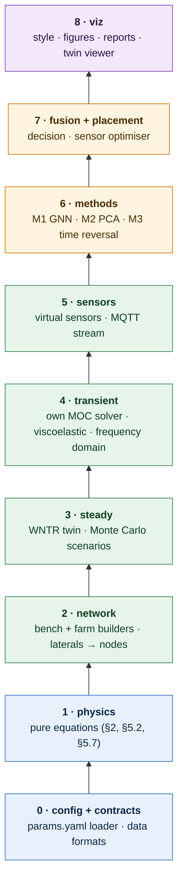

# HydroPin – Simulation architecture

How the simulation is organised: the rules the code follows, its layers, its data formats and the order it was built in.

- Equations: [math.md](math.md)
- Twin of the prototype bench: [prototype-bench.md](prototype-bench.md)
- Results: one folder per topic in [`../results/`](../results/), demo in [`../demo/`](../demo/)

---

## 1. Six rules

> **Rules the code follows**  
> 1. **One source of truth for constants.** Every number comes from `config/params.yaml`, with the same names as the math note. A test checks both directions: every name in the note exists in the file, and the file defines nothing the note doesn't.
> 2. **Layers, one direction only.** A module can only use the layers below it. A test fails if the physics ever imports a solver, or a solver imports a detection method.
> 3. **SI inside, readable outside.** Pressure is head in metres of water and flow is in m³/s inside the code. bar, L/s and L/h appear only in figures.
> 4. **Oracle before use.** Every module is checked against something independent (hand calculation, physical law, reference software) before anything else uses it.
> 5. **One topic = one validation page.** Each topic ends with a results page (figures + pass/fail table) before anything builds on it.
> 6. **Reproducible.** Every random draw has a seed, and one script per topic (`run/`) regenerates its page and figures.

---

## 2. Layers



| Layer | Package | Job | Math note |
|---|---|---|---|
| 0 | `config`, `contracts` | Load and check the parameters; define every data format | §0 |
| 1 | `physics` | Pure equations, no network and no files | §2.2–2.7, §5.2, §5.7 |
| 2 | `network` | Build the bench and the farm; reduce laterals to equivalent nodes; export `.inp` | §1, §2.4 |
| 3 | `steady` | Steady-state and 24 h twin with WNTR (pressure-driven demand, leaks); scenario sampler | §2, §2.9 |
| 4 | `transient` | Our own water-hammer solver (method of characteristics) and the frequency-domain model | §5 |
| 5 | `sensors` | Turn exact pressures into realistic sensor readings; fake MQTT stream | §3 |
| 6 | `methods` | M1, M2, M3, all returning the same output format | §4, §5.9 |
| 7 | `fusion`, `placement` | Combine the three methods and decide; optimise sensor positions | §6, §7 |
| 8 | `viz` | One visual style for every figure, the results pages and the demo viewer | – |

---

## 3. Data flow

```mermaid
flowchart LR
    P[(params.yaml)]:::cfg
    N[[NetworkSpec<br/>bench.yaml · farm.yaml]]:::cfg
    S[[Scenario<br/>sectors · leak · seed]]:::cfg

    P & N --> B[network.builder]:::sim
    B --> W[WNTR model]:::sim
    S --> ST[steady.solver]:::sim
    W --> ST
    ST --> SR[SteadyResult]:::data
    SR --> TR[transient.moc]:::sim
    TR --> TRR[TransientResult]:::data

    SR --> SE[sensors.model]:::sim
    TRR --> SE
    SE --> SS[SensorSeries]:::data
    SE -. "same JSON as ESP32" .-> MQ((MQTT stream)):::out

    SS --> M1[M1 · GNN]:::ai
    SS --> M2[M2 · PCA/SVD]:::ai
    SS --> M3[M3 · time reversal]:::ai
    M1 & M2 & M3 --> MO[MethodOutput ×3]:::data
    MO --> F[fusion]:::ai
    F --> D[Decision<br/>log · watch · alert]:::out
    D --> V[viz · twin viewer]:::out

    classDef cfg fill:#E8F1FB,stroke:#2F6DB5,color:#0B2545
    classDef sim fill:#E6F4EA,stroke:#2E7D4F,color:#0F3D24
    classDef data fill:#FFFFFF,stroke:#6B7280,color:#111827,stroke-dasharray: 4 3
    classDef ai fill:#FFF4E0,stroke:#C77700,color:#4A2C00
    classDef out fill:#F3E8FB,stroke:#7A3DB8,color:#2E1047
```



> **Why the MQTT stream is in the simulator**  
> The simulator publishes messages in **exactly** the format of the real ESP32 nodes. The platform member can build the dashboard and fusion before any hardware exists, and switching to the real farm later means changing the data source, nothing else.

---

## 4. Data contracts (frozen)

Defined in `hydropin_sim/contracts.py`. Later work can **add** optional fields but never rename or remove one. *Added so far: `Node.outlet_coeff` (hydraulics); paired-baseline arrays in the dataset file (M2).*

| Contract | What it holds | Produced by → used by |
|---|---|---|
| `NetworkSpec` | Nodes (source, junction, lateral block, dead end, flush valve), pipes (material, Ø, wall, length), pump curve, sector valves, lateral blocks, sectors | YAML file → `network` |
| `Scenario` | Open sectors, leaks (pipe, position, area), water temperature, clogging, uncertain parameters, seed | `steady.scenarios` → solvers |
| `SteadyResult` | Time × node heads and pressures, time × link flows, leak and pump flow | `steady` → `sensors`, `transient` |
| `TransientResult` | High-rate head and flow at monitored points, wave speed used per pipe | `transient` → `sensors`, M3 |
| `SensorSeries` | What one sensor delivers (NaN = lost packet) | `sensors` → methods |
| `MethodOutput` | Score in [0, 1], location map (sums to 1), quality index, pass/fail of its own quality gate | M1, M2, M3 → `fusion` |
| `Decision` | P(leak), 5–95 % band, suspect pipe, action, methods used and excluded with the reason | `fusion` → viz, drone agent |
| `SensorMessage` | MQTT payload `{farm, node, seq, ts, p_bar, temp_c, battery_v, simulated}` | simulator **and** real nodes → platform |

**Sign conventions:** a pipe goes from `start` to `end`, and $Q > 0$ means start → end. Position $x$ along a pipe is measured from its start node. All elevations use one site datum.

---

## 5. Technology choices

| Need | Choice | Why |
|---|---|---|
| Steady state | **WNTR** (EPA) | Trusted solver, pressure-driven demand, leak model, reads and writes EPANET `.inp` |
| Transients | **Our own MOC solver** | TSNet has no viscoelastic walls, dripper boundaries or our excitation valve. *Planned as oracle; dropped (incompatible with NumPy 2, wrong valve initialisation). Replaced by the exact analytical solution and grid convergence.* |
| Frequency domain (M3) | Our own transfer matrices (NumPy) | Directly follows math note §5.8 |
| M2 | NumPy / SciPy | SVD only |
| M1 | PyTorch | Plain GCN with a dense normalised adjacency (21 nodes); PyTorch Geometric turned out unnecessary |
| Parameters and contracts | YAML + Pydantic | Every value is checked for range and type when loaded |
| Figures | Matplotlib with one shared style (`viz.style`) | Same look in every report |
| Demo viewer | Self-contained HTML page | Opens anywhere, no install, demo-ready |

Python ≥ 3.10, works on Windows, macOS and Linux.

---

## 6. Folder layout

```
simulator/
├── README.md          overview: results, how to run
├── demo/              hydropin_viewer.html (open in a browser) + its page
├── results/<topic>/   README.md (results page) + figures, one folder per topic
├── docs/              math.md, architecture.md, prototype-bench.md, development-log.md
├── hydropin_sim/      the code: config, contracts + one folder per layer
├── run/<topic>.py     one script per results folder (+ the viewer and the wiring schematic)
├── oracles/<topic>.py the checks behind every results page, shared with pytest
├── tests/             test_<topic>.py + architecture and parameter tests
├── config/            params.yaml (all constants), networks/ (bench, demo farm)
└── data/              simulated training dataset (M1, M2)
```

---

## 7. Build order

Each topic adds one layer and is checked against its oracles before the next one uses it.

| # | Topic | Math | What its checks prove |
|---|---|---|---|
| 1 | [Physics library](../results/physics/README.md) | §2.2–2.7, §5.2, §5.7 | Laminar $f = 64/Re$; Swamee–Jain vs Colebrook < 2 %; Christiansen; wave speed; Joukowsky; leak laws |
| 2 | [Networks and steady-state twin](../results/hydraulics/README.md) | §1, §2.1–2.6 | Single pipe vs hand calculation; mass balance; aggregated vs fully modelled lateral |
| 3 | [Virtual sensors and dataset](../results/sensors/README.md) | §2.9, §3 | Leak flow = orifice law; sensor statistics match the parameters |
| 4 | [Pressure-wave solver](../results/pressure-waves/README.md) | §5.1, §5.5–5.6 | Exact analytical solution; Joukowsky; period $4L/a$; grid convergence |
| 5 | [Leak echoes, friction, pipe creep](../results/leak-echoes/README.md) | §5.3–5.4, §5.6–5.7 | Leak reflection vs formula; energy decays; elastic limit recovered |
| 6 | [M3 – time reversal](../results/m3-time-reversal/README.md) | §5.8–5.9 | Leak located within the resolution; robust to noise and sync error |
| 7 | [M2 – PCA/SVD](../results/m2-pca/README.md) | §4.1 | False alarms ≈ 1–2 %; detection and localisation scores |
| 8 | [M1 – graph neural network](../results/m1-gnn/README.md) | §4.2 | Held-out leak positions; beats a simple baseline |
| 9 | [Sensor placement](../results/sensor-placement/README.md) | §7 | Greedy close to exhaustive search |
| 10 | [Fusion and decision](../results/fusion/README.md) | §6 | Calibrated probabilities; quality gate excludes a failing method |
| 11 | [Demo viewer + MQTT stream](../demo/README.md) | – | Self-contained page; messages in the exact ESP32 format |
| 12 | [Prototype bench twin](../results/prototype-bench/README.md) | §10 | Every part of the bench; flow, mass balance, sensor chain |
| 13 | [Pressure waves on the bench](../results/bench-waves/README.md) | §10.7 | Joukowsky; time of flight; no cavitation; slam stays safe |

---

## 8. How a results page looks

Each `results/<topic>/README.md` has the same sections:

1. **What was built**: modules and functions, each linked to its math section.
2. **Checks**: test · expected · obtained · tolerance · ✅/❌
3. **Figures**: same style everywhere, units on every axis.
4. **What the figures tell us** and **Assumptions**: every `verify: true` parameter the topic depends on.
5. **Open points**: what still needs a measurement or a team decision.

---

## 9. Design decisions

- **D1. Own transient solver**, checked against exact solutions (TSNet cannot model PE creep, drippers or our valve).
- **D2. Laterals reduced to equivalent nodes** in the farm model; a fully modelled lateral checks the reduction.
- **D3. Two reference networks:**
  - **Bench line:** 150 m of HDPE PE100 Ø63 SDR11, fed at one end, flush valve at the other, leak valves at 40, 80 and 120 m, 2 fast sensors (used by the pressure-wave and M3 studies).
  - **Demo farm:** well + pump, PVC Ø90 main, 4 sectors on PE Ø75 sub-mains, 3 manifolds × 10 laterals of 100 m (Ø16, drippers every 0.4 m), about 1.2 ha. To be replaced by a pilot farm survey.
- **D4. Prototype bench twin** follows the hardware list of 18 Nov 2026 ([prototype-bench.md](prototype-bench.md)).
- **D5. Same page format** for every topic (§8).

Structural tests: `params.yaml` has 55+ entries, each with unit, symbol, meaning, source and plausible range; every code name in the math note is covered in both directions; the layer rule and the data contracts are enforced by tests (both were broken on purpose once to check that their tests fail).
