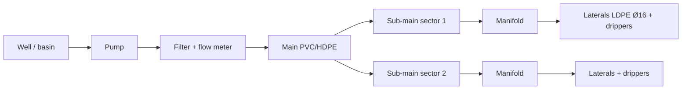

# HydroPin – Simulation math

All the equations the HydroPin simulation uses, with the **constant names used in the code** (`params.yaml`). Each section ends with what makes a **farm network** different from an urban one, and how to check the equation against real life.

> **Conventions**  
> - SI units everywhere. Pressure is expressed as **pressure head in metres of water** (1 bar ≈ 10.2 m).
> - $H$ = hydraulic head (m) = elevation + pressure head. $h$ = pressure head (m).
> - $Q$ = flow (m³/s), $V$ = mean velocity (m/s), $A = \pi D^2/4$ = cross-section (m²).
> - EPANET files use `FLOWUNITS LPS` and the **Darcy–Weisbach** head-loss formula (see §2.2).
> - Values marked ⚠ are typical literature values, to replace with the supplier datasheet or a bench measurement.

Related: the HydroPin solution blueprint and SWOT analysis (separate team documents).

---

## 0. Constants and parameters

### 0.1 Water and physics

| Code name | Symbol | Meaning | Default | Unit | Note |
|---|---|---|---|---|---|
| `G` | $g$ | Gravity | 9.81 | m/s² | |
| `RHO_W` | $\rho$ | Water density | 998 | kg/m³ | at 20 °C |
| `NU_W` | $\nu$ | Kinematic viscosity | 1.004e-6 (20 °C), 0.801e-6 (30 °C), 0.658e-6 (40 °C) | m²/s | Surface pipes heat up in summer: use water temperature |
| `K_W` | $K$ | Bulk modulus of water | 2.2e9 | Pa | |
| `P_ATM` | $p_{atm}$ | Atmospheric pressure | 101 325 | Pa | ≈ 10.33 m |
| `P_VAP` | $p_v$ | Vapour pressure | 2.34e3 (20 °C), 4.25e3 (30 °C), 7.38e3 (40 °C) | Pa | For the cavitation check in transients |

### 0.2 Pipes (one set per material)

| Code name | Symbol | Meaning | Default | Unit | Note |
|---|---|---|---|---|---|
| `D_INT` | $D$ | Internal diameter | per pipe | m | From the network survey |
| `E_WALL` | $e$ | Wall thickness | per pipe | m | From the SDR/PN class: $e = D_{out}/SDR$ |
| `L_PIPE` | $L$ | Length | per pipe | m | |
| `E_PIPE` | $E$ | Young's modulus (short-term) | PVC 3.0e9 · HDPE PE100 1.1e9 · LDPE laterals 0.25e9 | Pa | ⚠ Falls as temperature rises (PE) |
| `NU_P` | $\nu_p$ | Poisson ratio of the pipe | PVC 0.40 · PE 0.46 | – | ⚠ |
| `EPS_R` | $\varepsilon$ | Absolute roughness | 1.5e-6 (new) to 1e-5 (deposits) | m | Fertigation and biofilm increase it |
| `C1` | $c_1$ | Pipe anchoring factor | 1.0 | – | See §5.2 |
| `J0` | $J_0$ | Instantaneous creep compliance $=1/E_0$ | $1/E$ | Pa⁻¹ | PE only |
| `J_K`, `TAU_K` | $J_k,\ \tau_k$ | Kelvin–Voigt creep parameters | placeholder: $\tau_k \in \{0.05, 0.5, 1.5, 5\}$ s, $J_k \approx 0.01$–$0.2\,J_0$ | Pa⁻¹, s | ⚠ **Must be calibrated on the bench** |

### 0.3 Drip emitters, laterals and leaks

| Code name | Symbol | Meaning | Default | Unit | Note |
|---|---|---|---|---|---|
| `Q_NOM` | $q_{nom}$ | Nominal emitter flow | 2–4 | L/h | |
| `H_NOM` | $h_{nom}$ | Nominal emitter pressure | 10 | m | ≈ 1 bar |
| `K_D` | $k_d$ | Emitter coefficient | $q_{nom}/h_{nom}^{x}$ | m³/s·m⁻ˣ | |
| `X_EMIT` | $x$ | Emitter exponent | 0.5 (non-compensating) · 0–0.1 (pressure-compensating) | – | ⚠ From the dripper datasheet |
| `H_ACT`, `H_MAX` | $h_{act},\ h_{max}$ | Regulation range of compensating drippers | 5–10, 30–40 | m | ⚠ |
| `CV_MFG` | $c_v$ | Manufacturing variation of $k_d$ | 0.03–0.07 | – | |
| `C_CLOG` | $c_j$ | Clogging fraction of emitter $j$ | 0 (new) to 0.3 | – | Random per emitter in Monte Carlo |
| `S_EMIT` | $s$ | Emitter spacing | 0.3–0.5 | m | |
| `N_EMIT` | $N_e$ | Emitters per lateral | $L_{lat}/s$ | – | |
| `CD_LEAK` | $C_d$ | Leak discharge coefficient | 0.62 (sharp hole) – 0.75 (WNTR default) | – | |
| `A_LEAK` | $A_L$ | Leak area | swept | m² | |
| `N1_LEAK` | $N_1$ | Leak pressure exponent | 0.5 (rigid hole) to ≈ 1.5 (split in plastic) | – | ⚠ |
| `M_FAVAD` | $m$ | Leak-area growth with pressure | 0 (rigid) to positive (plastic) | m²/m | |

### 0.4 Pump, energy and money

| Code name | Symbol | Meaning | Default | Unit |
|---|---|---|---|---|
| `H0_PUMP`, `R_PUMP`, `N_PUMP` | $H_0,\ R_p,\ n_p$ | Pump curve | from the pump datasheet | m, –, – |
| `ETA_PUMP` | $\eta$ | Pump + motor efficiency | 0.5–0.7 | – |
| `C_ELEC` | $c_e$ | Electricity price | to source | TND/kWh |
| `C_WATER` | $c_w$ | Water price (real cost) | 1.45–1.60 (full cost) | TND/m³ |

### 0.5 Transients (M3)

| Code name | Symbol | Meaning | Default | Unit |
|---|---|---|---|---|
| `A_WAVE` | $a$ | Wave speed | computed (§5.2) | m/s |
| `ALPHA_AIR` | $\alpha_g$ | Free-air volume fraction | 0 to 1e-3 | – |
| `T_CLOSE` | $T_c$ | Valve closure time | 0.005–0.05 (to sweep) | s |
| `E_M` | $E_m$ | Valve closure-curve exponent | 1–2 | – |
| `DT` | $\Delta t$ | Transient time step | from Courant = 1 | s |
| `PSI_MAX` | $\psi$ | Max allowed wave-speed adjustment | 0.05 | – |

### 0.6 Sensors and decisions

| Code name | Symbol | Meaning | Default | Unit |
|---|---|---|---|---|
| `FS_BAR` | – | Sensor full scale | 6 or 10 | bar |
| `ACC` | – | Accuracy (fraction of full scale) | 0.0025 | – |
| `TEMPCO` | $\alpha_T$ | Zero drift per K (fraction of full scale) | 0.0002 | 1/K |
| `T_AMP` | $T_{amp}$ | Daily temperature swing (half amplitude) | 15 | K |
| `DRIFT_YR` | $\beta$ | Ageing drift per year (fraction of full scale) | 0.002 | 1/yr |
| `SIGMA_N` | $\sigma_\varepsilon$ | Short-term noise (fraction of full scale) | 0.0005 | – |
| `ADC_BITS` | $n_b$ | ADC resolution | 16 | bit |
| `LOSS_RATE` | – | LoRa packet loss | 0.02 | – |
| `FS_HIGH` | $f_s$ | M3 sampling rate | 2000 | Hz |
| `TAU_SENS` | $\tau_s$ | M3 sensor response time | 1e-3 | s |
| `SIGMA_SYNC` | $\sigma_{sync}$ | GPS time-sync error | 1e-6 | s |
| `SIGMA_HF` | $\sigma_{HF}$ | Noise of one M3 sample | 0.01 | m |
| `N_PULSES` | $N_p$ | M3 pulses averaged per test | 16 | – |
| `N_AVG` | $n_{avg}$ | Readings averaged per decision window | 15 | – |
| `TEMP_COMP_RESIDUAL` | $\rho_T$ | Fraction of the temperature drift left after compensation | 0.1 | – |
| `SIGMA_Q` | $\sigma_Q$ | Flow-meter noise (fraction of the reading) | 0.005 | – |
| `KAPPA` | $\kappa$ | Detection margin (× noise) | 3 | – |
| `TAU1`, `TAU2` | $\tau_1,\ \tau_2$ | Watch / alert thresholds on P(leak) | 0.3, 0.8 | – |

### 0.7 Prototype board (3rd phase, §10)

Parameters of the bench prototype (hardware list and sketch of 18 Nov 2026). ⚠ = to measure on the assembled board.

| Code name | Symbol | Meaning | Default | Unit |
|---|---|---|---|---|
| `PB_TILT` | $\theta_B$ | Board tilt (0 = flat on the table, as built) | 0 | deg |
| `PB_Z_BOARD` | $z_B$ | Board bottom edge above the bucket water ⚠ | 0.5 | m |
| `PB_Z_PUMP` | $z_P$ | Pump outlet above the bucket water ⚠ | 0 | m |
| `PB_D_HOSE`, `PB_L_HOSE` | $d_h,\ L_h$ | Soft pump hose: inside diameter ⚠, length | 0.006, 1 | m |
| `PB_D_OUT_PE`, `PB_E_WALL_PE` | $D_o,\ e_{PE}$ | 16 mm PE pipe: outside diameter, wall ⚠ | 0.016, 0.0012 | m |
| `PB_D_BARB` | $d_{barb}$ | Bore of barbed tees, elbows, reducer ⚠ | 0.011 | m |
| `PB_D_VALVE`, `PB_D_TAP` | $d_v,\ d_t$ | Bore of the 16 mm mini valves and of the ½" tap valves ⚠ | 0.008, 0.008 | m |
| `PB_D_SS`, `PB_L_SS` | $d_{ss},\ L_{ss}$ | Swagelok sensor tee: inside diameter, length ⚠ | 0.010, 0.06 | m |
| `PB_L_TAP`, `PB_L_RETURN` | $L_t,\ L_r$ | Leak-tap tube, return pipe ⚠ | 0.25, 1.5 | m |
| `PB_RETURN_FULL` | $\chi_r$ | 1 = outlet tubes run full (siphon), 0 = drain freely ⚠ | 0 | – |
| `PB_DZ_SENSOR` | $\Delta z_s$ | Sensor diaphragm above the pipe axis ⚠ | 0.08 | m |
| `K_TEE_RUN`, `K_TEE_BRANCH`, `K_ELBOW` | $K_{tr},K_{tb},K_{el}$ | Fitting losses on top of the bore restriction ⚠ | 0.4, 1.2, 0.9 | – |
| `K_FLOWMETER` | $K_{FM}$ | Flow sensor + adapters ⚠ | 10 | – |
| `K_EXIT` | $K_{ex}$ | Free outlet (velocity head lost) | 1 | – |
| `K_PLUG` | $K_{pc}(\theta)$ | Plug/ball valve loss vs closing angle (table, valve-bore velocity) ⚠ | Weisbach table | – |
| `THETA_CLOSED` | $\theta_c$ | Angle at which a quarter-turn valve shuts | 82 | deg |
| `PB_Q0_PUMP`, `PB_H0_PUMP`, `PB_N_PUMP` | $Q_0,H_0,n_P$ | R365 at 12 V: free flow, shut-off head, curve exponent ⚠ | 2.5 L/min, 18, 1 | m³/s, m, – |
| `PB_V_NOM`, `PB_V_SUPPLY` | $V_{nom},V_s$ | Pump rated / supplied voltage ⚠ | 12, 12 | V |
| `PB_SIGMA_V`, `PB_TAU_V` | $\sigma_V,\tau_V$ | Slow wander of the 12 V adapter ⚠ | 0.003, 60 | –, s |
| `PB_RIPPLE_M`, `PB_F_RIPPLE` | $A_r,f_r$ | Pump pressure ripple at the sensors ⚠ | 0.1, 150 | m, Hz |
| `PB_T_WATER`, `PB_T_AMP_LAB` | $T_{lab},T_{lab,amp}$ | Bench water temperature, lab swing ⚠ | 22, 2 | °C, K |
| `PB_SAFE_FRAC` | $\phi_s$ | Allowed fraction of the sensor maximum | 0.9 | – |
| `PS_P_MIN`, `PS_P_MAX`, `PS_V_MAX` | $p_{min},p_{max},V_{max}$ | Swagelok S range and output | −1, 1.6, 10 | bar, bar, V |
| `PS_ACC`, `PS_TEMPCO`, `PS_DRIFT_YR` | $ACC_s,\alpha_s,\beta_s$ | Accuracy, thermal effect, stability (fractions of span) | 0.005, 0.0002, 0.002 | –, 1/K, 1/yr |
| `PS_SIGMA_N`, `PS_TAU` | $\sigma_s,\tau_{ps}$ | Output noise ⚠, response time | 0.0002, 0.001 | –, s |
| `DIV_R_TOP`, `DIV_R_BOT`, `DIV_TOL` | $R_1,R_2,t_R$ | Divider resistors and tolerance | 20 k, 10 k, 1 % (rev 1) | Ω, Ω, – |
| `CL_R_SHUNT` | $R_{sh}$ | Shunt for a 4–20 mA sensor | 150 | Ω |
| `FW_DIV_FACTOR`, `FW_T_AVG` | $c_{fw},T_{fw}$ | Firmware divider factor, averaging period | 3.2, 1 | –, s |
| `ADS_FSR`, `ADS_BITS`, `ADS_DR` | $FSR,n_{ads},DR$ | ADS1115 range, resolution, data rate | ±4.096, 16, 128 | V, bit, SPS |
| `ADS_NOISE`, `ADS_GAIN_ERR`, `ADS_OFFSET_LSB` | $\sigma_{ads},\sigma_g,\sigma_o$ | ADS1115 noise, gain and offset spread | 120 µV, 0.05 %, 1 LSB | V, –, LSB |
| `ADS_Z_IN`, `ADS_VDD` | $Z_{in},V_{DD}$ | ADS1115 input impedance, supply | 6 MΩ, 3.3 | Ω, V |
| `FM_K`, `FM_F_OFF` | $K_F,f_0$ | Hall flow sensor: pulses/s per L/min, offset ⚠ | 8.1, −3 | Hz/(L/min), Hz |
| `FM_ACC`, `FM_JITTER` | $ACC_F,\sigma_F$ | Device spread of $K_F$, rotor jitter ⚠ | 0.03, 0.01 | – |
| `FM_K_FW`, `FM_T_WIN` | $K_{fw},T_w$ | Firmware pulse factor ⚠, counting window | 7.5, 1 | Hz/(L/min), s |
| `PB_T_SPINDOWN` | $T_{sd}$ | Time for the R365 to stop after a power cut ⚠ (§10.7) | 0.1 | s |

---

## 1. Network model

The farm is a graph $\mathcal G = (\mathcal V, \mathcal E)$: nodes are junctions, emitters, pump and source; links are pipes and valves.

> **Farm vs city**  
> A city network is **looped** with consumers that follow a daily pattern. A drip network is mostly **branched** (tree), fed by **one pump**, and its "consumers" are **thousands of drippers** opened sector by sector according to the irrigation schedule. Each combination of open sectors is a different network state.

---

## 2. Steady-state hydraulics (digital twin, M1, M2, sensor placement)

### 2.1 Head, mass and energy

$$
H_i = z_i + \frac{p_i}{\rho g}, \qquad h_i = H_i - z_i
$$

**Mass balance** at each junction $i$ (inflows positive):
$$
\sum_{j \in \mathcal N(i)} Q_{ji} = d_i(h_i) + q_{L,i}(h_i)
$$
where $d_i$ is the emitter (dripper) outflow and $q_{L,i}$ the leak outflow.

**Energy balance** along each link $ij$:
$$
H_i - H_j = h_{f,ij} + h_{m,ij}
$$

The solver (EPANET/WNTR, Global Gradient Algorithm) solves all of these together with Newton's method:
$$
\begin{bmatrix} A_{11}(Q) & A_{12} \\ A_{21} & 0 \end{bmatrix}
\begin{bmatrix} Q \\ H \end{bmatrix}
=
\begin{bmatrix} -A_{10} H_{0} \\ d + q_L \end{bmatrix}
$$
$A_{12}$ = link–node incidence matrix, $A_{11}$ = diagonal head-loss terms, $H_0$ = fixed heads (source, pump).

### 2.2 Friction head loss

**Darcy–Weisbach** (use this one):
$$
h_f = f\,\frac{L}{D}\,\frac{V^2}{2g}, \qquad V = \frac{Q}{A}, \qquad Re = \frac{V D}{\nu}
$$

Friction factor $f$:
$$
f = \frac{64}{Re}\ \ (Re < 2000), \qquad
f = 0.316\,Re^{-0.25}\ \ (\text{smooth plastic},\ 4000 < Re < 10^5)
$$
$$
f = \frac{0.25}{\left[\log_{10}\!\left(\dfrac{\varepsilon}{3.7 D} + \dfrac{5.74}{Re^{0.9}}\right)\right]^2}\ \ (\text{Swamee–Jain, turbulent})
$$
Between 2000 and 4000, EPANET interpolates.

**Hazen–Williams** (do **not** use for laterals):
$$
h_f = \frac{10.67\,L\,Q^{1.852}}{C_{HW}^{1.852}\,D^{4.87}}
$$

> **Farm vs city**  
> Hazen–Williams was fitted on large pipes in turbulent flow (city mains). Drip laterals are small (Ø 12–20 mm) and the flow becomes **laminar** towards the end of each lateral, because almost all the water has already left through the drippers. Example: a 100 m lateral with 250 drippers at 2 L/h has $Re \approx 13\,000$ at its inlet but $Re < 2000$ over its last metres. **Darcy–Weisbach is mandatory here.**

**Minor losses** (fittings, dripper barbs, tees):
$$
h_m = K_m \frac{V^2}{2g}
$$
For barbs on laterals, use an equivalent length per dripper (≈ 0.1–0.5 m ⚠).

**Filter at the farm head** (changes over time as it clogs, then drops after a backflush):
$$
h_{filt}(t) = k_{filt}(t)\,Q^2
$$
> **Why this matters**  
> A clogging filter lowers the pressure everywhere downstream, which can look like a leak. It must be one of the "normal" variations in M2 and in the Monte Carlo runs.

### 2.3 Drippers

$$
q_e = k_d\,h^{x}
$$
- Non-compensating dripper: $x \approx 0.5$
- Pressure-compensating (PC) dripper: $q_e = q_{nom}$ for $h_{act} \le h \le h_{max}$; outside that range it behaves like an orifice, continuous at both ends: $q_e = q_{nom}\,(h/h_{act})^{0.5}$ below $h_{act}$ and $q_e = q_{nom}\,(h/h_{max})^{0.5}$ above $h_{max}$

Per-dripper variation (Monte Carlo):
$$
k_{d,j} = k_d\,(1 + c_v\,\xi_j)\,(1 - c_j), \qquad \xi_j \sim \mathcal N(0,1),\ \ c_j \sim \text{Beta}(\cdot)
$$

> **Farm vs city**  
> - City demand barely depends on pressure. **Drip demand is pressure-dependent by design.**
> - With **non-compensating** drippers, a leak lowers pressure, so drippers deliver less. Part of the leak flow is offset and the pump flow rises less than the leak flow.
> - With **PC** drippers, the dripper flow stays constant, so **the full leak flow shows up at the flow meter**. The pressure drop still exists, but the drippers hide it from the crop until pressure falls below $h_{act}$.
> - **Clogging is the opposite signature of a leak** (less flow, higher pressure upstream). M1 and M2 must learn to tell the two apart.

### 2.4 Laterals as one equivalent node

Modelling every dripper would mean hundreds of thousands of nodes. Instead, each lateral (or each manifold block) is reduced to one node.

**Christiansen factor** (pipe with $N_e$ equally spaced outlets):
$$
F = \frac{1}{m+1} + \frac{1}{2N_e} + \frac{\sqrt{m-1}}{6N_e^2}, \qquad h_{f,lat} = F\ h_f(Q_{lat}, L_{lat})
$$
$m = 2$ (Darcy–Weisbach, rough), $1.75$ (Blasius), $1.852$ (Hazen–Williams).

**Average pressure along the lateral** (standard design rule; $\Delta z_{lat} = z_{in} - z_{end}$, positive downhill):
$$
\bar h \approx h_{in} - \tfrac{3}{4}\,h_{f,lat} + \tfrac{1}{2}\,\Delta z_{lat}
$$

**Equivalent emitter** at the lateral inlet:
$$
Q_{lat} = N_e\,k_d\,\bar h^{\,x}
$$

> **EPANET limitation**  
> EPANET has **one global emitter exponent** for the whole network. Drippers ($x$) and leaks ($N_1$) therefore share it. Version 1: keep both at 0.5 and model leaks with WNTR `add_leak` (its exponent is fixed at 0.5). Later: write a custom pressure–flow law for each node.

### 2.5 Leaks

**Orifice** (WNTR form):
$$
Q_L = C_d\,A_L\,\sqrt{2 g h_L}
$$
**Emitter** form (EPANET):
$$
Q_L = C_L\,h_L^{N_1}
$$
**FAVAD** (the leak area opens up as pressure rises, typical of plastic pipes):
$$
Q_L = C_d\sqrt{2g}\,\left(A_0\,h_L^{0.5} + m\,h_L^{1.5}\right)
$$

> **Farm vs city**  
> City leaks are mostly small holes and joint leaks in rigid pipes (exponent ≈ 0.5). On farms the typical failures are **split PE laterals, cuts from tools or rodents, and fittings that pop off**. These are **large compared with the pipe flow**, and their area grows with pressure ($N_1 > 0.5$, FAVAD).

### 2.6 Pump and source

$$
H_p = H_0 - R_p\,Q^{n_p}, \qquad P = \frac{\rho\,g\,Q\,H_p}{\eta}
$$
For a borehole, the source level moves with drawdown and over the season: $H_{source}(t) = z_{ground} - s_{well}(t)$.

> **Farm vs city**  
> A city is fed by tanks with an almost constant level. A farm is fed by **a pump that starts and stops**, so its working point moves on the pump curve when a leak appears: more flow, less head. The pump curve is a core part of the twin.

### 2.7 Water balance, losses and cost

Flow imbalance at the pump outlet ($\mathcal S_{open}(t)$ = sectors currently open; the flow meter reads $\hat Q = Q\,(1 + \varepsilon_Q)$ with $\varepsilon_Q \sim \mathcal N(0, \sigma_Q^2)$):
$$
\Delta Q(t) = Q_{pump}(t) - \sum_{s \in \mathcal S_{open}(t)} Q_s^{model}(t), \qquad \text{suspect if } \Delta Q > \kappa\,\sigma_Q
$$
Water lost, energy lost, cost:
$$
V_{lost} = \sum_t Q_L(t)\,\Delta t, \qquad E_{lost} = \frac{\rho\,g\,H_p\,V_{lost}}{\eta}, \qquad \text{Cost} = c_w V_{lost} + c_e E_{lost}
$$

### 2.8 Pressure-driven demand (when pressure is too low)

Wagner law, used by WNTR in PDD mode:
$$
d_i =
\begin{cases}
d_i^{req} & h_i \ge h_{req} \\[4pt]
d_i^{req}\left(\dfrac{h_i - h_{min}}{h_{req} - h_{min}}\right)^{1/e_p} & h_{min} < h_i < h_{req} \\[4pt]
0 & h_i \le h_{min}
\end{cases}
$$

### 2.9 Monte Carlo (uncertain parameters)

Each simulated scenario draws:
$$
\theta = \{\varepsilon_{ij},\ z_i,\ k_{d,j},\ c_j,\ k_{filt},\ H_0,\ \text{open sectors},\ \text{leak position},\ A_L\} \sim p(\theta)
$$
The outputs (pressure at the sensors, pump flow) are then passed through the sensor model (§3).

> **How to check §2 against real life**  
> 1. Single pipe: compare $h_f$ computed by hand with WNTR (error < 0.1 %).
> 2. Mass balance closes: $\lvert Q_{pump} - \sum d - \sum q_L \rvert < 10^{-6}$ m³/s.
> 3. Emitter uniformity (Christiansen uniformity, or the gap between minimum and average dripper flow) matches the farm's design values.
> 4. On the bench: measured pressure along the pipe vs simulated pressure, with no leak, then with one calibrated leak.

---

## 3. Sensor model

### 3.1 Low-rate sensors (M1, M2)

Let $F_S$ = full scale in metres $= 10.2 \times$ `FS_BAR`. Sensor $i$ reads:
$$
y_i(t) = (1+\gamma_i)\,h_i(t) + b_i + \alpha_T F_S\,\Delta T_i(t) + \beta_i F_S\,\frac{t}{t_{yr}} + \varepsilon_i(t)
$$
$$
\gamma_i \sim \mathcal N\!\left(0, (\tfrac{ACC}{2})^2\right),\quad
b_i \sim \mathcal N\!\left(0, (\tfrac{ACC\cdot F_S}{2})^2\right),\quad
\varepsilon_i \sim \mathcal N\!\left(0, (\sigma_\varepsilon F_S)^2\right)
$$
$$
\Delta T_i(t) = T_{amp}\,\sin\!\left(2\pi\left(\frac{t}{86400} - \phi\right)\right)
$$
ADC quantisation and packet loss:
$$
\hat y_i = \Delta_q\,\mathrm{round}\!\left(\frac{y_i}{\Delta_q}\right), \quad \Delta_q = \frac{F_S}{2^{n_b}}, \qquad \hat y_i(t) = \text{NaN with probability } LOSS\_RATE
$$
Averaging $n$ samples divides the random noise by $\sqrt n$, but **not** the bias or the drift.

### 3.2 High-rate sensors (M3)

First-order response, then sampling at $f_s$ with a GPS timing error:
$$
\tau_s\,\dot y + y = h(t), \qquad t_k^{(i)} = \frac{k}{f_s} + \delta_i, \quad \delta_i \sim \mathcal N(0, \sigma_{sync}^2)
$$

### 3.3 Detectability

A leak at position $\ell$ is detectable by sensor $i$ if:
$$
\left\lvert h_i^{(\ell)} - h_i^{(0)} \right\rvert > \kappa\,\sigma_{tot,i}, \qquad \sigma_{tot,i}^2 = \frac{\sigma_{\varepsilon}^2 F_S^2}{n_{avg}} + \sigma_{drift,i}^2
$$
$\sigma_{drift,i}$ = what remains of the temperature and ageing drift after compensation. Bias and gain errors cancel when the sensors are zeroed at installation and a leak is judged as a *change*; the daily temperature swing does not, unless it is compensated with the box temperature:
$$
\sigma_{drift,i} = \rho_T\,\frac{\alpha_T F_S T_{amp}}{\sqrt 2} \qquad (\rho_T = 1 \text{ without compensation})
$$
*(made explicit for the sensor model)*

> **Farm vs city**  
> Drip networks run at **1–3 bar** (cities: 3–6 bar), so the pressure change caused by a leak is small. Sensors sit **in the sun**, in boxes in the field, so the temperature drift is much larger than in an urban chamber.

---

## 4. Detection methods on steady-state data

### 4.1 M2 – PCA/SVD subspace

Healthy data matrix $X \in \mathbb R^{T \times n}$ (rows = time, columns = sensors), standardised:
$$
\tilde X = (X - \mathbf 1 \mu^\top)\,\mathrm{diag}(s)^{-1}, \qquad \tilde X = U \Sigma V^\top, \qquad \lambda_j = \frac{\sigma_j^2}{T-1}
$$
Keep the first $k$ components: those standing above the noise floor, $\lambda_j > 2\,\mathrm{median}(\lambda)$. This is equivalent to the usual 90–95 % of variance when the healthy variation is low-rank, but does not keep pure-noise directions. $P_k = V_k V_k^\top$. *(Features are changes vs the last healthy irrigation of the same shift.)*

For a new sample $\tilde x$:
$$
t = V_k^\top \tilde x, \qquad r = (I - P_k)\,\tilde x
$$
$$
SPE = \lVert r \rVert^2, \qquad T^2 = \sum_{j=1}^{k} \frac{t_j^2}{\lambda_j}
$$
**Detection:** alarm if $SPE > SPE_{99.5\%}$ or $T^2 > T^2_{99.5\%}$ (percentiles of healthy validation windows; the pair gives ≈ 1 % false alarms).

**Localisation:** signature of a leak at $\ell$ = average standardised change $s_\ell$, from the twin and from staged leaks.
$$
\ell^\star = \arg\max_\ell \ \frac{r^\top (I-P_k)\,s_\ell}{\lVert r \rVert\,\lVert (I-P_k)\,s_\ell \rVert}
$$
Blueprint 2-D version: $z_\ell = V_2^\top s_\ell$, angle $\theta_\ell = \operatorname{atan2}(z_{\ell,2}, z_{\ell,1})$; a new anomaly is assigned to the nearest angle.

**Quality index:** $q_2$ = variance explained on healthy data, and the false-alarm rate on validation data.

> **Farm vs city**  
> A city has **one** "normal" that follows the daily cycle. A farm has **one normal per combination of open sectors** and pump state. Build one subspace per configuration, or add the configuration as an input. Filter clogging and the daily heat cycle also belong in "normal".

### 4.2 M1 – Graph neural network

Residual at sensor nodes (zero plus a mask elsewhere):
$$
r_i(t) = \hat y_i(t) - h_i^{model}(t)
$$
Node features $x_i = [\,r_i \text{ (window statistics)},\ h_i^{model},\ z_i,\ \text{sensor mask},\ \text{sector open flag}\,]$.

**GCN layer** ($\hat A = A + I$; the edge weights can be hydraulic conductances $w_{ij} = 1/r_{ij}$):
$$
H^{(l+1)} = \sigma\!\left(\hat D^{-1/2}\hat A\,\hat D^{-1/2} H^{(l)} W^{(l)}\right)
$$
**GraphSAGE layer:**
$$
h_i^{(l+1)} = \sigma\!\left(W_1 h_i^{(l)} + W_2\ \underset{j \in \mathcal N(i)}{\mathrm{mean}}\ h_j^{(l)}\right)
$$
**Leak probability per pipe** $e = (u,v)$:
$$
p_e = \sigma\!\left(w^\top [\,h_u \Vert h_v \Vert x_e\,] + b\right)
$$
**Loss** (weighted because leaky pipes are rare):
$$
\mathcal L = -\frac{1}{\lvert\mathcal E\rvert}\sum_e \left[w_+\,y_e \log p_e + (1-y_e)\log(1-p_e)\right], \qquad w_+ = \frac{\#\text{healthy}}{\#\text{leaky}}
$$
**Transfer learning** on the few staged real leaks:
$$
\mathcal L_{ft} = \mathcal L_{real} + \lambda\,\lVert \theta - \theta_{sim} \rVert^2
$$
**Metrics:** detection rate, false-alarm rate, time to detect; localisation error = **metres of pipe** between the true leak and the top-ranked pipe.

---

## 5. Transient hydraulics (M3)

### 5.1 Governing equations (1-D, viscoelastic pipe)

$$
\frac{\partial H}{\partial t} + \frac{a^2}{gA}\frac{\partial Q}{\partial x} + \frac{2a^2}{g}\frac{\partial \varepsilon_r}{\partial t} = 0 \qquad \text{(continuity)}
$$
$$
\frac{\partial H}{\partial x} + \frac{1}{gA}\frac{\partial Q}{\partial t} + h_{fs} + h_{fu} = 0 \qquad \text{(momentum)}
$$
Steady friction per unit length:
$$
h_{fs} = \frac{f\,Q\lvert Q\rvert}{2 g D A^2}
$$
$\varepsilon_r$ = retarded (creep) strain of the pipe wall (§5.3). For PVC, $\varepsilon_r \approx 0$.

### 5.2 Wave speed

$$
a = \sqrt{\dfrac{K/\rho}{1 + c_1\,\dfrac{K D}{E\,e}}}
$$
Thin wall ($D/e > 25$):
- anchored at the upstream end only: $c_1 = 1 - \nu_p/2$
- anchored throughout against axial movement: $c_1 = 1 - \nu_p^2$
- free to move (expansion joints, surface laterals): $c_1 = 1$

Thick wall ($D/e < 25$, e.g. SDR11 and SDR17), anchored throughout ⚠:
$$
c_1 = \frac{2e}{D}(1+\nu_p) + \frac{D\,(1-\nu_p^2)}{D+e}
$$

**Effect of trapped air** (small free-air fraction, isothermal; $p_{abs}$ in Pa):
$$
a_{eff} = \frac{a}{\sqrt{1 + \alpha_g\,\rho\,a^2 / p_{abs}}}
$$

> **Order of magnitude**  
> - HDPE PE100 SDR11, Ø63 (wall 5.7 mm), $E$ = 1.1 GPa: $a \approx$ **335 m/s**
> - PVC PN10, Ø63 (wall 3.0 mm), $E$ = 3 GPa: $a \approx$ **385 m/s**
> - Only 0.1 % air at 2 bar takes HDPE from 335 to about **285 m/s**.

> **Farm vs city**  
> - City pipes (cast iron, steel) have $a \approx$ 1000–1300 m/s. Plastic farm pipes are **3–4 times slower**, so reflections arrive later. This makes them easier to separate in time, but they are **heavily damped**.
> - Farm pipes are often **loosely buried or on the surface**, so $c_1 \approx 1$.
> - Frequent pump stops and starts trap **air**, which lowers $a$ and makes it depend on pressure.

### 5.3 Viscoelasticity (PE pipes) – generalised Kelvin–Voigt

Creep compliance:
$$
J(t) = J_0 + \sum_{k=1}^{N_{KV}} J_k\left(1 - e^{-t/\tau_k}\right)
$$
Wall loading ($c_1$ as in §5.2):
$$
F(t) = \frac{c_1\,D\,\rho\,g\,\left(H(t) - H_0\right)}{2e}
$$
Each Kelvin–Voigt element:
$$
\frac{d\varepsilon_{r,k}}{dt} = \frac{1}{\tau_k}\left(J_k\,F(t) - \varepsilon_{r,k}\right), \qquad \varepsilon_r = \sum_k \varepsilon_{r,k}
$$
Time-step update ($F$ taken constant over $\Delta t$):
$$
\varepsilon_{r,k}^{\,n+1} = e^{-\Delta t/\tau_k}\,\varepsilon_{r,k}^{\,n} + \left(1 - e^{-\Delta t/\tau_k}\right) J_k\,F^{\,n+1}
$$

> **Oracle**  
> With all $J_k = 0$, the viscoelastic solver must give **exactly** the elastic TSNet result.

### 5.4 Unsteady friction (Brunone, Vardy coefficient)

$$
h_{fu} = \frac{k_3}{gA}\left(\frac{\partial Q}{\partial t} + a\,\mathrm{sgn}(Q)\left\lvert\frac{\partial Q}{\partial x}\right\rvert\right), \qquad k_3 = \frac{\sqrt{C^*}}{2}
$$
$$
C^* = 0.00476\ \ (\text{laminar}), \qquad C^* = \frac{7.41}{Re^{\,\log_{10}(14.3/Re^{0.05})}}\ \ (\text{turbulent})
$$

> **Farm vs city**  
> Flows near dead ends and in laterals are **slow or laminar**, so unsteady friction and creep, not steady friction, cause most of the damping.

### 5.5 Method of characteristics (numerical solver)

Characteristic lines $dx/dt = \pm a$. With
$$
B = \frac{a}{gA}, \qquad R = \frac{f\,\Delta x}{2 g D A^2}, \qquad \text{Courant: } Cr = \frac{a\,\Delta t}{\Delta x} = 1
$$
$$
C^+:\ \ H_P = C_P - B\,Q_P - \frac{2a^2\Delta t}{g}\,\dot\varepsilon_{r,P}, \qquad C_P = H_A + B\,Q_A - R\,Q_A\lvert Q_A\rvert
$$
$$
C^-:\ \ H_P = C_M + B\,Q_P - \frac{2a^2\Delta t}{g}\,\dot\varepsilon_{r,P}, \qquad C_M = H_B - B\,Q_B + R\,Q_B\lvert Q_B\rvert
$$
Interior point (elastic case):
$$
Q_P = \frac{C_P - C_M}{2B}, \qquad H_P = \frac{C_P + C_M}{2}
$$
**Network time step:** choose $\Delta t$, then for each pipe $N_j = \mathrm{round}\!\left(L_j/(a_j\Delta t)\right) \ge 1$. Adjust the wave speed to $a_j' = L_j/(N_j\Delta t)$ and require $\lvert a_j' - a_j\rvert / a_j \le \psi$.

### 5.6 Boundary conditions

**Source / basin:** $H_P = H_{res}$

**Pump running during the test:** $H_P = H_0 - R_p\,Q_P^{\,n_p}$, solved together with $C^-$

**Closed end / closed lateral:** $Q_P = 0 \Rightarrow H_P = C_P$

**Junction** (pipes in, pipes out, outflow $q_{ext}$):
$$
H_P = \frac{\sum_{in} C_{P,j}/B_j + \sum_{out} C_{M,k}/B_k - q_{ext}}{\sum_{in} 1/B_j + \sum_{out} 1/B_k}
$$

**Leak node** ($C_L = C_d A_L\sqrt{2g}$, leak elevation $z_L$, same $B$ on both sides):
$$
\frac{C_P + C_M - 2H_P}{B} = C_L\sqrt{H_P - z_L}
\ \Rightarrow\
u = \sqrt{H_P - z_L} = \frac{-B C_L + \sqrt{B^2C_L^2 + 8\,(C_P + C_M - 2z_L)}}{4}
$$

**Dripper node:** same as the leak node with $q = k_d h^{x}$ (solved by Newton).

**Excitation valve** discharging to atmosphere at the flush point (heads measured from the valve outlet):
$$
\tau(t) = \left(1 - \frac{t}{T_c}\right)^{E_m}\ (0 \le t \le T_c),\quad \tau = 0\ (t > T_c), \qquad C_v = \frac{(Q_0\,\tau)^2}{2 H_0}
$$
$$
Q_P = -B\,C_v + \sqrt{(B\,C_v)^2 + 2\,C_v\,C_P}
$$

**Cavitation check:** if $H_P - z < \dfrac{p_v - p_{atm}}{\rho g}$, flag the run (column separation, not modelled in v1).

> **Farm vs city**  
> Low working pressure and high points in the field make **cavitation during the pressure drop more likely** than in a city. The excitation must stay small: check this condition for every test design.

### 5.7 Quick formulas for sanity checks

**Joukowsky** (closure faster than $2L/a$):
$$
\Delta H = -\frac{a}{g}\,\Delta V
$$
**Period** of the pressure oscillation (source–pipe–valve): $T = 4L/a$

**Reflection from a leak** (small-signal; leak admittance $Y_L$):
$$
Y_L = \frac{Q_{L0}}{2\,h_{L0}}, \qquad r_L = -\frac{B\,Y_L}{2 + B\,Y_L}, \qquad \text{transmitted fraction } = 1 + r_L
$$
**Leak position** from the arrival time of its reflection at a sensor next to the valve:
$$
x_L = \frac{a\,t_L}{2}
$$
**Best possible resolution** (set by how sharp the pulse is) and distance travelled per sample:
$$
\Delta x_{res} \approx \frac{a\,T_c}{2}, \qquad \Delta x_{sample} = \frac{a}{f_s}
$$
**Leak visible to M3 if:** $\lvert r_L \rvert\,\lvert\Delta H_J\rvert > \kappa\,\sigma_{HF}$

> **Order of magnitude**  
> HDPE, $a$ = 335 m/s, $T_c$ = 10 ms → $\Delta x_{res} \approx$ **1.7 m**. With $T_c$ = 50 ms → **8.4 m**.

### 5.8 Frequency domain (used by time reversal / matched-field processing)

**Pipe transfer matrix** (upstream $u$ → downstream $d$, length $l$):
$$
\begin{bmatrix} h \\ q \end{bmatrix}_d =
\begin{bmatrix} \cosh \mu l & -Z_c \sinh \mu l \\ -\dfrac{1}{Z_c}\sinh \mu l & \cosh \mu l \end{bmatrix}
\begin{bmatrix} h \\ q \end{bmatrix}_u
$$
$$
\mu = \frac{1}{a}\sqrt{-\omega^2 + i\,\omega\,g A R_L}, \qquad Z_c = \frac{\mu\,a^2}{i\,\omega\,g A}, \qquad R_L = \frac{f\,Q_0}{g D A^2}
$$
**Viscoelastic pipe:** frequency-dependent wave speed
$$
\frac{1}{a(\omega)^2} = \rho\left(\frac{1}{K} + \frac{c_1 D}{e}\,J^*(\omega)\right), \qquad J^*(\omega) = J_0 + \sum_k \frac{J_k}{1 + i\omega\tau_k}
$$
**Leak point matrix:**
$$
\begin{bmatrix} 1 & 0 \\ -Y_L & 1 \end{bmatrix}
$$

### 5.9 M3 – Time reversal localisation

1. **Measured impulse response** (deconvolution of the sensor signal $Y$ by the valve input $U$, with small regularisation $\epsilon$):
$$
\hat H_m(\omega) = \frac{Y(\omega)\,U^*(\omega)}{\lvert U(\omega)\rvert^2 + \epsilon}
$$
2. **Model response** for a leak at candidate position $x$: $G(x,\omega)$ = leaky response − intact response at the sensor (from §5.8).
3. **Residual** (what the intact model cannot explain; no leak-free *measurement* needed): $\Delta \hat H_m = \hat H_m - H_{intact}$. In practice:
   - the model includes the sensor lag $1/(1 + s\tau_s)$;
   - the wave speed of the model is first replaced by $a_{id}$ (step 6 below);
   - the comparison is done in the time domain, on $\mathcal L^{-1}$ of the model evaluated on $\mathrm{Re}(s) = \sigma$, inside the first round trip $t_0 + t_{gate} < t < t_0 + 2L/a$ (all leak echoes arrive there; the pulse itself is gated out, which creates a blind zone $a\,t_{gate}/2$ next to the valve);
   - slow model mismatch is removed with a high-pass filter (signal minus its 20 ms moving average);
   - $N_p$ identical pulses are averaged, so the noise is $\sigma_{HF}/\sqrt{N_p}$.
4. **Focusing function** (time reversal = correlating the time-reversed residual with the model; in the frequency domain, a normalised inner product):
$$
J(x) = \frac{\left\lvert \sum_\omega \Delta\hat H_m^*(\omega)\,G(x,\omega) \right\rvert^2}{\sum_\omega \lvert \Delta\hat H_m(\omega)\rvert^2\ \sum_\omega \lvert G(x,\omega)\rvert^2}, \qquad \hat x_L = \arg\max_x J(x)
$$
5. **Leak size** (least squares, once the position is known):
$$
\hat Y_L \propto \frac{\mathrm{Re}\,\langle G(\hat x_L), \Delta\hat H_m\rangle}{\lVert G(\hat x_L)\rVert^2}
$$
6. **Wave speed identification** from the reflection of a known feature (pipe end at distance $L_{end}$, arrival time $t_{end}$): $a_{id} = 2L_{end}/t_{end}$

**Quality index:**
$$
q_3 = \left(SNR = 10\log_{10}\frac{P_{signal}}{P_{noise}},\ \ \frac{\lvert a_{id} - a_{model}\rvert}{a_{model}}\right)
$$

> **How to check §5 against real life**  
> 1. Instantaneous closure: simulated surge = Joukowsky (< 1 %), period = $4L/a$.
> 2. Elastic solver = TSNet on the same .inp; viscoelastic solver with $J_k = 0$ = elastic solver.
> 3. Synthetic leak at a known $x_L$ → time-reversal error in metres, with noise and sync error added.
> 4. Bench: measure $a$ from the pipe-end reflection, calibrate $J_k, \tau_k$ on a leak-free test, then validate on a staged leak.

---

## 6. Fusion and decision

For each method $i$: score $s_i$, location map $p_i(x)$, quality $q_i$.

**Quality gate:** method $i$ is kept ($i \in \mathcal A$) if $q_i \ge q_i^{min}$ and its score is not an outlier:
$$
\left\lvert \mathrm{logit}(s_i) - \mathrm{median}_j\,\mathrm{logit}(s_j) \right\rvert \le \delta
$$
**Probability fusion** (log-odds, weights $w_i$ learned on bench data, prior $p_0$):
$$
\mathrm{logit}\,P(\text{leak}) = \mathrm{logit}\,p_0 + \sum_{i \in \mathcal A} w_i\left(\mathrm{logit}\,s_i - \mathrm{logit}\,p_0\right), \qquad \mathrm{logit}\,p = \ln\frac{p}{1-p}
$$
**Location fusion** (separate location weights $v_i$: a method can detect well and localise poorly):
$$
p(x) \propto \prod_{i \in \mathcal A} p_i(x)^{v_i}
$$
**Uncertainty band:** rerun with $M$ Monte Carlo draws of $\theta$ → 5th and 95th percentiles of $P$.

**Decision:** $P < \tau_1$ → log only; $\tau_1 \le P < \tau_2$ → watch and trigger an M3 test; $P \ge \tau_2$ → alert, then drone.

---

## 7. Sensor placement

Choose the sensor set $S \subset \mathcal V$, $\lvert S\rvert = k$, that maximises:
$$
\Phi(S) = \underbrace{\frac{1}{\lvert\mathcal L\rvert}\sum_{\ell \in \mathcal L} \mathbb 1\!\left[\max_{i \in S}\frac{\lvert \Delta h_i^{(\ell)}\rvert}{\sigma_{tot,i}} > \kappa\right]}_{\text{detection coverage}}
+ \lambda_{iso}\,\underbrace{\min_{\ell \ne \ell'} \angle\!\left(\Delta h_S^{(\ell)}, \Delta h_S^{(\ell')}\right)}_{\text{leaks tell apart}}
$$
The minimum over all pairs is always 0 when two leak locations sit at the same place (a block and the end of its sub-main), so the isolation term is the **mean, over visible leak locations, of the angle to the nearest other visible location more than 5 m away**, scaled to [0, 1] by π/2. A location that no sensor sees scores 0.

Greedy: add the sensor that raises $\Phi$ the most, repeat until $k$. Then refine with a genetic algorithm (population = sensor sets, fitness = $\Phi$, mutation = move one sensor to a neighbouring node).

---

## 8. Farm vs city – summary

| Topic | City network | Farm drip network | Where it is in the math |
|---|---|---|---|
| Source | Tanks, nearly constant head | Pump from well/basin, starts and stops; level varies | §2.6 |
| Demand | Consumers, daily pattern, weakly pressure-dependent | Drippers, pressure-dependent; sectors open by schedule | §2.3, §4.1 |
| Topology | Looped | Branched (tree), many dead ends | §1, §5.6 |
| Pipes | Iron, steel, large Ø, elastic | PVC, HDPE, LDPE, small Ø, **viscoelastic** | §5.2–5.3 |
| Flow regime | Turbulent | Laminar at the end of laterals | §2.2, §5.4 |
| Pressure | 3–6 bar | 1–3 bar → smaller leak signal, cavitation risk | §3.3, §5.6 |
| Wave speed | 1000–1300 m/s | 250–400 m/s, very sensitive to air | §5.2 |
| Typical leaks | Small holes, joints ($N_1 \approx 0.5$) | Splits, cuts, popped fittings (large, $N_1 > 0.5$) | §2.5 |
| Look-alike faults | Demand changes | Dripper clogging, filter clogging, sector switching | §2.2, §2.3 |
| Sensor environment | Underground chambers | Boxes in the sun | §3.1 |

---

## 9. Open questions (for expert review: transients and agronomy)

- [ ] Pipe references used on Tunisian farms (material, SDR/PN, Ø) for mains, sub-mains and laterals → `E_PIPE`, `E_WALL`, `NU_P`
- [ ] Dripper datasheets (PC or not, $k_d$, $x$, $h_{act}$) → `K_D`, `X_EMIT`, `H_ACT`
- [ ] Typical farm layout and irrigation schedule (sector sizes, shifts)
- [ ] Creep parameters $J_k, \tau_k$ for the HDPE used → bench calibration
- [ ] Excitation valve model and closure time → `T_CLOSE`, `E_M`
- [ ] Pump curve and well drawdown for the pilot farm → `H0_PUMP`, `R_PUMP`, `N_PUMP`
- [ ] Is the leak exponent of split laterals closer to 0.5 or to 1.5? → `N1_LEAK`, `M_FAVAD`

---

## 10. Prototype board twin (3rd phase)

The bench prototype is a 60 × 40 cm board: R365 pump → soft hose → flow sensor F0 → tee → two branches (resistance valve R, leak tee, Swagelok sensor tee P, end valve V) that join at the right corner and return to the bucket. Leak taps L1 (branch A, before P1), L2 (branch B, before P2), L3 (branch B, after P2) are ½" valves with a short tube to the bucket. The twin models **every part on the hardware list**; code in `network/prototype.py`, `steady/board.py`, `sensors/board.py`.

### 10.1 Geometry and elevation

Board coordinates $(x, y)$ from the bottom-left corner (read off the sketch). Elevation above the bucket water surface and height of a sensor diaphragm:
$$
z = z_B + y\,\sin\theta_B, \qquad h_{sensor} = h_{axis} - \Delta z_s
$$
The sensors point straight up, so $\Delta z_s$ is vertical whatever the tilt. The board lies flat on the table ($\theta_B = 0$, 22 Nov): P1 and P2 sit at the same height. Had it stood upright, the top branch would be ~15 cm higher and P1 would read ≈ 15 mbar less than P2 with no leak.

### 10.2 Fittings, valves and outlets

All coefficients are referred to the velocity in the 16 mm pipe, $h_m = K\,V^2/2g$ (EPANET convention). A barbed fitting or valve whose bore $d$ is narrower than the pipe $D$ adds a contraction + Borda–Carnot expansion ($\beta = d/D$):
$$
K_b(\beta) = \frac{(1-\beta^2)^2 + \tfrac12(1-\beta^2)}{\beta^4}
$$
Tee (run / branch) and elbow: $K_b + K_{tr}$, $K_b + K_{tb}$, $K_b + K_{el}$. Swagelok tee: contraction $\tfrac12(1-\beta^2)$ and expansion $(1-\beta^2)^2$ on its own (stainless) velocity.

Quarter-turn hand valve at closing angle $\theta$ (0° open):
$$
K_v(\theta) = K_b(\beta_v) + \frac{K_{pc}(\theta)}{\beta_v^4}, \qquad \theta \ge \theta_c \Rightarrow \text{shut}
$$
$K_{pc}$ is the Weisbach plug-cock table (log-linear interpolation, last segment extrapolated up to $\theta_c$). ⚠ Beyond 65° this is an extrapolation: the real valves are calibrated from healthy readings (§10.6).

Outlets into the bucket are fixed-head nodes behind a check valve, with $K_{ex} = 1$ (free jet). Head of the outlet: the tube end if $\chi_r = 1$ (tube runs full, siphon), otherwise the fitting itself.

**Calibrated leak** — an orifice of diameter $d_o$ at the end of a tap tube, same law as §2.5:
$$
K_{or} = \left(\frac{A_{pipe}}{C_d\,A_o}\right)^2 \quad\Leftrightarrow\quad Q_L = C_d A_o \sqrt{2 g\, h_{eff}}
$$

### 10.3 Pump, supply and ripple

DC diaphragm pump at speed ratio $s = V_s / V_{nom}$ (both the free flow and the shut-off head scale with the motor speed):
$$
H(Q) = s H_0 \left[1 - \left(\frac{Q}{s\,Q_0}\right)^{n_P}\right]
$$
Slow wander of the adapter voltage, Ornstein–Uhlenbeck: $s(t) = 1 + \delta s(t)$, $\mathrm{std}(\delta s) = \sigma_V$, correlation $e^{-|\Delta t|/\tau_V}$. Its effect on any reading $y$ uses the twin's sensitivity $\partial y/\partial s$ (central difference). Pump ripple at a sensor: $\delta h(t) = A_r \sin(2\pi f_r t + \varphi_i)$.

**Safety:** with every outlet shut the board sits at the shut-off head, $s H_0 - z > \phi_s\,p_{max}$ → never close all valves. The twin flags any setting with $\max h > \phi_s\,p_{max}$.

### 10.4 Pressure chain (Swagelok → divider → ADS1115 → firmware)

Span fraction measured by the transducer ($p$ in bar gauge, $\Delta T$ = lab swing):
$$
u = (1+\gamma)\frac{p - p_{min}}{p_{max}-p_{min}} + b + \alpha_s \Delta T + \beta_s t_{age} + \varepsilon_s, \quad \gamma, b \sim \mathcal N\!\left(0,(\tfrac{ACC_s}{2})^2\right),\ \varepsilon_s \sim \mathcal N(0,\sigma_s^2)
$$
Output clipped to $u \in [0,1]$ (saturation). Voltage version through the divider (resistors drawn within $\pm t_R$, $R_2$ loaded by the ADC input):
$$
V_{adc} = V_{max}\,u\,k, \qquad k = \frac{R_2'}{R_1 + R_2'}, \quad R_2' = R_2 \parallel Z_{in}
$$
4–20 mA version: $V_{adc} = (4 + 16u)\,\text{mA} \times R_{sh}$.

ADS1115: each conversion is (to first order) a boxcar mean over $T_c = 1/DR$; with $n_{ch}$ channels read in turn, one channel gets $DR/n_{ch}$ samples/s. Then
$$
v = (1+g)\,\overline{V_{adc}} + o\,\Delta + \varepsilon_{ads}, \qquad \text{code} = \mathrm{round}(v/\Delta), \quad \Delta = \frac{2\,FSR}{2^{n_{ads}}} = 125\ \mu V
$$
clipped to $[-FSR, \min(FSR, V_{DD})]$. A sine (ripple) through the sensor lag and the boxcar keeps the exact gain
$$
G(f) = \frac{1}{\sqrt{1+(2\pi f\tau_{ps})^2}}\;\mathrm{sinc}(f\,T_c), \qquad \mathrm{sinc}(x) = \frac{\sin \pi x}{\pi x}
$$
(zero when $f_r$ is a multiple of $DR$). Firmware (team's formulas), then mean over $T_{fw}$:
$$
\hat V_s = c_{fw}\,\text{code}\,\Delta, \qquad \hat p = p_{min} + (p_{max}-p_{min})\frac{\hat V_s}{V_{max}}
$$
Resolution: one code = $2.6 \times 3.2 \times 125\,\mu V / 10\,V \approx 0.10$ mbar ≈ 1 mm of water.

### 10.5 Flow chain (Hall sensor → pulse counter)

Pulse frequency of the device and count in a window $T_w$ (phase $\phi$ integrates $f$):
$$
f = \max\!\left(0,\ K_F\,Q_{[L/min]} + f_0\right)(1 + \varepsilon_F), \qquad n_k = \lfloor \phi(t_k + T_w) \rfloor - \lfloor \phi(t_k) \rfloor
$$
Firmware: $\hat Q = (n_k/T_w - f_{0,fw})/K_{fw}$. Uncalibrated ($K_{fw} = 7.5$, $f_{0,fw} = 0$) it is biased; the bucket calibration sets $K_{fw} \to K_F$, $f_{0,fw} \to f_0$. Resolution of one window: $1/(K_F T_w)$ L/min, i.e. **≈ 0.12 L/min with a 1 s window** (≈ 10 % of the board's flow) → count over ≥ 10 s.

### 10.6 Calibration and detection on the board

Healthy calibration: fit $K_{FM}$, the four valve coefficients and $Q_0, H_0$ to the readings of a few healthy settings (least squares on $P1, P2, F0$). A leak is judged as a change from the paired healthy reading (as on the farm, §3.3):
$$
\Delta\mathbf y = (\Delta P_1, \Delta P_2, \Delta F_0), \qquad \text{detect if } |\Delta y_j| > \kappa\,\sigma_j(T)
$$
$\sigma_j(T)$ = standard deviation of a reading averaged over $T$ (from the simulated chain, or from the 5-minute quiet recording). The tap is identified by the direction of $(\Delta P_1, \Delta P_2)$ (cosine, §4.1). Common-mode disturbances (pump supply, temperature) cancel in $P_1 - P_2$.

### 10.7 Pressure waves on the board

The board uses the same characteristics solver as the bench and the farm (§5.1–5.5, quasi-steady + unsteady friction, viscoelastic PE), with three additions:

**Lumped valves.** A hand valve is far too short and too stiff to be gridded (a nearly shut valve has $K \sim 10^4$–$10^5$, which makes the explicit friction term unstable). It becomes a lumped element between its two nodes $a$, $b$:
$$
Q|Q| = c_v^2\,(H_a - H_b), \qquad H_a = \frac{S_a - Q}{W_a}, \quad H_b = \frac{S_b + Q}{W_b}
$$
($S$, $W$ = sums of the characteristics arriving at each node, as for any node). With $C = S_a/W_a - S_b/W_b$, $D = 1/W_a + 1/W_b$, $R = 1/c_v^2$:
$$
Q = \operatorname{sgn}(C)\,\frac{-D + \sqrt{D^2 + 4R|C|}}{2R}
$$
exact at every step and stable for any $c_v$, including shut ($c_v = 0 \Rightarrow Q = 0$). $c_v$ comes from the steady flow, $c_v = |Q_0|/\sqrt{|\Delta H_0|}$, so the run starts in equilibrium.

**Leak taps** (tap + orifice + tube to the bucket) become emitters at the tee, $Q = c\sqrt{H - H_{out}}$, with $c = Q_0/\sqrt{H_0 - H_{out}}$ from the steady state.

**Pump** with any exponent and a speed $s(t)$: inflow $Q = \left[(H_{res} + sH_0 - H)/r'\right]^{1/n_P}$, $r' = r\,s^{1-n_P}$, never negative (the diaphragm valves act as check valves). Power cut: $s$ falls linearly to 0 in `PB_T_SPINDOWN`.

**Wave speeds** (§5.2): 16 mm LDPE ≈ 148 m/s, soft hose ≈ 58 m/s, stainless sensor tees ≈ 1 400 m/s. The grid step is set by the 3 cm stainless halves: $\Delta t \approx 11\ \mu s$.

| Code name | Symbol | Meaning | Default | Unit |
|---|---|---|---|---|
| `PB_T_SPINDOWN` | $T_{sd}$ | Time for the R365 to stop after a power cut ⚠ | 0.1 | s |

