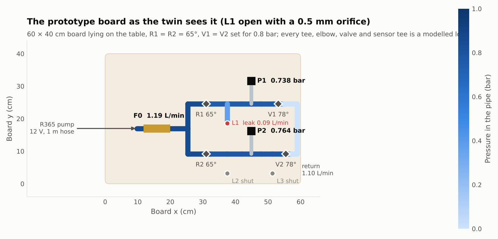

# HydroPin – Prototype bench twin

The simulation contains a twin of the 3rd-phase prototype bench (hardware list + sketch of 18 Nov 2026). Every part on the list is modelled. The twin predicts what P1, P2 and F0 will publish for any valve setting and any leak. Results pages: [bench twin](../results/prototype-bench/README.md) and [bench pressure waves](../results/bench-waves/README.md). Equations: [math §10](math.md#10-prototype-board-twin-3rd-phase).

> **Two hardware lists disagree**  
> The cost sheet (16 Nov) lists 3 sensors (0–10 bar), YF-S201 flow sensors, a 370 W pump and 3 branches. The PDF and the sketch (18 Nov) list 2 Swagelok sensors, an R365 pump and 2 branches. **The twin follows the 18 Nov version.** Switching to the cost-sheet version is a parameter change only.

## Every part on the board, and how the twin handles it

| Part (hardware list) | In the twin | Values to confirm (⚠ in `params.yaml` §0.7) |
|---|---|---|
| Bucket 20 L | Fixed water level, all outlets return to it | Height of the board above the water |
| R365 pump, 12 V | Diaphragm-pump curve, scales with the supply voltage | Free flow and shut-off pressure (listings disagree: 1–2.5 bar) |
| 12 V adapter | Slow voltage wander → pump speed → pressure and flow | Wander, from a 5-min quiet recording |
| Pump pulsation | Ripple at the sensors, filtered by the sensor and the ADC | Amplitude and frequency, from the quiet recording |
| Soft hose 8 mm, 1 m | Pipe (soft PVC) + expansion into the 16 mm pipe | Inside diameter |
| Reducer 16 × 8, adapters 16 × ½" | Losses (bore restriction) | Bore |
| Brass flow sensor F0 | Head loss + pulse output f = K·Q + f₀, counted by the ESP32 | Model (K factor), bucket calibration |
| 16 mm PE pipe | Pipe with friction (laminar at this flow) | Wall thickness |
| Barbed tees, elbows | Losses (tee run/branch, elbow, narrow bore) | Bore |
| Mini valves R1, R2, V1, V2 | Loss vs closing angle (plug-valve law), shut = removed | Calibrated from healthy readings |
| Leak taps L1, L2, L3 (½" valve + 25 cm tube) | Tee branch + valve + tube + free outlet; optional calibrated orifice | Tube length |
| Swagelok sensor tees | Short stainless section (contraction/expansion) | Inside diameter, length |
| Swagelok S sensors P1, P2 | −1…1.6 bar → 0–10 V, accuracy 0.5 % span, thermal drift, noise, 1 ms response, saturation; 4–20 mA option | Check the 2nd sensor's label; noise |
| 20 kΩ / 10 kΩ dividers (rev 1) | Ratio with 1 % resistors and the ADC input impedance | – |
| ADS1115 | ±4.096 V, 16 bit, data rate shared by P1/P2, gain/offset error, noise, conversion filter | Data rate chosen in the firmware |
| ESP32 firmware | Your formulas (× 3.2, −1 + V/10 × 2.6), 1-s averages, pulse counting | K factor used for F0 |
| Return pipe to the bucket | Free outlet (or siphon if it runs full) | Does it run full? |
| Board flat on the table | Height of every part above the bucket water (P1 and P2 at the same height) | Table height, bucket position |
| Hose clamps, clips, PTFE tape | No hydraulic effect | – |
| Laptop, Wi-Fi | MQTT messages in the same format as the field nodes (see the demo viewer) | – |

## What the twin predicts before the bench is built

- **Working point:** the pressure only rises when V1/V2 are almost shut (≈ 78° of 82°). Turn them slowly and watch P1/P2.
- **R1/R2 must restrict more:** at 45° both sensors drop almost equally for any leak. At ~65° a leak at L1 drops P1 almost twice as much as P2.
- **L2 and L3 look identical.** A third mini valve between L2 and P2 separates them.
- **A cracked-open ½" tap is a huge leak** (≥ 30 % of the flow). For small, repeatable leaks, put a drilled end cap (0.2 / 0.5 / 1 mm) or a dripper at the end of each tap tube.
- **F0 must be calibrated with the bucket**, and counted over ≥ 30 s: at ~1 L/min it gives only ~6 pulses per second.
- **Use P1 − P2:** the 12 V adapter moves both pressures together; the difference cancels it.
- **Never close all valves:** the pump's shut-off pressure is above the sensors' 1.6 bar.
- **Keep the R365 out of the water:** it is self-priming, not submersible (the 18 Nov diagram shows it inside the bucket).

## Pressure waves on the board

The transient solver now also runs on the board. Four events, played in slow motion in the viewer's **3D bench** tab:

- **V1 slams shut (10 ms):** P1 rises by ~0.4 bar over 150 ms; highest pressure 1.28 bar, under the 1.44 bar limit. Safe for the sensors.
- **M3 pulse (V1 closes 10 % in 5 ms):** a smooth rise of ~30 mbar. The soft hose and the PE damp the sharp echoes M3 needs.
- **L1 bursts open (0.8 mm):** P1 drops ~100 mbar within 10 ms (−150 mbar once settled); P2 later and about half as much.
- **Pump power cut:** both pressures fall smoothly to ~0 in ~0.15 s, no cavitation.

Wave speeds: ≈ 148 m/s in the 16 mm PE, 58 m/s in the soft hose, 1 400 m/s in the stainless sensor tees.

## M3 (transient method)

M3 is **not tested on the board** (budget, and the board is too short and has no fast valve). It stays fully in the simulation: transient solver, leak echoes and time reversal on the 150 m bench line and the demo farm (the pressure-wave studies (solver, leak echoes, M3)). Its parameters remain literature values (⚠) until someone can run a real pulse test.

## What to record once the board is assembled

1. The ⚠ dimensions above (caliper: bores, wall; tape: lengths, heights).
2. Healthy readings (P1, P2, F0) for 4–5 valve settings → the twin fits the real valve and fitting losses.
3. Each leak's real flow (cup + stopwatch, 30 s) and the matching readings.
4. Five minutes with nothing changing → real noise, ripple and adapter wander.
5. F0 bucket calibration at two flows → K factor and offset.
