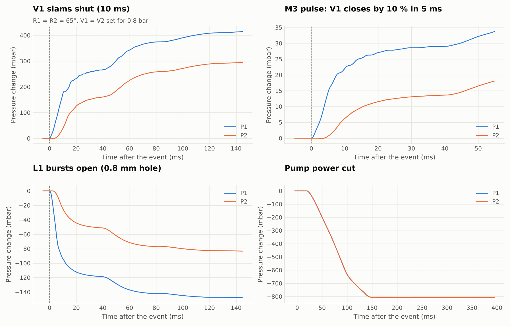
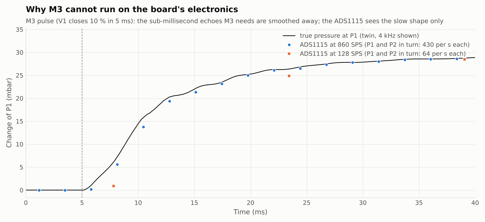

# Pressure waves on the prototype bench

> **✅ all checks pass (7/7)**  
> The prototype twin now also runs pressure waves: the same characteristics solver as the bench and the farm, extended with exact lumped valves, emitter leak taps and a pump that can stop. Four events are simulated at the reference setting and played in slow motion in the viewer's 3D tab.

Back to the [overview](../../README.md) · Equations: [math](../../docs/math.md) · Design: [architecture](../../docs/architecture.md)

## 1. What was built

| Code | What it does | Math |
|---|---|---|
| `transient/moc.py` | Lumped valves (exact, stable when shut), pipe → emitter taps, pump exponent n and speed s(t), RampEvent; farm/bench results unchanged (all pressure-wave, leak-echo and M3 tests pass) | §10.7 |
| `transient/board.py` | run_event(): v1_slam, v1_pulse (M3), l1_burst, pump_trip from the board's steady state | §10.7 |
| `steady/board.py` | run_board_full(): steady state + prepared model for the transient solver | §10 |
| `results/bench-waves/board_waves.json` | Pressure change at 24 nodes + mid-pipe points, 4 events, ADS1115 samples (128 and 860 SPS) | – |

## 2. Checks

Each check compares the code with an analytical solution, a reference software or a physical law.

| # | Check | Expected | Obtained | Tolerance | Ref | Result |
|---|---|---|---|---|---|---|
| 1 | Starts in equilibrium: no head drift before the event (lumped valves, leak tap, pump n = 1) | 0 m | 2.3494e-05 m | ± 1.0000e-04 m | §10.7 | ✅ |
| 2 | Joukowsky: head rise at V1 = a ΔV / g before the first reflection | 0.98868 m | 0.98894 m | ± 2 % | §5.2, §10.7 | ✅ |
| 3 | Joukowsky downstream: head drop at V1b = a ΔV / g | -0.97134 m | -0.97175 m | ± 2 % | §5.2, §10.7 | ✅ |
| 4 | Wave from L1 reaches P1 after the pipe travel time (A3 + half sensor tee) | 3.1993e-04 s | 3.0926e-04 s | ± 3.1993e-05 s | §5.1 | ✅ |
| 5 | V1 slammed shut in 10 ms: highest pressure stays under 90 % of 1.6 bar | 1.44 bar | 1.2783 bar | ≤ expected | §10.3 | ✅ |
| 6 | Pump power cut: no cavitation anywhere on the board | no | no | – | §5.7 | ✅ |
| 7 | After the pump stops, P1 settles at the static value (outlets at board level, sensor Δz_s above the axis) | -0.0078454 bar | -0.0076994 bar | ± 0.002 bar | §10.3 | ✅ |

## 3. Figures

**Figure 1.** P1 and P2 during the four events.

**Figure 2.** The M3 pulse at P1, true vs what the ADS1115 would sample.

## 4. What the figures tell us

- **Wave speeds on the board:** 16 mm LDPE ≈ 148 m/s, soft hose ≈ 58 m/s, stainless sensor tees ≈ 1407 m/s. A wave crosses the board in about 4 ms.
- **Slamming V1 shut is safe for the sensors:** P1 rises by 414 mbar and the highest pressure on the board reaches 1.28 bar (limit 1.44). The flow is small (≈ 6 cm/s), so the Joukowsky surge is only ≈ 0.1 bar; the rest is the pump pushing against one shut branch.
- **A sudden 0.8 mm leak at L1** sends a pressure drop of -148 mbar to P1 within 0.3 ms.
- **Power cut:** the pump stops in 0.1 s; P1 falls smoothly to its static value (lowest -10 mbar), no cavitation.
- **The waves are smooth, not sharp.** The soft hose and the viscoelastic PE damp the fast echoes; the steps every ~35 ms are the wave going up and down the 1 m hose (2 × 1 m / 58 m/s). Echoes from the board's fittings would arrive within 1 ms and are smeared out.
- **M3 on the board's electronics is impossible, as expected:** the ADS1115 gives each sensor 64 samples/s (128 SPS) or 430 (860 SPS, its maximum), enough for the slow shape but not for sub-millisecond echoes. M3 needs a ≥ 2 kHz sensor and a ≥ 100 m line, as in the leak-echo and M3 studies.

## 5. Assumptions

- Reference setting: R1 = R2 = 65°, V1 = V2 for 0.8 bar, no leak; water at 22 °C.
- Events: V1 shut in 10 ms (fast solenoid or slam), 10 % pulse in 5 ms, 0.8 mm burst in 5 ms, pump spin-down 0.1 s (⚠).
- Free outlets into the bucket are fixed-head boundaries; the pump's diaphragm valves stop any back-flow.
- PE is viscoelastic (Kelvin–Voigt, §5.3) with the farm's LDPE values; no air in the pipes.

## 6. Open points

- Film the pump stopping (phone, slow motion) to replace the 0.1 s spin-down guess.
