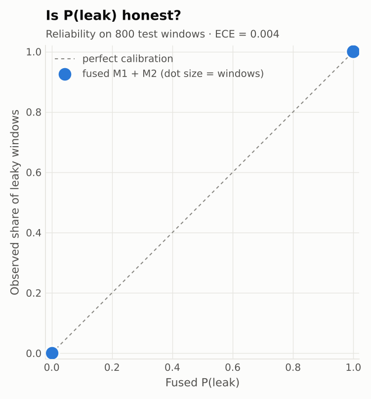
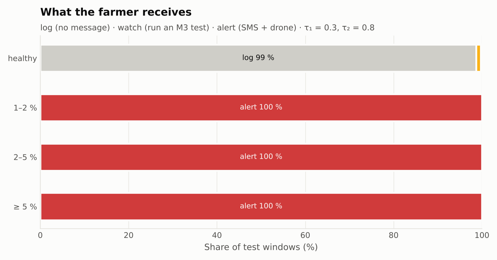

# Fusion and decision

> **✅ all checks pass (9/9)**  
> M1 and M2 outputs on the 800 test windows are fused as in math note §6: quality gate, log-odds fusion of the scores, weighted product of the location maps, bootstrap band, and the log/watch/alert decision. Weights are learned on validation windows only.

Back to the [overview](../../README.md) · Equations: [math](../../docs/math.md) · Design: [architecture](../../docs/architecture.md)

## 1. What was built

| Code | What it does | Math |
|---|---|---|
| `fusion/decision.py` | Quality gate (own gate + outlier rule with ≥ 3 methods), log-odds fusion, location fusion, bootstrap band, decide(), weight learning | §6 |
| `oracles/fusion_cases.py` | M1 + M2 outputs on validation (learning) and test (evaluation) | §6 |

## 2. Checks

Each check compares the code with an analytical solution, a reference software or a physical law.

| # | Check | Expected | Obtained | Tolerance | Ref | Result |
|---|---|---|---|---|---|---|
| 1 | Fused probability: expected calibration error ≤ 0.05 (weak test here, see findings) | 0.05 | 0.0043116 | ≤ expected | §6 | ✅ |
| 2 | Fused detection AUC ≥ best single method | 0.999 | 1 | ≥ expected | §6 | ✅ |
| 3 | Fused location (leaks ≥ 5 %): right sector ≥ best single method − 1 pt | 0.97913 | 0.9837 | ≥ expected | §6 | ✅ |
| 4 | Alerts on healthy test windows ≤ 2 % | 0.02 | 0.0025641 | ≤ expected | §6 | ✅ |
| 5 | Leaks ≥ 5 % raise an alert ≥ 95 % of the time | 0.95 | 1 | ≥ expected | §6 | ✅ |
| 6 | Quality gate: a method failing its own gate is excluded (decision = M1 alone) | yes | yes | – | §6 | ✅ |
| 7 | Outlier rule: with 3 methods, one silent method (M3, damped wave) is excluded | yes | yes | – | §6 | ✅ |
| 8 | The 5–95 % band always contains the fused probability | yes | yes | – | §6 | ✅ |
| 9 | Actions follow the thresholds τ₁, τ₂ exactly | yes | yes | – | §6 | ✅ |

## 3. Figures

**Figure 1.** Reliability diagram of the fused probability.

**Figure 2.** Decisions sent to the farmer, by leak size.

## 4. What the figures tell us

- Learned detection weights: M1 0.65, M2 2.19 (both informative). Location weights: M1 2.0, M2 2.0.
- **Calibration cannot really be judged yet.** On this dataset almost every window gets P ≈ 0 or P ≈ 1 (leaks of 1–20 % are separated perfectly), so the ECE of 0.004 is trivially low. The next dataset should include 0.1–1 % leaks, where the methods hesitate; that is where τ₁/τ₂ and the 'watch' action (automatic M3 test) matter.
- Healthy windows end in an alert **0.3 %** of the time; leaks ≥ 5 % **100 %**. Small leaks (1–2 %) are also alerted, because both methods see them clearly in this dataset.
- Location: right sector **98 %** fused vs 99 % M2 alone and 83 % M1 alone. Exact location 52 % fused vs 61 % M2: the weights maximise the probability given to the true location, which slightly lowers the top-1 rate. As M1 gets more data, its location weight should fall automatically.
- The quality gate works as designed: a method failing its own gate is dropped, and with three methods a silent M3 (e.g. wave damped by trapped air) is treated as an outlier instead of vetoing the alert.
- The prior of the training data (≈ 50 % leaky windows) is not the field prior. In operation, apply the Bayes prior shift logit P_field = logit P − logit p₀,train + logit p₀,field, with p₀,field estimated from the pilot farm.

## 5. Assumptions

- M3 is not part of the learned weights yet (it runs on demand on single lines; its weight is set to 1 until bench data exist).
- Thresholds τ₁ = 0.3 and τ₂ = 0.8 from params.yaml.
- Bootstrap of the validation set (40 resamples) for the 5–95 % band.

## 6. Open points

- Regenerate the dataset with leaks down to 0.1 % (one parameter in steady/scenarios.py) to calibrate τ₁, τ₂ and the watch zone.
- Agree on the farmer-facing actions: log / watch (automatic M3 test) / alert (SMS + map + optional drone).
