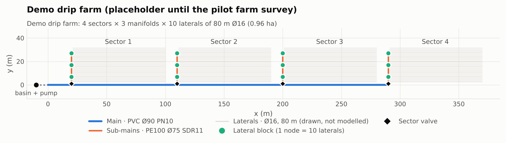
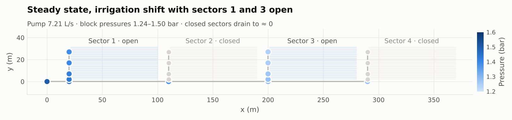
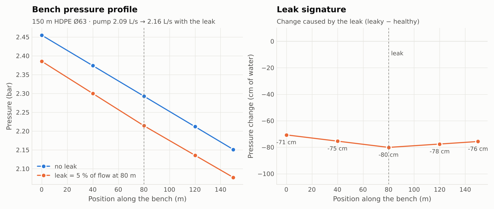
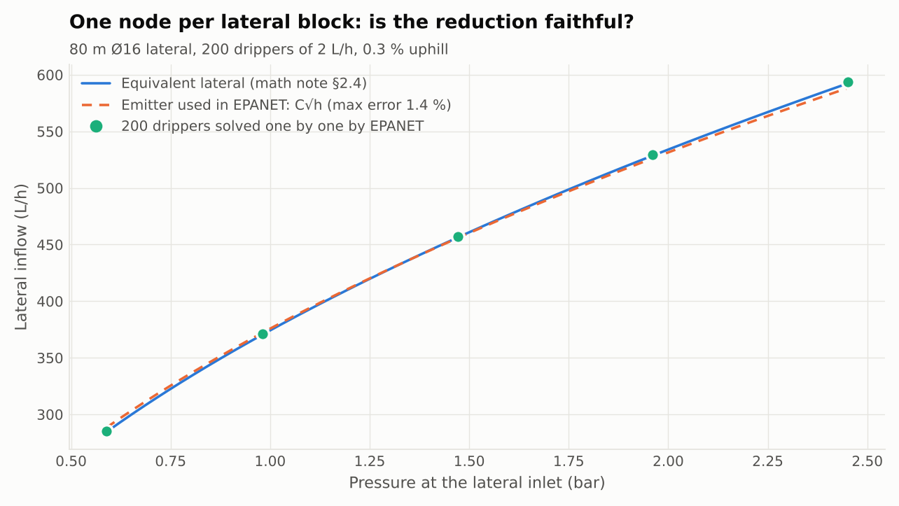
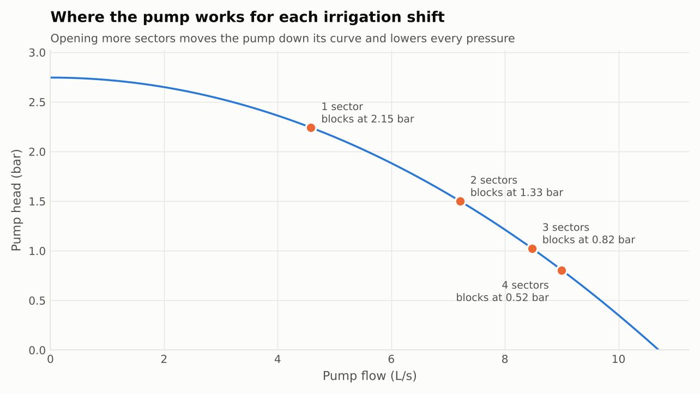

# Networks and steady-state twin

> **✅ all checks pass (13/13)**  
> The test bench and a demo drip farm are described as validated network files, turned into EPANET models (Darcy–Weisbach, one node per lateral block) and solved. Results are checked against our own physics, an independent dripper-by-dripper model and conservation laws.

Back to the [overview](../../README.md) · Equations: [math](../../docs/math.md) · Design: [architecture](../../docs/architecture.md)

## 1. What was built

| Code | What it does | Math |
|---|---|---|
| `network/generators.py` | Bench placeholder (150 m HDPE Ø63) and parametric demo farm; YAML save/load | §1 |
| `network/builder.py` | NetworkSpec → EPANET model: D-W, viscosity from temperature, lateral-block emitter fit, pump curve, .inp export | §2.1–2.6 |
| `steady/solver.py` | Runs a Scenario: open/closed sectors, leaks (pipe split + orifice), clogging, roughness/elevation draws → SteadyResult | §2, §2.9 |
| `config/networks/` | bench.yaml, farm_demo.yaml and their EPANET .inp files (open them in EPANET to inspect) | – |
| `contracts.py` | Added optional `Node.outlet_coeff` (fixed outlet, e.g. bench flush valve), allowed by the contract rule | – |

## 2. Checks

Each check compares the code with an analytical solution, a reference software or a physical law.

| # | Check | Expected | Obtained | Tolerance | Ref | Result |
|---|---|---|---|---|---|---|
| 1 | EPANET single-pipe head loss = our Darcy–Weisbach (HDPE Ø63, 2 L/s, 20 °C) | 1.9033 m | 1.9024 m | ± 0.1 % | §2.2 | ✅ |
| 2 | EPANET single-pipe head loss = our Darcy–Weisbach (HDPE Ø63, 2 L/s, 35 °C) | 1.776 m | 1.7752 m | ± 0.1 % | §2.2 | ✅ |
| 3 | Mass balance: pump flow = sum of all emitter outflows (2 sectors open) | 0.0072106 m³/s | 0.0072106 m³/s | ± 0.01 % | §2.1 | ✅ |
| 4 | Lateral-block emitter fit (q = C√h) vs equivalent lateral over 6–25 m | 0.02 | 0.013585 | ≤ expected | §2.4 | ✅ |
| 5 | Equivalent lateral vs 200 drippers solved by EPANET (80 m Ø16, flat) | 1.0376e-04 m³/s | 1.0354e-04 m³/s | ± 2 % | §2.4 | ✅ |
| 6 | Equivalent lateral vs 200 drippers solved by EPANET (80 m Ø16, 0.3 % uphill (demo farm)) | 1.0313e-04 m³/s | 1.0291e-04 m³/s | ± 2 % | §2.4 | ✅ |
| 7 | Our explicit lateral (physics library) vs the same lateral solved by EPANET | 1.0376e-04 m³/s | 1.0375e-04 m³/s | ± 0.5 % | §2.4 | ✅ |
| 8 | Closed sector valves carry no flow | 1.0000e-09 m³/s | 0 m³/s | ≤ expected | §1 | ✅ |
| 9 | Pump operating point lies on its curve H = h0 − rQ² | 15.306 m | 15.306 m | ± 0.1 % | §2.6 | ✅ |
| 10 | Head always falls in the direction of flow (every open pipe) | yes | yes | – | §2.1 | ✅ |
| 11 | Every open turbulent pipe of the farm: EPANET loss = our Darcy–Weisbach + minor | 0.005 | 5.5388e-04 | ≤ expected | §2.2 | ✅ |
| 12 | Leak outflow = orifice law at the leak node pressure (bench, 3 mm²) | 3.9929e-05 m³/s | 3.9929e-05 m³/s | ± 0.01 % | §2.5 | ✅ |
| 13 | Export to EPANET .inp and reload gives the same pressures | 0.001 m | 1.7166e-05 m | ≤ expected | – | ✅ |

## 3. Figures

**Figure 1.** The demo farm: PVC main, one PE sub-main per sector behind a valve, three lateral blocks per sector.

**Figure 2.** Pressures computed by the twin for a shift with sectors 1 and 3 open.

**Figure 3.** Bench: a leak of 5 % of the flow at 80 m, seen by pressure sensors at the junctions.

**Figure 4.** Check of decision D2: the one-node lateral block against 200 drippers solved individually.

**Figure 5.** Pump operating points for shifts of 1 to 4 sectors.

## 4. What the figures tell us

- EPANET and our own Darcy–Weisbach agree within **0.05 %** on a single pipe and within **0.06 %** on every turbulent pipe of the farm. The two code paths can be trusted to describe the same physics.
- The one-node lateral block stays within **1.4 %** of the equivalent-lateral law over 0.6–2.5 bar, and within **0.2 %** of 200 drippers solved one by one.
- On the bench, a leak of 5 % of the flow at 80 m raises the pump flow from 2.09 to 2.16 L/s and lowers every pressure by **71–80 cm of water**: easy to detect (≈ 3× the ±25 cm sensor accuracy). But most of that drop is the pump sliding down its curve and is the same everywhere. The part that points to the leak, the difference between sensors, is only **≈ 9 cm**, below sensor accuracy. Steady-state pressure **detects** well but **localises** poorly on a single line, which is exactly why M3 exists.
- With this placeholder pump, block pressures range from ≈ 0.5 to ≈ 2.1 bar depending on how many sectors are open. The **irrigation shift is a major state of the network**, which confirms that M2 needs one 'normal' per shift (math note §4.1).
- Closed sectors drain through their drippers, so their sensors read ≈ 0. A sensor reading near zero in a closed sector is normal, not a leak.

## 5. Assumptions

- Bench and farm geometry, pump curves and terrain slopes are placeholders (Architecture D3).
- Laterals: 80 m Ø16 with 2 L/h non-compensating drippers every 0.4 m. PC drippers are not a power law and are not supported by the EPANET twin yet.
- Lateral-block emitter fitted over 6–25 m. Outside that range the fit error grows; checked automatically.
- Leaks are orifices (N₁ = 0.5): EPANET has one global emitter exponent (math note §2.4 warning).
- Sector valves are ideal on/off links with K = 2 minor loss when open.

## 6. Open points

- Hardware team: send the real bench layout (lengths, tees, leak-valve and sensor positions, pump or tank).
- Pilot farm: survey of the main, sub-mains, sectors and typical shifts as soon as possible, to replace the demo farm.
