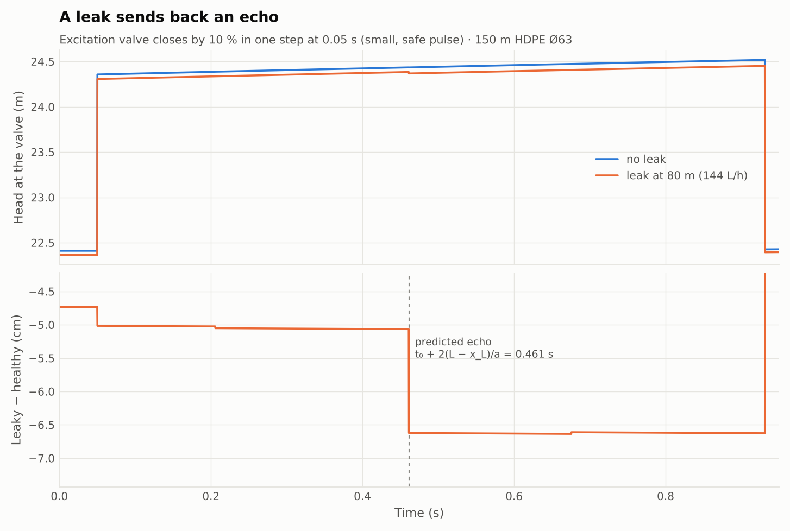
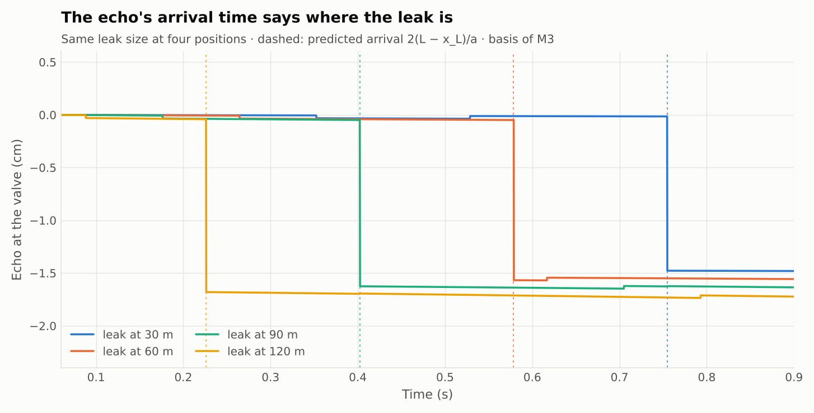
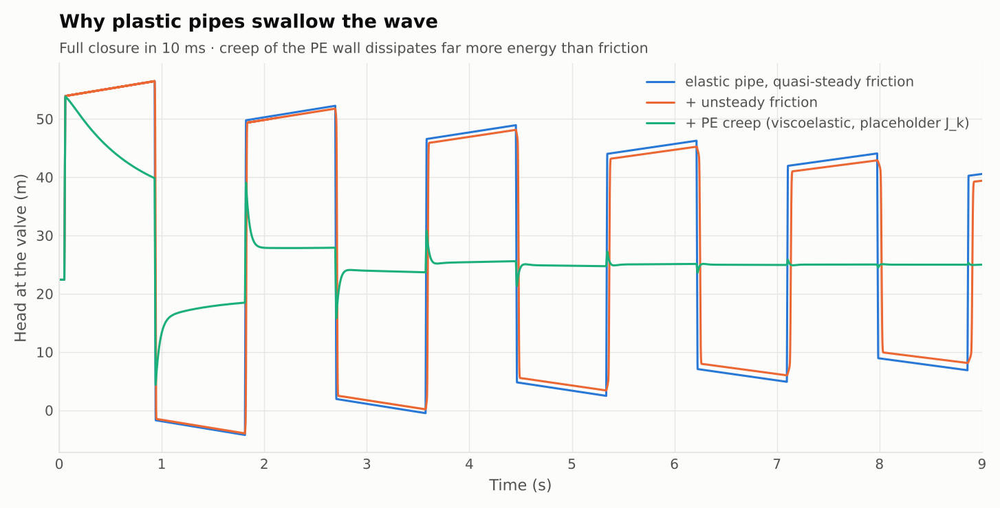
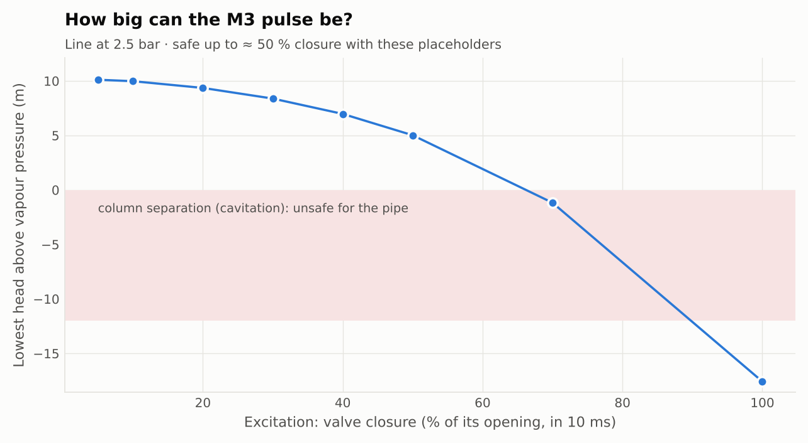

# Leak echoes, unsteady friction and pipe creep

> **✅ all checks pass (9/9)**  
> The transient solver now contains the three effects that matter on a farm: the leak itself (an echo), the extra damping of unsteady friction, and the creep of plastic pipe walls. Each one is checked against theory, and the solver says how large the M3 pulse may safely be.

Back to the [overview](../../README.md) · Equations: [math](../../docs/math.md) · Design: [architecture](../../docs/architecture.md)

## 1. What was built

| Code | What it does | Math |
|---|---|---|
| `transient/moc.py · leak nodes` | A leak is an emitter node inside the pipe (same as the steady twin) | §5.6 |
| `transient/moc.py · unsteady=True` | Brunone–Vardy unsteady friction, k₃ from the initial Reynolds number | §5.4 |
| `transient/moc.py · viscoelastic=True` | Generalised Kelvin–Voigt creep, exact exponential update, implicit in H_P | §5.3 |
| `transient/moc.py · p_vap_head` | Cavitation monitor: lowest head above vapour pressure over the whole run | §5.6 |

## 2. Checks

Each check compares the code with an analytical solution, a reference software or a physical law.

| # | Check | Expected | Obtained | Tolerance | Ref | Result |
|---|---|---|---|---|---|---|
| 1 | Viscoelastic solver with J_k = 0 reproduces the elastic solver | 1.0000e-09 m | 0 m | ≤ expected | §5.3 | ✅ |
| 2 | Leak echo arrives at the valve at t₀ + 2(L − x_L)/a (leak at 80 m) | 0.46124 s | 0.46125 s | ± 7.4919e-04 s | §5.7 | ✅ |
| 3 | Leak echo amplitude = r_L · ΔH₁ · 2/(1 + B·Y_valve) (small-signal theory) | -0.017204 m | -0.015567 m | ± 15 % | §5.7 | ✅ |
| 4 | Unsteady friction damps more than quasi-steady friction (4th-period amplitude ratio) | 0.6997 | 0.66989 | ≤ expected | §5.4 | ✅ |
| 5 | Viscoelastic (PE creep) damps more than an elastic pipe (4th-period amplitude ratio) | 0.6997 | 0.1091 | ≤ expected | §5.3 | ✅ |
| 6 | Viscoelastic creep delays the wave (first pressure reversal comes later) | 0.93883 s | 0.93983 s | ≥ expected | §5.3 | ✅ |
| 7 | Each period is weaker than the previous one (energy decays) | yes | yes | – | §5.1 | ✅ |
| 8 | Cavitation is flagged for a full fast closure at 2.5 bar (down-surge below vapour) | yes | yes | – | §5.6 | ✅ |
| 9 | No cavitation for a 10 % closure (the excitation M3 should use) | no | no | – | §5.6 | ✅ |

## 3. Figures

**Figure 1.** The echo of a 3 mm² leak at 80 m after a small valve pulse, and its predicted arrival time.

**Figure 2.** Echo arrival time for four leak positions.

**Figure 3.** Damping: elastic pipe vs unsteady friction vs PE creep.

**Figure 4.** Safe excitation size: cavitation margin vs valve closure.

## 4. What the figures tell us

- A leak of only **≈ 2 % of the flow** sends back a clear **≈ 1.6 cm** echo at exactly the predicted time **t₀ + 2(L − x_L)/a**. The amplitude matches small-signal theory within 7 %. The physical basis of M3 is confirmed in our own solver.
- **PE creep dominates damping.** With the placeholder creep values, the 4th oscillation keeps only 11 % of its amplitude (70 % for an elastic pipe). For M3 this means: use the **first echo**, measure close to the excitation, and **calibrate J_k, τ_k on the bench** (a leak-free test is enough).
- Unsteady friction adds a little damping (70 % → 67 %). Small but real; kept on for M3.
- A full fast closure on a 2.5 bar line sends the down-surge **below vapour pressure** (cavitation risk). The pulse is safe up to ≈ **50 % closure** in 10 ms. M3 should use small partial closures (5–10 %), which still give clean echoes (figure 1).
- First run of oracle 5.4 failed: unsteady friction made damping *weaker*. Cause: the code used sgn(Q·∂Q/∂x) instead of the math note's sgn(Q)·|∂Q/∂x|. Fixed by following the note.

## 5. Assumptions

- PE100 creep parameters J_k, τ_k are order-of-magnitude placeholders (`verify`): the damping figure is qualitative until bench calibration.
- k₃ of unsteady friction from Vardy's C* at the initial Reynolds number (constant during the run).
- Leak = orifice (exponent 0.5) linearised by the solver at each step; no leak-area change with pressure (FAVAD m = 0).
- Cavitation is flagged, not simulated; a run with a flag is not used for M3 training.

## 6. Open points

- Hardware team: plan a **partial** (5–10 %) fast closure for the M3 valve, not a full one.
- Bench protocol: one leak-free transient test first, to calibrate wave speed and PE creep.
