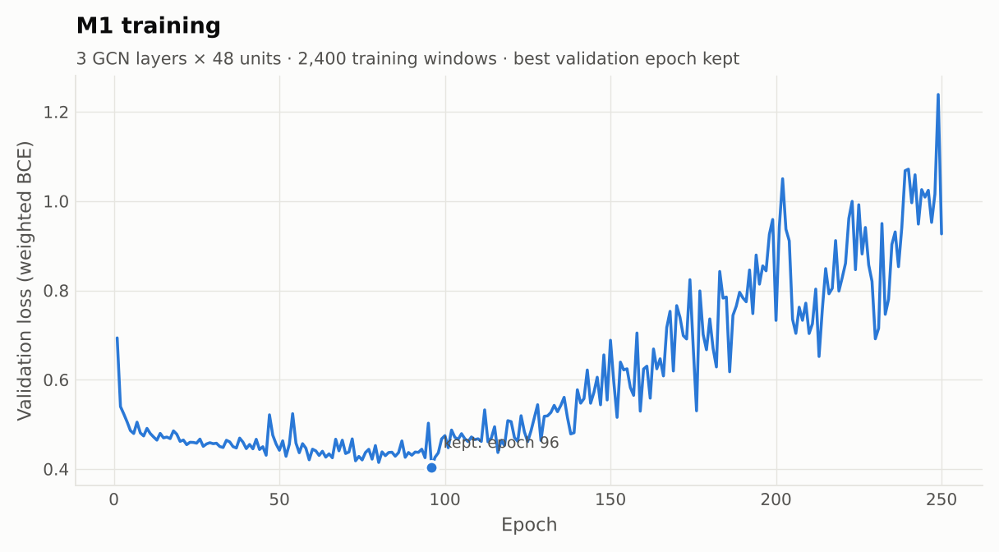
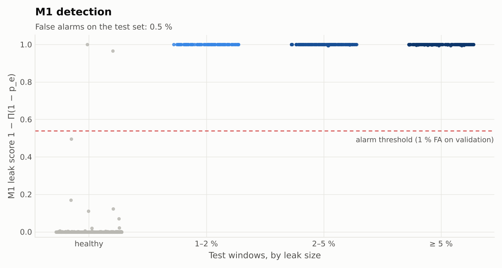
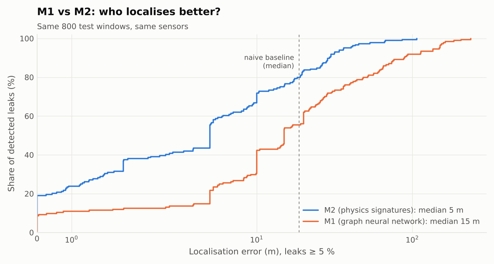

# M1 – graph neural network

> **✅ all checks pass (7/7)**  
> M1 is a 3-layer graph convolutional network on the farm's pipe graph, with one leak probability per pipe and per lateral block (math note §4.2). It is trained on the simulated dataset (same split as M2) and includes the transfer-learning term for the staged leaks of the real farm.

Back to the [overview](../../README.md) · Equations: [math](../../docs/math.md) · Design: [architecture](../../docs/architecture.md)

## 1. What was built

| Code | What it does | Math |
|---|---|---|
| `methods/m1_gnn.py` | Graph from the network spec, node features, GCN layers, edge and block heads, weighted BCE, early stopping, fine_tune (λ‖θ − θ_sim‖²), MethodOutput | §4.2 |
| `oracles/m1_cases.py` | Training/evaluation on the dataset, threshold at 1 % false alarms on validation | §4.2 |

## 2. Checks

Each check compares the code with an analytical solution, a reference software or a physical law.

| # | Check | Expected | Obtained | Tolerance | Ref | Result |
|---|---|---|---|---|---|---|
| 1 | False alarms on healthy test windows ≤ 3 % (threshold set for 1 % on validation) | 0.03 | 0.0051282 | ≤ expected | §4.2 | ✅ |
| 2 | Detection rate, leaks of 1–2 % | 0.9 | 1 | ≥ expected | §4.2 | ✅ |
| 3 | Detection rate, leaks ≥ 5 % | 0.95 | 1 | ≥ expected | §4.2 | ✅ |
| 4 | Leaks ≥ 5 %: right sector ≥ 2 × chance (chance ≈ 1/3) | 0.66667 | 0.83152 | ≥ expected | §4.2 | ✅ |
| 5 | Leaks ≥ 5 %: beats the naive 'nearest sensor with the largest drop' (median error) | 18.686 m | 15 m | ≤ expected | §4.2 | ✅ |
| 6 | GCN propagation matrix D^-1/2 Â D^-1/2 is symmetric with eigenvalues in [−1, 1] | yes | yes | – | §4.2 | ✅ |
| 7 | Transfer learning: the penalty λ‖θ − θ_sim‖² keeps fine-tuning closer to θ_sim | 4.2 | 0.02575 | ≤ expected | §4.2 | ✅ |

## 3. Figures

**Figure 1.** Validation loss during training.

**Figure 2.** M1 leak score of every test window.

**Figure 3.** Localisation error of M1 and M2 on the same test windows.

## 4. What the figures tell us

- **Detection is excellent**: 100 % of leaks ≥ 1 % detected with 0.5 % false alarms. Same level as M2, by a completely different route (learned from data, not from signatures).
- **Localisation is weaker than M2**: right sector 83 % (M2: 99 %), median error 15 m (M2: 5 m). It still beats the naive 'nearest sensor' rule (19 m). With ≈ 35 candidate locations and ≈ 35 training leaks per location, the network has too few examples. A tuned variant (more units, lower class weights) did not change this, so it is a data limit, not a tuning one.
- Consequence for fusion: **weight M1 for detection, M2 for location**. M1 would improve with a larger synthetic dataset (cheap: ≈ 2 min per 4,000 windows) and with the staged leaks of the pilot farm (transfer learning, checked by oracle 8.7).
- Implementation note: PyTorch Geometric was not needed. The graph has 21 nodes, so the normalised adjacency is a small dense matrix, which keeps the GCN formula of §4.2 visible in 3 lines of code.

## 5. Assumptions

- Residual r_i = change vs the last healthy irrigation of the same shift (as established for M2), divided by σ_tot.
- Single leak at a time; lateral leaks are labelled at their block.
- Training data is simulated only; the transfer-learning penalty λ = 1e-2 is a starting value.

## 6. Open points

- Agree that fusion weights M1 for detection and M2 for location (data-driven weights are learned by the fusion).
