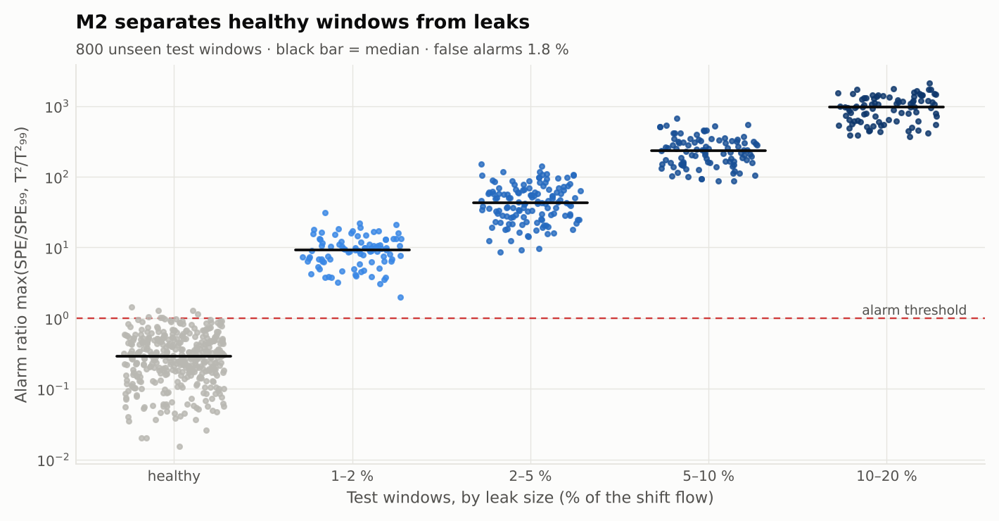
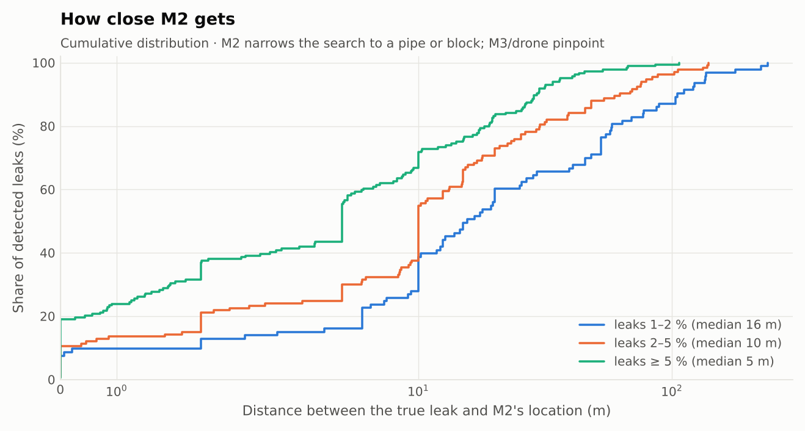
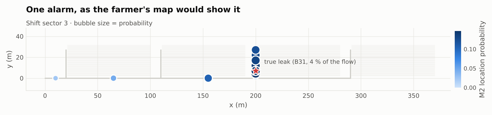

# M2 – PCA/SVD detection and localisation

> **✅ all checks pass (8/8)**  
> M2 is trained per irrigation shift on healthy windows only and tested on 800 unseen windows of the simulated dataset. It flags a change when the pressure/flow pattern leaves the healthy subspace, then matches the residual against leak signatures computed by the digital twin.

Back to the [overview](../../README.md) · Equations: [math](../../docs/math.md) · Design: [architecture](../../docs/architecture.md)

## 1. What was built

| Code | What it does | Math |
|---|---|---|
| `methods/features.py` | Zeroing, temperature compensation, window means; change vs the last healthy irrigation of the same shift | §3.1, §3.3 |
| `methods/signatures.py` | Leak signatures from the twin (every location that carries water in a shift) | §4.1 |
| `methods/m2_pca.py` | Per-shift SVD, SPE and T² with 99 % thresholds, cosine localisation, MethodOutput | §4.1 |
| `sensors/dataset.py` | Dataset extended (added fields only): paired healthy baseline window per sample | §2.9 |

## 2. Checks

Each check compares the code with an analytical solution, a reference software or a physical law.

| # | Check | Expected | Obtained | Tolerance | Ref | Result |
|---|---|---|---|---|---|---|
| 1 | False alarms on 390 healthy test windows ≤ 3 % (design: 1 %) | 0.03 | 0.017949 | ≤ expected | §4.1 | ✅ |
| 2 | Detection rate, leaks of 1–2 % of the flow | 0.9 | 1 | ≥ expected | §4.1 | ✅ |
| 3 | Detection rate, leaks of 2–5 % | 0.95 | 1 | ≥ expected | §4.1 | ✅ |
| 4 | Detection rate, leaks ≥ 5 % | 0.95 | 1 | ≥ expected | §4.1 | ✅ |
| 5 | Leaks ≥ 5 %: the right sector (or main) is found | 0.9 | 0.98913 | ≥ expected | §4.1 | ✅ |
| 6 | Leaks ≥ 5 %: median localisation error ≤ 10 m | 10 m | 5 m | ≤ expected | §4.1 | ✅ |
| 7 | SVD algebra: VᵀV = I and the residual is orthogonal to the normal subspace | 1.0000e-10 | 1.5460e-15 | ≤ expected | §4.1 | ✅ |
| 8 | Each noise-free twin signature is recognised as itself (or an exact twin of itself) | yes | yes | – | §4.1 | ✅ |

## 3. Figures

**Figure 1.** Alarm ratio of every test window, by leak size.

**Figure 2.** Localisation error of detected leaks.

**Figure 3.** Example alarm on the farm map: M2's location probabilities and the true leak.

## 4. What the figures tell us

- **First attempt failed, and the reason matters for the product.** Trained on absolute readings across many random farm states, M2 detected only 15 % of 5–10 % leaks. On a pump-fed farm, a leak moves pressure and flow *along the pump curve*, exactly like cleaner drippers or smoother pipes, so across different farms they look the same. A deployed system compares each irrigation with the **last healthy irrigation of the same shift on the same farm**. The dataset now has that paired baseline (another day, water temperature ±2 °C, new noise).
- With change-vs-baseline features: **100 % of 1–2 % leaks, 100 % of 2–5 % and 100 % of ≥ 5 % leaks are detected**, with **1.8 % false alarms**.
- Localisation: for leaks ≥ 5 %, the right sector is found **99 %** of the time and the median error is **5 m** (90 % within 29 m). The exact location is right in 61 % of cases. With 9 sensors, neighbouring blocks of a sub-main have almost the same signature. **M2 points to a pipe or a block; M3 and the drone pinpoint.**
- The number of PCA components is now chosen above the noise floor. Healthy changes are mostly isotropic sensor noise plus one structured direction (water temperature through viscosity). The '95 % of variance' rule kept noise directions and blinded the method. Math note §4.1 updated accordingly.

## 5. Assumptions

- A healthy baseline of the same shift exists from a recent irrigation (same clogging and roughness, water temperature within ±2 °C). In the field: the last irrigation not flagged by any method.
- 9 pressure sensors in the default positions (sensor placement optimises them) + the pump flow meter.
- Leak signatures from the nominal twin with a 5 % leak; real signatures scale roughly linearly with leak size.
- Thresholds at 99 % of healthy validation windows per shift (SPE and T² each at 99.5 %).

## 6. Open points

- Product rule: keep a rolling healthy baseline per shift (the platform stores the last unflagged irrigation of each shift).
