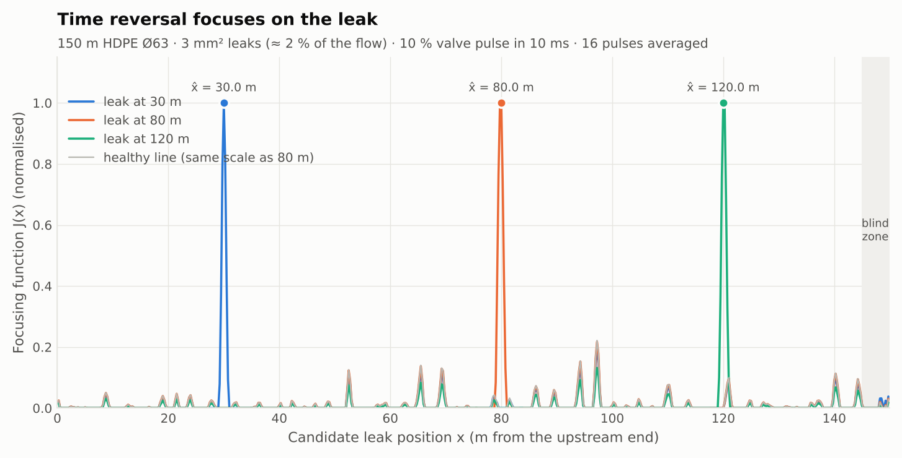
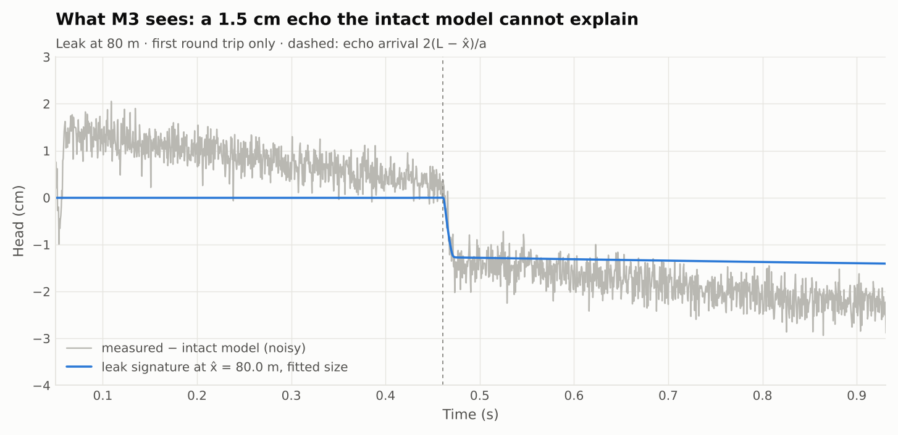
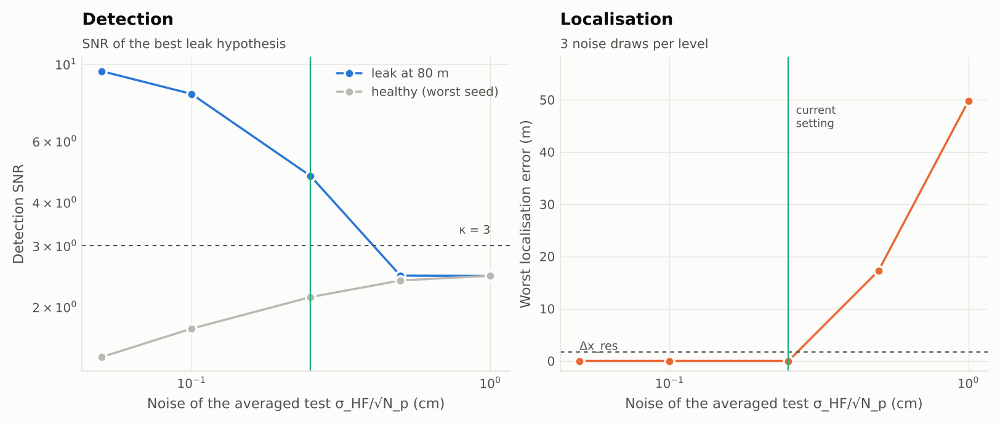
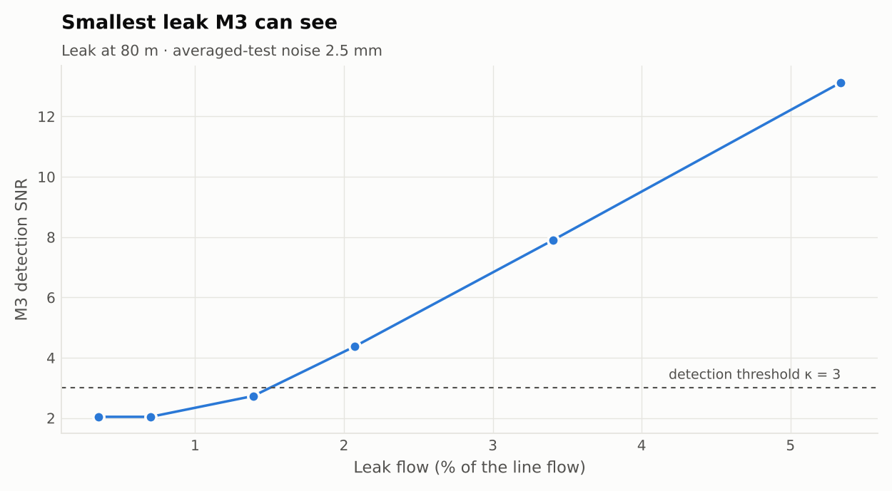

# M3 – transient time-reversal localisation

> **✅ all checks pass (10/10)**  
> M3 is implemented as written in math note §5.8–5.9: a frequency-domain model of the line, the residual the intact model cannot explain, and a focusing function J(x). It is tested on 'measurements' produced by a different physics (our nonlinear MOC with unsteady friction and creep) read by the high-rate sensor model.

Back to the [overview](../../README.md) · Equations: [math](../../docs/math.md) · Design: [architecture](../../docs/architecture.md)

## 1. What was built

| Code | What it does | Math |
|---|---|---|
| `transient/frequency.py` | Laplace-domain line model: pipe and leak transfer matrices, viscoelastic wave speed, reservoir/pump and valve boundaries | §5.8 |
| `methods/m3_timereversal.py` | Residual vs intact model, leak signatures, focusing J(x), size Ŷ_L, wave-speed identification a_id, SNR, MethodOutput | §5.9 |
| `oracles/m3_cases.py` | Synthetic experiments: MOC truth → high-rate sensor (lag, GPS offset, averaged noise) → M3 | §3.2 |
| `params.yaml + math note` | New `SIGMA_HF`, `N_PULSES`; §5.9 made explicit (residual, gate, high-pass, first round trip, calibration on a_id, pulse averaging) | §0.6, §5.9 |

## 2. Checks

Each check compares the code with an analytical solution, a reference software or a physical law.

| # | Check | Expected | Obtained | Tolerance | Ref | Result |
|---|---|---|---|---|---|---|
| 1 | Leak at 10 m (≈ 2 % of the flow) located within Δx_res = a·T_c/2 | 10 m | 10 m | ± 1.7029 m | §5.9 | ✅ |
| 2 | Leak at 30 m (≈ 2 % of the flow) located within Δx_res = a·T_c/2 | 30 m | 30 m | ± 1.7029 m | §5.9 | ✅ |
| 3 | Leak at 80 m (≈ 2 % of the flow) located within Δx_res = a·T_c/2 | 80 m | 80 m | ± 1.7029 m | §5.9 | ✅ |
| 4 | Leak at 120 m (≈ 2 % of the flow) located within Δx_res = a·T_c/2 | 120 m | 120 m | ± 1.7029 m | §5.9 | ✅ |
| 5 | Leak at 140 m (≈ 2 % of the flow) located within Δx_res = a·T_c/2 | 140 m | 140 m | ± 1.7029 m | §5.9 | ✅ |
| 6 | Every leak is detected: weakest leak SNR > κ = 3 | 3 | 4.1548 | ≥ expected | §5.9 | ✅ |
| 7 | No false alarm on a healthy line: strongest healthy SNR < κ = 3 | 3 | 2.1282 | ≤ expected | §5.9 | ✅ |
| 8 | Wave speed identified from the data (a_id) = solver's wave speed | 340.54 m/s | 340.52 m/s | ± 0.5 % | §5.9 | ✅ |
| 9 | Leak size (admittance Y_L) estimated within 30 % | 8.4851e-07 m²/s | 7.0057e-07 m²/s | ± 30 % | §5.9 | ✅ |
| 10 | Viscoelastic (PE creep) line: leak at 80 m still located within Δx_res | 80 | 79.5 | ± 1.7029 | §5.3, §5.9 | ✅ |

## 3. Figures

**Figure 1.** Focusing function for leaks at 30, 80 and 120 m, and for a healthy line on the same scale.

**Figure 2.** The residual (measured − intact model) and the fitted leak signature at the found position.

**Figure 3.** Robustness to sensor noise: detection SNR and localisation error.

**Figure 4.** Detection SNR vs leak size.

## 4. What the figures tell us

- Leaks of ≈ 2 % of the flow are located **to the exact grid cell (0.25 m)** at 10, 30, 80, 120 and 140 m. The physical resolution limit with a 10 ms pulse is Δx_res = 1.7 m.
- Healthy lines stay below the threshold and leaks are clearly above it: **no false alarm, no miss** in the test set. Below ≈ 1.5 mm of noise the linear model itself becomes the limit (a healthy line then looks like a weak leak), so the SNR uses noise + a 1.5 mm model-mismatch floor.
- The wave speed is identified from the data to **0.01 %** (a_id), so M3 **calibrates itself** on every test. That is why the result barely changes when the pipe creeps (80 → 79.5 m) or when the model ignores creep.
- Noise is what limits M3. With one pulse and a 1 cm sensor it fails. Averaging **16 pulses** (≈ 16 × 1 s) brings the noise to 2.5 mm and it works. Localisation stays correct up to ≈ 2.5 mm of averaged noise, i.e. **N_p ≥ 16** pulses with σ_HF = 1 cm.
- Smallest leak M3 detects at 80 m: ≈ **1.5 % of the line flow** with the current settings.
- Building M3 took three iterations, all logged. A plain frequency-domain match was swamped by cm-level model mismatch (friction, sensor lag). Fixes: model the sensor lag, use only the first round trip, gate out the pulse, high-pass the residual, average pulses. Noise-free, the method was exact from the start; noise and mismatch were the real problems.
- Blind zone: leaks within ≈ 5 m of the excitation valve are hidden by the pulse itself. Put a second flush point at the other end of long lines.

## 5. Assumptions

- Single line with a reservoir-like upstream end. Branched sub-mains need the junction transfer matrices (same math, not yet coded); the farm uses M3 per sub-main line.
- `SIGMA_HF` = 1 cm per sample and `N_PULSES` = 16 are placeholders (`verify`); measure the noise on the bench.
- Excitation = 10 % closure in 10 ms (safe, see the leak-echo study). The valve law is known (recorded by the M3 kit).
- One leak at a time.

## 6. Open points

- Hardware team: the M3 test is a train of identical small pulses ≈ 1 s apart (16 is the minimum with a 1 cm sensor; plan 32 for margin); log the valve command.
- Bench: measure σ_HF of the chosen high-rate sensor + ADC.
