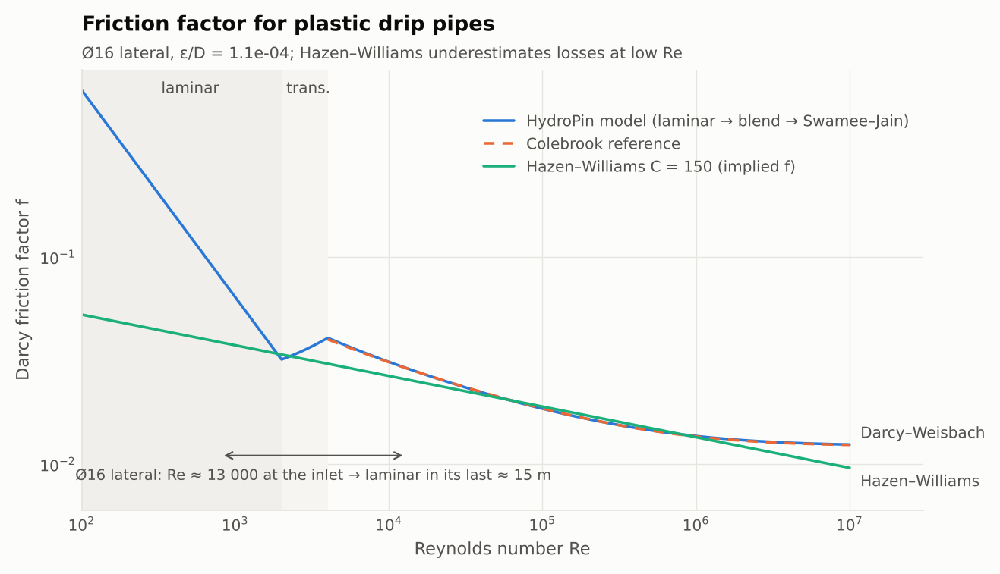
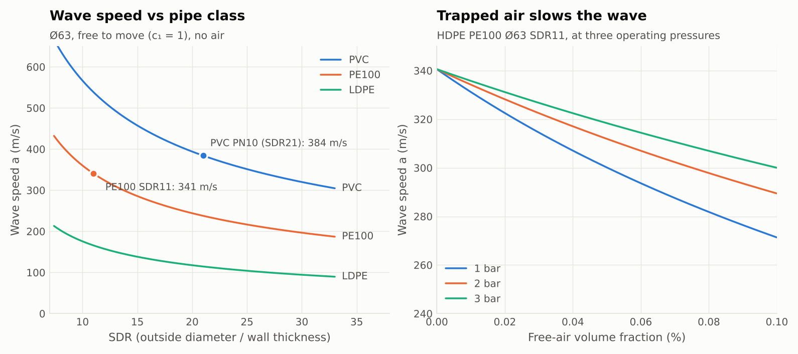
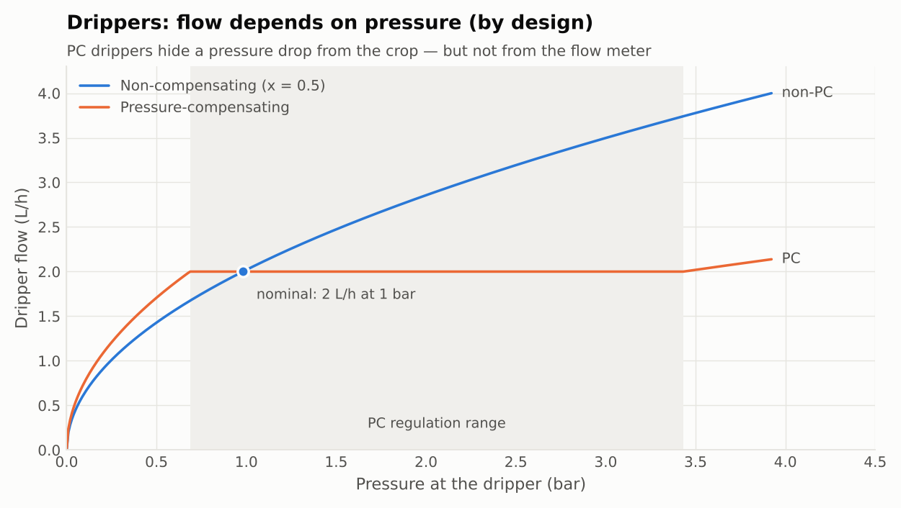
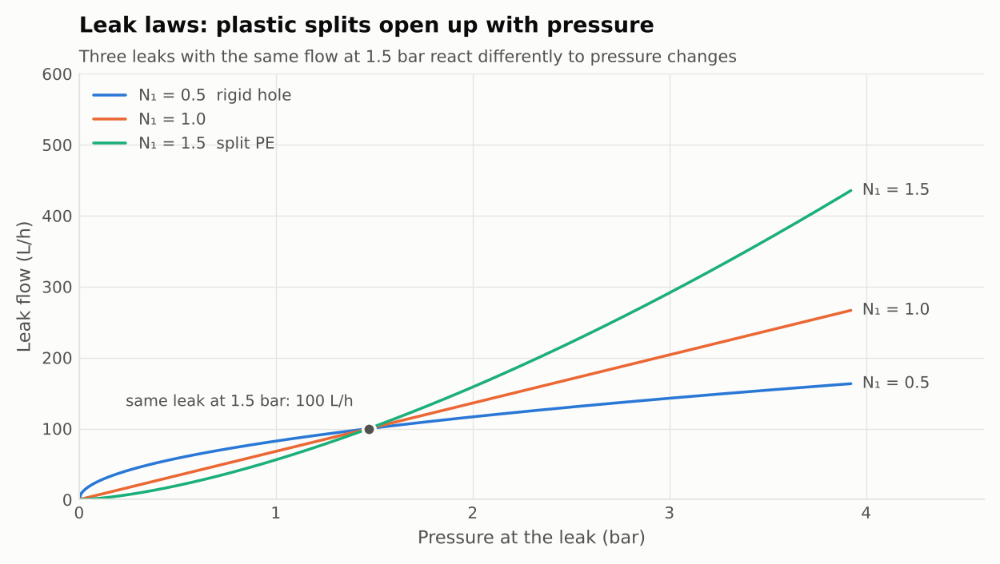
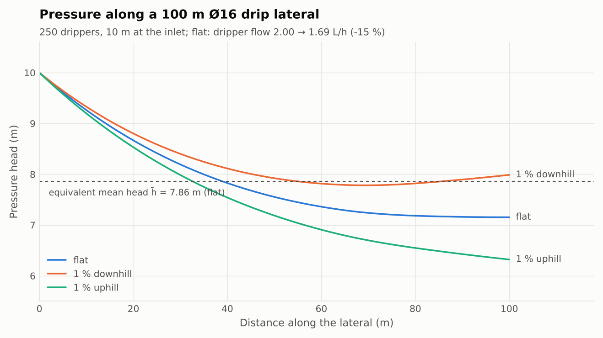
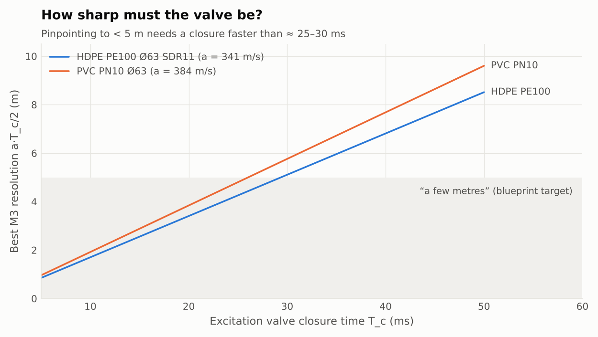

# Physics library

> **✅ all checks pass (31/31)**  
> Every equation of math note §2.2–2.7 and §5.2/§5.7 is coded as a pure function and checked against a hand calculation, a physical limit or an independent reference.

Back to the [overview](../../README.md) · Equations: [math](../../docs/math.md) · Design: [architecture](../../docs/architecture.md)

## 1. What was built

| Code | What it does | Math |
|---|---|---|
| `physics/friction.py` | Re, laminar / Blasius / Swamee–Jain / Colebrook, Darcy–Weisbach, Hazen–Williams, minor losses | §2.2 |
| `physics/emitters.py` | Dripper law (non-PC and PC), Christiansen factor, equivalent lateral, fully modelled lateral (reference) | §2.3–2.4 |
| `physics/leaks.py` | Orifice, emitter form, FAVAD, inverse orifice | §2.5 |
| `physics/pump.py` | Pump curve, pumping power, water/energy/cost lost | §2.6–2.7 |
| `physics/waves.py` | Anchoring factor c₁, wave speed, air correction, Joukowsky, period, leak admittance and reflection, resolution, cavitation threshold | §5.2, §5.6–5.7 |
| `oracles/physics.py` | 31 oracle checks shared by pytest and this report | – |
| `viz/style.py, viz/report.py` | Shared visual style (validated colour-blind-safe palette) and report writer | – |

## 2. Checks

Each check compares the code with an analytical solution, a reference software or a physical law.

| # | Check | Expected | Obtained | Tolerance | Ref | Result |
|---|---|---|---|---|---|---|
| 1 | Laminar friction f = 64/Re at Re = 1000 | 0.064 | 0.064 | ± 1.0000e-12 | §2.2 | ✅ |
| 2 | Colebrook, smooth pipe, Re = 1e5 vs Moody/Prandtl value 0.0180 | 0.018 | 0.01799 | ± 0.5 % | §2.2 | ✅ |
| 3 | Blasius vs Colebrook, smooth pipe, Re = 1e5 | 0.01799 | 0.01777 | ± 2 % | §2.2 | ✅ |
| 4 | Swamee–Jain vs Colebrook, worst case over Re 5e3–1e8, ε/D 1e-6–1e-2 | 0.03 | 0.028279 | ≤ expected | §2.2 | ✅ |
| 5 | Darcy–Weisbach head loss, HDPE Ø63, 2 L/s, 100 m (hand calc. with Colebrook) | 1.9138 m | 1.9033 m | ± 3 % | §2.2 | ✅ |
| 6 | Head loss changes sign with flow direction | yes | yes | – | §2.2 | ✅ |
| 7 | Hazen–Williams (C=150) ≈ Darcy–Weisbach for a Ø100 main at 1 m/s | 0.91586 m | 0.93272 m | ± 10 % | §2.2 | ✅ |
| 8 | Hazen–Williams underestimates laminar loss (Ø16 lateral, Re = 500): HW/DW < 0.7 | 0.7 | 0.32444 | ≤ expected | §2.2 | ✅ |
| 9 | Non-compensating dripper delivers Q_NOM at H_NOM | 5.5556e-07 m³/s | 5.5556e-07 m³/s | ± 1e-10 % | §2.3 | ✅ |
| 10 | PC dripper is continuous at its activation pressure | 5.5556e-07 m³/s | 5.5556e-07 m³/s | ± 0.0001 % | §2.3 | ✅ |
| 11 | Christiansen F = 1 for a single outlet (m = 2) | 1 | 1 | ± 1.0000e-12 | §2.4 | ✅ |
| 12 | Christiansen F → 1/(m+1) for many outlets (n = 10⁵, m = 1.75) | 0.36364 | 0.36364 | ± 0.01 % | §2.4 | ✅ |
| 13 | Christiansen formula vs exact sum, n = 250, m = 1.75 | 0.36564 | 0.36564 | ± 0.1 % | §2.4 | ✅ |
| 14 | Equivalent lateral vs every dripper modelled, 100 m Ø16, flat | 1.2321e-04 m³/s | 1.2264e-04 m³/s | ± 2 % | §2.4 | ✅ |
| 15 | Equivalent lateral vs every dripper modelled, 100 m Ø16, 1 % downhill | 1.2628e-04 m³/s | 1.2576e-04 m³/s | ± 2 % | §2.4 | ✅ |
| 16 | Equivalent lateral vs every dripper modelled, 100 m Ø16, 1 % uphill | 1.2004e-04 m³/s | 1.1945e-04 m³/s | ± 2 % | §2.4 | ✅ |
| 17 | Mass balance of the explicit lateral (inflow = sum of drippers) | 1.2321e-04 m³/s | 1.2321e-04 m³/s | ± 1e-10 % | §2.1 | ✅ |
| 18 | Orifice leak, A = 10 mm², h = 20 m (hand calc.) | 1.2282e-04 m³/s | 1.2282e-04 m³/s | ± 1e-07 % | §2.5 | ✅ |
| 19 | FAVAD with m = 0 equals the orifice law | 1.2282e-04 m³/s | 1.2282e-04 m³/s | ± 1e-10 % | §2.5 | ✅ |
| 20 | Emitter form with N1 = 0.5 equals the orifice law | 1.2282e-04 m³/s | 1.2282e-04 m³/s | ± 1e-10 % | §2.5 | ✅ |
| 21 | Pump curve gives the shut-off head at Q = 0 | 40 m | 40 m | ± 1.0000e-12 m | §2.6 | ✅ |
| 22 | Pumping power ρgQH/η, 5 L/s at 30 m, η = 0.6 (hand calc.) | 2448.1 W | 2448.1 W | ± 1e-10 % | §2.6 | ✅ |
| 23 | Rigid pipe limit: a → √(K/ρ) | 1484.6 m/s | 1484.6 m/s | ± 0.0001 % | §5.2 | ✅ |
| 24 | Thick-wall c1 → thin-wall 1 − ν² when e/D → 0 | 0.7884 | 0.7884 | ± 0.001 % | §5.2 | ✅ |
| 25 | Wave speed HDPE PE100 Ø63 SDR11, free (hand calc.) | 340.59 m/s | 340.59 m/s | ± 1e-07 % | §5.2 | ✅ |
| 26 | 0.1 % air at 2 bar slows HDPE to ≈ 286 m/s (math note example) | 286.2 m/s | 286.12 m/s | ± 0.5 % | §5.2 | ✅ |
| 27 | Joukowsky: a = 335 m/s, ΔV = −1 m/s → ΔH = +34.15 m | 34.149 m | 34.149 m | ± 1e-10 % | §5.7 | ✅ |
| 28 | Leak admittance Y_L = Q/(2h) equals dQ/dh of the orifice law | 2.5000e-06 m²/s | 2.5000e-06 m²/s | ± 0.001 % | §5.7 | ✅ |
| 29 | Leak reflection → −B·Y/2 for a small leak | -8.1823e-09 | -8.1823e-09 | ± 0.0001 % | §5.7 | ✅ |
| 30 | Leak reflection → −1 for a huge leak (open end) | -1 | -1 | ± 1.0000e-06 | §5.7 | ✅ |
| 31 | Cavitation threshold at 20 °C (gauge head) | -10.109 m | -10.109 m | ± 1e-07 % | §5.6 | ✅ |

## 3. Figures

**Figure 1.** Friction factor. Our composite law follows Colebrook in turbulent flow; Hazen–Williams drifts away at low Reynolds numbers, which is exactly where drip laterals end.

**Figure 2.** Wave speed. Left: by pipe class and material. Right: effect of a small amount of trapped air.

**Figure 3.** Dripper laws used by the twin.

**Figure 4.** Leak laws: why the exponent N₁ matters for plastic pipes.

**Figure 5.** Pressure along a lateral, every dripper modelled. The dashed line is the mean head used by the one-node equivalent.

**Figure 6.** M3 localisation resolution as a function of the excitation valve closure time.

## 4. What the figures tell us

- Swamee–Jain stays within **2.8 %** of Colebrook over the whole turbulent range, enough for a twin whose roughness is itself uncertain.
- Hazen–Williams underestimates the head loss by **≈ 17 % at Re = 1500 and ≈ 65 % at Re = 500**. Laterals end in that range, so the twin uses **Darcy–Weisbach everywhere**.
- The one-node equivalent lateral matches the fully modelled lateral within **0.46 %** (flat, downhill and uphill). This justifies decision D2.
- A 100 m Ø16 lateral with drippers every 0.4 m loses **2.85 m** of its 10 m. Dripper flow falls from 2.00 to 1.69 L/h (**-15 %**), more than the usual ±10 % design rule. Real farms probably use shorter laterals or Ø20 tube: ask the agricultural engineer, then set the demo farm accordingly.
- Wave speed with the current placeholders: **341 m/s** for HDPE PE100 Ø63 SDR11 free to move (335 m/s if anchored) and **384 m/s** for PVC PN10 Ø63. Only 0.1 % trapped air removes ≈ 15 %.
- For M3 to pinpoint within 5 m, the excitation valve must close in **less than ≈ 25–30 ms**. Pass this requirement to the hardware team.

## 5. Assumptions

- `E_PIPE`, `NU_P` (PVC, PE100, LDPE): literature placeholders (`verify`).
- `Q_NOM` = 2 L/h, `H_NOM` = 10 m, `X_EMIT` = 0.5, `H_ACT` = 7 m, `H_MAX` = 35 m: generic dripper (`verify`).
- A PC dripper outside its regulation range behaves like an orifice (exponent 0.5). Added explicitly to math note §2.3.
- Transition zone 2000 < Re < 4000: linear blend (EPANET uses a cubic; the difference is < 2 % in a zone a lateral crosses in a few metres).
- Christiansen exponent m = 1.75 (Blasius, smooth plastic) for the equivalent lateral.
- Dripper barb losses are not included yet (math note §2.2, equivalent length 0.1–0.5 m per dripper).

## 6. Open points

- Darcy–Weisbach for every pipe, mains included (one law, no Hazen–Williams anywhere).
- Ask the agricultural engineer for typical lateral length and diameter on Tunisian farms (the demo farm will use 80 m Ø16 laterals until then).
- Send the hardware team the valve requirement: closure < 25 ms.
