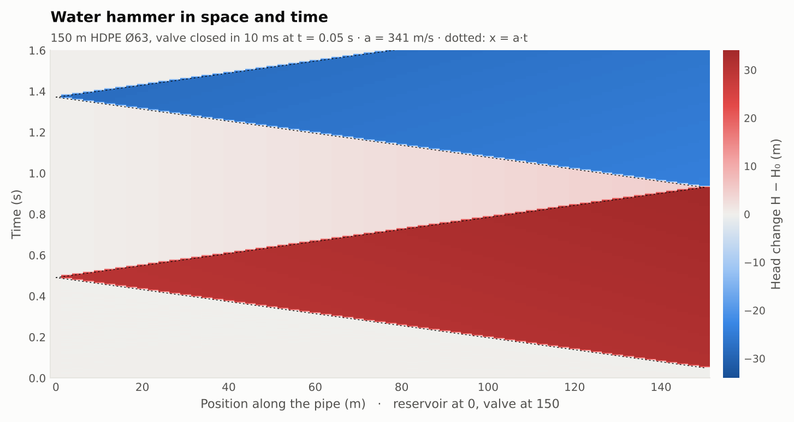
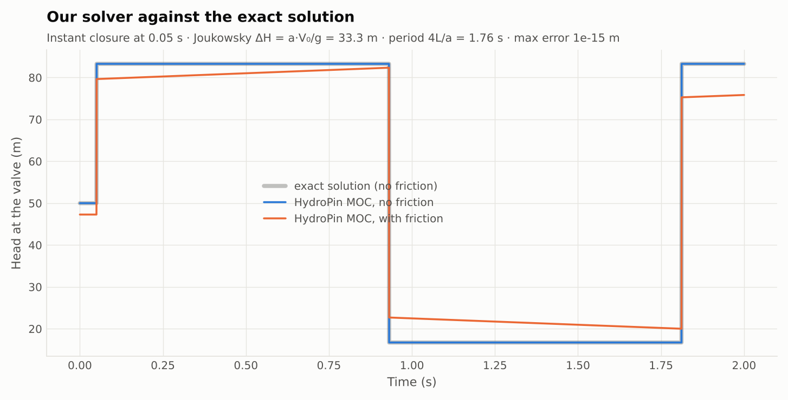
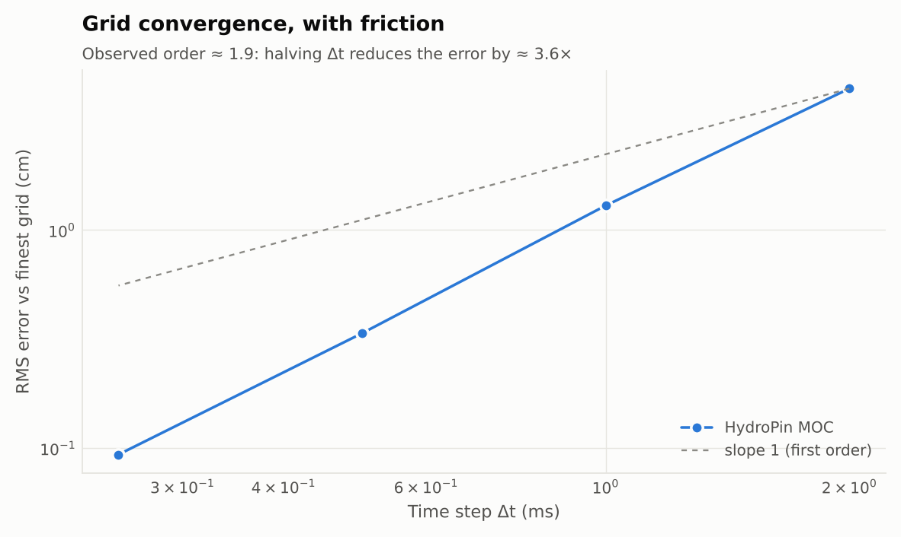

# Pressure-wave solver (method of characteristics)

> **✅ all checks pass (8/8)**  
> Our own water-hammer solver runs on the same networks, leaks and shifts as the steady twin. It matches the exact analytical solution to machine precision, converges when the grid is refined, and keeps a whole farm perfectly steady when nothing happens.

Back to the [overview](../../README.md) · Equations: [math](../../docs/math.md) · Design: [architecture](../../docs/architecture.md)

## 1. What was built

| Code | What it does | Math |
|---|---|---|
| `transient/moc.py · make_grid` | Courant-1 grid with per-pipe wave-speed adjustment ≤ PSI_MAX | §5.5 |
| `transient/moc.py · build_model` | Transient model from the prepared EPANET model + steady state (same leaks, clogging, shifts) | §5.1–5.2 |
| `transient/moc.py · run` | Vectorised MOC: interior points, junctions, emitters (lateral blocks, leaks, outlets), reservoir, pump, time-varying excitation valve, cavitation monitor | §5.5–5.6 |
| `oracles/transient_cases.py` | Reference set-ups: reservoir–pipe–valve, bench line, exact square-wave solution | §5.7 |

## 2. Checks

Each check compares the code with an analytical solution, a reference software or a physical law.

| # | Check | Expected | Obtained | Tolerance | Ref | Result |
|---|---|---|---|---|---|---|
| 1 | Joukowsky: first surge at the valve = a·V₀/g (instant closure, no friction) | 33.275 m | 33.275 m | ± 0.0001 % | §5.7 | ✅ |
| 2 | Whole 2 s trace = exact square-wave solution (max error / ΔH_J) | 1.0000e-09 | 1.2812e-15 | ≤ expected | §5.1 | ✅ |
| 3 | Oscillation period = 4L/a | 1.7617 s | 1.7627 s | ± 0.0568 % | §5.7 | ✅ |
| 4 | No numerical damping (Courant = 1): surge after 1.5 s = first surge | 33.275 m | 33.275 m | ± 1e-07 % | §5.5 | ✅ |
| 5 | Grid convergence with friction: error falls when Δt is refined (observed order) | 0.8 | 1.8665 | ≥ expected | §5.5 | ✅ |
| 6 | With friction, the line packs: surge exceeds Joukowsky, then decays | yes | yes | – | §5.7 | ✅ |
| 7 | Farm grid: wave-speed adjustment within PSI_MAX, Courant = 1 everywhere | 0.05 | 0.0036377 | ≤ expected | §5.5 | ✅ |
| 8 | No excitation → the farm (pump, junctions, 6 lateral blocks) stays steady for 3 s | 0.01 m | 5.2020e-04 m | ≤ expected | §5.6 | ✅ |

## 3. Figures

**Figure 1.** The pressure wave travelling back and forth after a 10 ms valve closure.

**Figure 2.** Head at the valve: exact solution vs our solver (no friction) and the realistic case with friction.

**Figure 3.** Error vs time step (with friction): the solver converges.

## 4. What the figures tell us

- Without friction, the solver reproduces the exact solution (Joukowsky surge, 4L/a period, no artificial damping) to **10⁻¹⁵ m**: the numerical scheme adds nothing of its own.
- With friction the error halves when Δt halves (observed order ≈ 1.9). At Δt = 0.5 ms the RMS error is **0.3 cm**, well below sensor noise.
- The first farm test revealed a real bug: minor losses (K = 2 on sector valves) were missing in the transient solver, so the farm drifted 13 cm in 3 s with nothing happening. Fixed; the drift is now **< 1 mm**.
- **TSNet could not serve as the reference** (decision D1). Version 0.3.1 fails under NumPy 2. In a separate NumPy-1 environment it mis-initialises a valve discharging to a reservoir (39 m error, its own warning) and crashes on a valve feeding a junction. The exact solution plus grid convergence are stronger oracles. TSNet is no longer a dependency.

## 5. Assumptions

- Quasi-steady friction (Darcy–Weisbach evaluated with the local flow at each step); minor losses spread evenly along the pipe.
- Wave speed from math note §5.2 with placeholder E and ν_p (`verify`), pipes free to move (c₁ = 1), no free air.
- Excitation valve = a time-varying emitter with closure law τ(t) = (1 − t/T_c)^E_m.
- Column separation is detected (flag), not simulated (math note §5.6).

## 6. Open points

- Accept replacing TSNet by the analytical solution and grid convergence as oracles.
