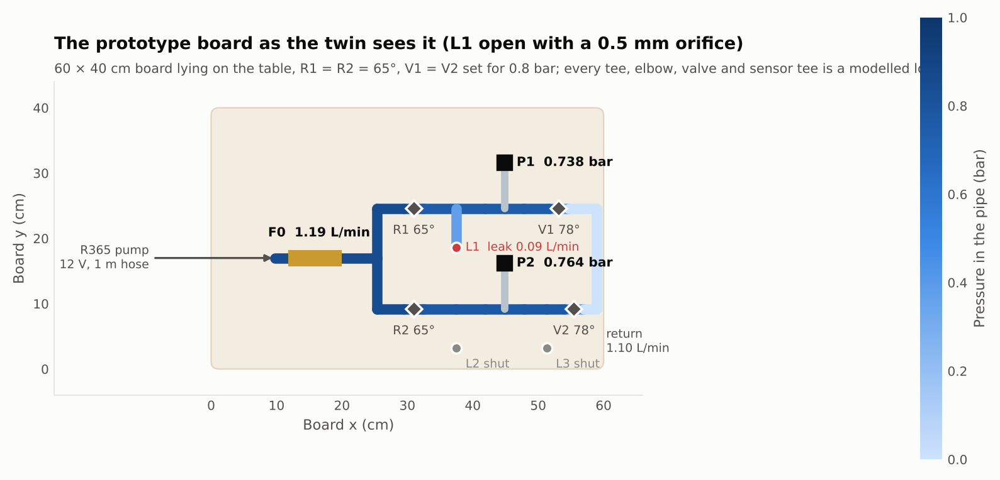
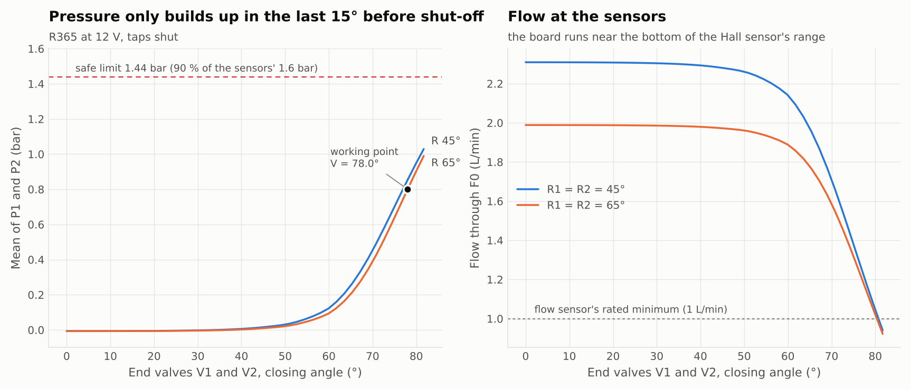
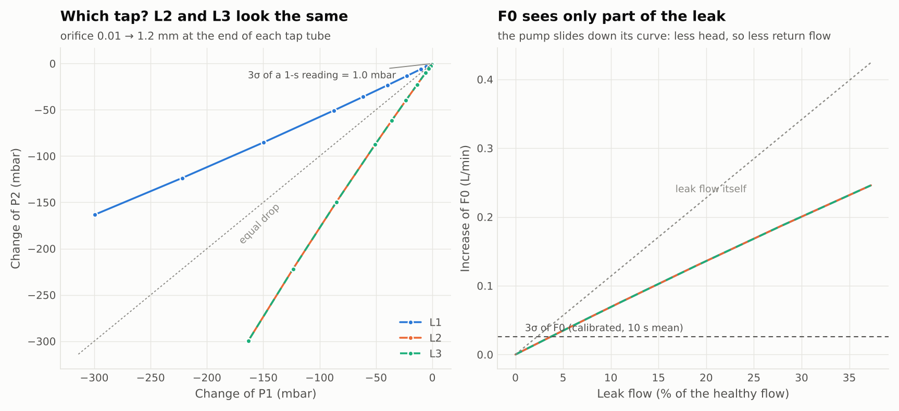
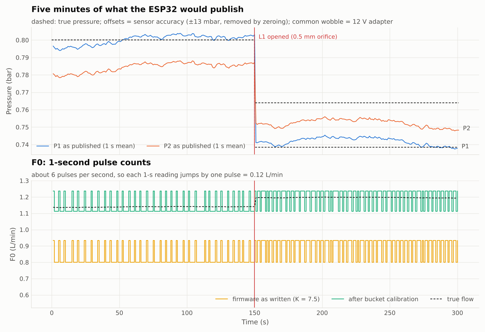
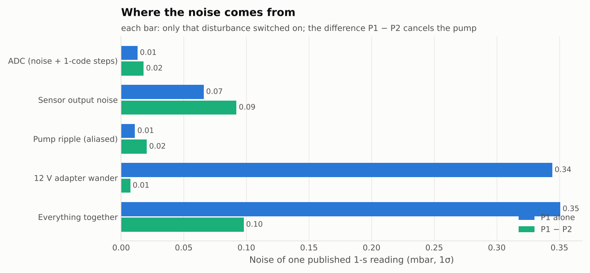
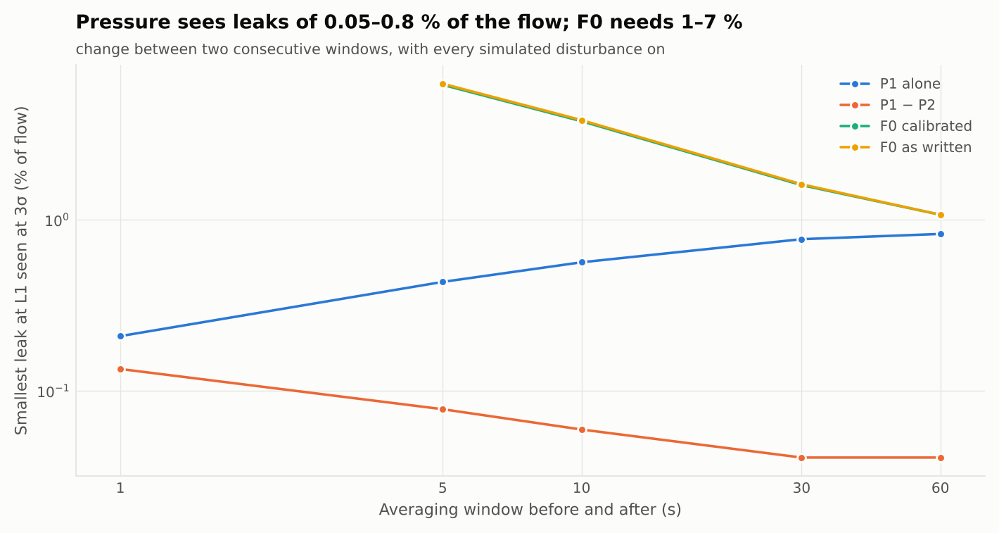

# Prototype bench twin

> **✅ all checks pass (28/28)**  
> Twin of the 3rd-phase board, built from the hardware list and sketch of 18 Nov 2026: every pipe, fitting, valve, tap, the R365 pump, both Swagelok sensors with their divider, the ADS1115, the ESP32 firmware formulas and the Hall flow sensor's pulse counter. It predicts what P1, P2 and F0 will publish for any valve setting and any leak, before the board is built.

Back to the [overview](../../README.md) · Equations: [math](../../docs/math.md) · Design: [architecture](../../docs/architecture.md)

## 1. What was built

| Code | What it does | Math |
|---|---|---|
| `physics/fittings.py` | Bore restriction, Weisbach plug-valve law K(θ), DC diaphragm pump curve vs voltage, ripple | §10.2–10.3 |
| `network/prototype.py` | Board geometry from the sketch, BoardSetting (valve angles, calibrated leak orifices), board_spec | §10.1–10.2 |
| `steady/board.py` | run_board (EPANET, check valves on outlets, shut valves removed), safety check, end-valve angle for a target pressure | §10.3 |
| `sensors/board.py` | PressureChain (Swagelok → divider/shunt → ADS1115 → firmware), HallFlowMeter (pulse counter), supply wander, timelines | §10.3–10.5 |
| `config/params.yaml › prototype` | 63 new parameters with source, range and ⚠ flag; 2 new materials (soft PVC hose, 316 steel) | §0.7 |

## 2. Checks

Each check compares the code with an analytical solution, a reference software or a physical law.

| # | Check | Expected | Obtained | Tolerance | Ref | Result |
|---|---|---|---|---|---|---|
| 1 | Bore restriction K_b(β = 0.5) = (0.75² + 0.375)/0.5⁴ | 15 | 15 | ± 1e-10 % | §10.2 | ✅ |
| 2 | No restriction when the bore equals the pipe: K_b(1) = 0 | 0 | 0 | ± 1.0000e-15 | §10.2 | ✅ |
| 3 | Valve law returns the Weisbach table at 40° | 17.3 | 17.3 | ± 1e-07 % | §10.2 | ✅ |
| 4 | Valve loss rises monotonically from open to shut | yes | yes | – | §10.2 | ✅ |
| 5 | Pump at 80 % voltage: shut-off head = 0.8 H0 | 14.4 m | 14.4 m | ± 1e-10 % | §10.3 | ✅ |
| 6 | Pump at 80 % voltage: zero head at 0.8 Q0 | 0 m | 0 m | ± 1.0000e-09 m | §10.3 | ✅ |
| 7 | Single path: EPANET flow = hand-solved energy equation | 0.53958 L/min | 0.53972 L/min | ± 0.1 % | §10.2, §2.1 | ✅ |
| 8 | Single path: P1 from EPANET = hand calculation | 13.163 m | 13.162 m | ± 0.002 m | §10.1–10.2 | ✅ |
| 9 | Mass balance: pump flow = return + all taps (two leaks open) | 1.3148 L/min | 1.3148 L/min | ± 0.0001 % | §2.1 | ✅ |
| 10 | Tap with a 0.8 mm orifice follows the orifice law (§2.5) | 0.21459 L/min | 0.21465 L/min | ± 0.5 % | §10.2 | ✅ |
| 11 | Flat board: every fitting sits at z_B (no elevation between P1 and P2) | 0.5 m | 0.5 m | ± 1.0000e-12 m | §10.1 | ✅ |
| 11b | Sensor reads the pipe pressure minus its stem height Δz_s | 8.1576 m | 8.1576 m | ± 1.0000e-12 m | §10.1 | ✅ |
| 12 | Design claim: a leak on branch A drops P1 more than P2 | yes | yes | – | hardware list | ✅ |
| 13 | Design claim: a leak on branch B drops P2 more than P1 | yes | yes | – | hardware list | ✅ |
| 14 | Reference setting stays below 90 % of the sensors' 1.6 bar | yes | yes | – | §10.3 | ✅ |
| 15 | All outlets shut → shut-off head exceeds the safe limit (never do it) | yes | yes | – | §10.3 | ✅ |
| 16 | Divider ratio with the ADC input in parallel | 0.31214 | 0.31214 | ± 1e-10 % | §10.4 | ✅ |
| 17 | ADS1115 step at ±4.096 V = 125 µV | 1.2500e-04 V | 1.2500e-04 V | ± 1e-10 % | §10.4 | ✅ |
| 18 | Ideal chain: the firmware formula inverts the sensor to ± ½ code | 5.2000e-05 bar | 5.2000e-05 bar | ≤ expected | §10.4 | ✅ |
| 19 | 4–20 mA version (150 Ω): firmware inverts to ± ½ code | 6.7708e-05 bar | 6.6667e-05 bar | ≤ expected | §10.4 | ✅ |
| 20 | Overpressure saturates the output at 10 V × k (no wrap-around) | 3.1214 V | 3.1214 V | ± 1e-10 % | §10.4 | ✅ |
| 21 | Ripple after sensor lag + ADC boxcar: analytic = brute force | 0 m | 5.2261e-06 m | ± 2.0000e-05 m | §10.4 | ✅ |
| 22 | Ripple at exactly DR is cancelled by the conversion (sinc zero) | 0 m | 3.8979e-17 m | ± 1.0000e-12 m | §10.4 | ✅ |
| 23 | Counter: mean pulse rate = K_F Q + f_0 (long run, no jitter) | 6.224 Hz | 6.224 Hz | ± 0.1 % | §10.5 | ✅ |
| 24 | Counter: every window holds ⌊fT⌋ or ⌈fT⌉ pulses | yes | yes | – | §10.5 | ✅ |
| 25 | Calibrated firmware: mean flow = true flow | 1.1388 L/min | 1.1388 L/min | ± 0.1 % | §10.5 | ✅ |
| 26 | Supply wander: std = σ_V | 0.003 | 0.0029644 | ± 6 % | §10.3 | ✅ |
| 27 | Supply wander: correlation at lag τ_V = e⁻¹ | 0.36788 | 0.36163 | ± 0.05 | §10.3 | ✅ |

## 3. Figures

**Figure 1.** The board as modelled, coloured by pressure, with L1 leaking through a 0.5 mm orifice.

**Figure 2.** Operating map: pressure and flow vs the end-valve angle, for two settings of R1/R2.

**Figure 3.** Leak signatures of the three taps for orifices of 0.01–1.2 mm.

**Figure 4.** Five simulated minutes of published data; L1 opens at 150 s.

**Figure 5.** Noise budget of one published 1-s reading.

**Figure 6.** Smallest detectable leak vs averaging window.

## 4. What the figures tell us

- **Working point.** The pressure only builds up when V1/V2 are within ~15° of shut-off; 0.8 bar needs V ≈ 78.0° with R1 = R2 = 65° (shut at 82°). Around there, 1° moves the pressure by 0.05 bar: set it slowly while watching P1/P2 on the laptop. The valve law beyond 65° is an extrapolation, so the real angle will differ; the healthy calibration fixes that.
- **R1/R2 must really restrict.** At 45° they drop only 7 cm of water, so a leak on either branch moves P1 and P2 almost equally (ΔP1/ΔP2 = 1.05 for a 0.5 mm leak at L1). At 65° the branch contrast is clear: a 0.5 mm leak at L1 gives ΔP1 = -62 mbar vs ΔP2 = -36 mbar.
- **L2 and L3 cannot be told apart** with P1, P2 and F0 (cosine of their signatures ≥ 1.0000): both are on branch B, and both leaks draw their water through R2 only. A restriction between L2 and P2 separates them (L3's water must cross it, L2's does not): with a third mini valve at ~65–70° there (K ≈ 8 000) the two signatures are 16° apart in the P1–P2 plane. A third pressure sensor would also do it.
- **Leak taps opened by hand are far too big.** The ½" tap leaks 88 % of the flow at 60°, 47 % at 75°, 34 % at 80° and still 31 % at 81.5° (shut at 82°). For reproducible small leaks, put a calibrated orifice at the end of each tap tube (a drilled cap or a dripper): 0.5 mm ≈ 8 % of the flow, 0.2 mm ≈ 1.3 %.
- **Pressure resolution is not the limit.** One ADS1115 code is 0.10 mbar. The largest noise is the 12 V adapter wandering (0.3 mbar on P1 alone, sensitivity 1.09 bar per 100 % voltage), and it nearly cancels in P1 − P2 (0.01 mbar). Use the difference, or a regulated supply.
- **F0 needs calibration and long windows.** At ~1.1 L/min the sensor gives ~6 pulses/s; with the firmware's K = 7.5 and no offset it reads -27 % off. A 1-s reading steps by 0.12 L/min. After the bucket calibration, with 30-s windows, F0 detects leaks ≥ 1.6 % of the flow; pressure detects ≥ 0.04 %.
- **Never close all valves** (oracle 12.15): the R365 shut-off head (~1.8 bar) exceeds the sensors' 1.6 bar. The twin flags any setting whose highest pressure passes 90 % of 1.6 bar.
- **M3 is not tested on the board** (team decision, and the board is too short and has no fast valve). It remains fully in the simulation on the bench line and the demo farm (the pressure-wave studies (solver, leak echoes, M3)), with its parameters still marked ⚠.

## 5. Assumptions

- Layout read off the 18 Nov sketch; lengths, bores and heights are estimates (all ⚠ in params.yaml §0.7).
- Board flat on the table (team decision, 22 Nov), 0.5 m above the bucket water (bucket on the floor, assumed); outlet tubes drain freely (no siphon).
- Pump R365: straight-line curve through 2.5 L/min free flow and 1.8 bar shut-off at 12 V; listings disagree (1–2.5 bar).
- Fitting losses: Crane-type K values plus the bore restriction; valves follow the Weisbach plug-cock table. Laminar flow on the board (Re ≈ 800–1 700) makes real minor losses somewhat larger than these turbulent values: calibrated later.
- Pump ripple 0.1 m at 150 Hz and adapter wander 0.3 % are guesses until the 5-minute quiet recording.
- Flow sensor taken as a brass G1/2 type with f = 8.1 Q − 3 (Adafruit datasheet); the firmware constant 7.5 is the common example value.
- EPANET uses g = 9.80665 m/s²; the hand oracle 9.81 m/s² (0.03 % difference, inside the 0.1 % tolerance of 12.7).

## 6. Open points

- Confirm which list is current: the cost sheet (16 Nov: 3 sensors 0–10 bar, YF-S201, 370 W pump, 3 branches) or the PDF + sketch (18 Nov). The twin follows the 18 Nov version.
- Set R1/R2 near 65° (not 45°) so the two branches respond differently.
- Replace the hand-cracked leak taps by calibrated orifices (drilled end caps 0.2 / 0.5 / 1 mm, or drippers).
- Decide how to separate L2 from L3: a third mini valve between L2 and P2 (~65–70°), a third sensor, or accept 'branch B' as the answer.
- Keep the R365 out of the water: it is a self-priming diaphragm pump, not a submersible one (the 18 Nov diagram shows it inside the bucket).
- Once assembled, measure the ⚠ values and record the healthy settings, the leak flows and a 5-minute quiet run; the twin will be calibrated on them.
