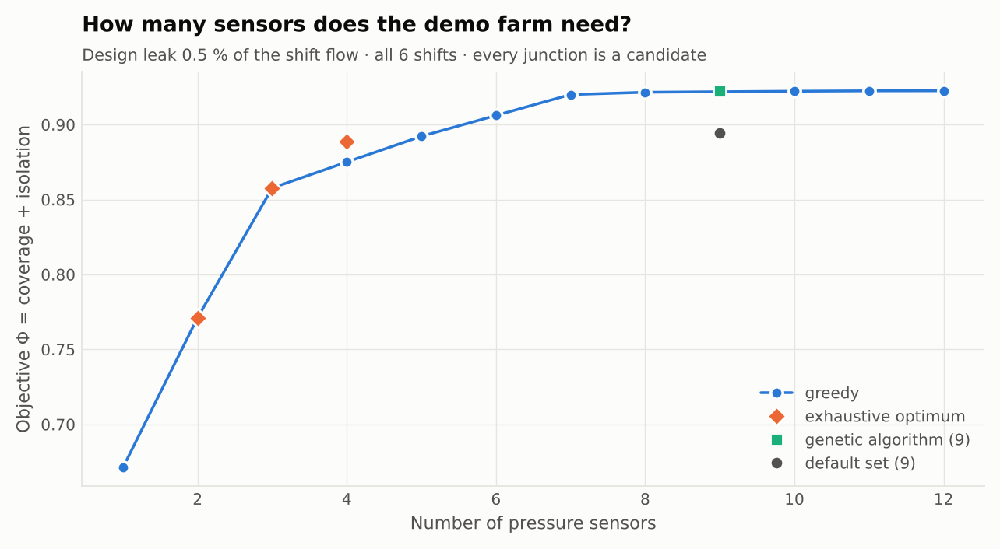
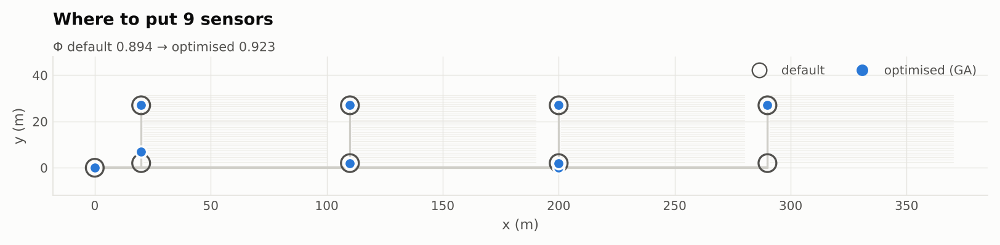

# Sensor placement

> **✅ all checks pass (7/7)**  
> Every junction of the demo farm is a candidate sensor position. The objective of math note §7 rewards seeing every design leak in every shift (coverage) and telling neighbouring leaks apart (isolation). Greedy search, exhaustive search on small cases and a genetic algorithm are compared.

Back to the [overview](../../README.md) · Equations: [math](../../docs/math.md) · Design: [architecture](../../docs/architecture.md)

## 1. What was built

| Code | What it does | Math |
|---|---|---|
| `placement/optimizer.py` | Objective Φ, greedy, exhaustive, genetic algorithm (crossover + move-to-neighbour mutation) | §7 |
| `oracles/placement_cases.py` | Placement problem: signatures of every leak location at every node, for all 6 shifts | §7 |

## 2. Checks

Each check compares the code with an analytical solution, a reference software or a physical law.

| # | Check | Expected | Obtained | Tolerance | Ref | Result |
|---|---|---|---|---|---|---|
| 1 | Greedy reaches ≥ 95 % of the exhaustive optimum with 2 sensors | 0.95 | 1 | ≥ expected | §7 | ✅ |
| 2 | Greedy reaches ≥ 95 % of the exhaustive optimum with 3 sensors | 0.95 | 1 | ≥ expected | §7 | ✅ |
| 3 | Greedy reaches ≥ 95 % of the exhaustive optimum with 4 sensors | 0.95 | 0.98447 | ≥ expected | §7 | ✅ |
| 4 | Greedy Φ never decreases when a sensor is added | yes | yes | – | §7 | ✅ |
| 5 | Genetic algorithm (seeded with greedy) ≥ greedy, 9 sensors | 0.92187 | 0.92258 | ≥ expected | §7 | ✅ |
| 6 | Optimised 9-sensor set ≥ the default set | 0.89444 | 0.92258 | ≥ expected | §7 | ✅ |
| 7 | Optimised 9 sensors see as many design leaks as a sensor on every junction would | 0.90411 | 0.90411 | ± 1.0000e-09 | §7 | ✅ |

## 3. Figures

**Figure 1.** Objective vs number of sensors: greedy, exhaustive optimum, genetic algorithm, default set.

**Figure 2.** Default vs optimised positions for 9 sensors.

## 4. What the figures tell us

- Greedy is optimal with 2–3 sensors and within 98.4 % of the optimum with 4 (exhaustive check). The GA then improves the 9-sensor set.
- Diminishing returns: **6 sensors** reach 98 % of the best objective. Beyond that, extra sensors add almost nothing on this farm. That is a useful cost argument for the business plan.
- Optimised 9-sensor set: HEAD, B11, B13, S2, B23, M3, S3, B33, B43. Compared with the default, it moves sensors from sector heads to the **far ends of sub-mains** (B·3, B·1) and to the main, where leak signatures differ most.
- Coverage: the optimised 9 sensors see **90 %** of 0.5 % design leaks, exactly as many as 21 sensors (one per junction) would. The remaining ones sit below κσ_tot in single-sector shifts (smaller flow). 0.5 % is the practical floor for steady-state detection on this farm; the first oracle version wrongly expected 100 % and was corrected to 'as good as every junction'.
- Every sector needs at least one sensor: when a sector is closed, its sensors read 0, so coverage is only reached with one sensor per sector.
- Objective made explicit (math note §7): isolation is the mean angle to the nearest *other* visible location (not the minimum over all pairs, which is always 0 for leaks at the same place), and a leak no sensor sees scores 0.

## 5. Assumptions

- Design leak 0.5 % of the shift flow, signatures scaled linearly from the 5 % twin signatures.
- Detection threshold κ σ_tot with temperature compensation .
- λ_iso = 1 (coverage and isolation weighted equally).

## 6. Open points

- Use the optimised positions for the pilot farm once its survey replaces the demo farm (rerun this script).
