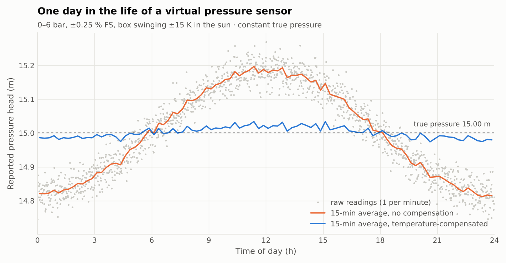
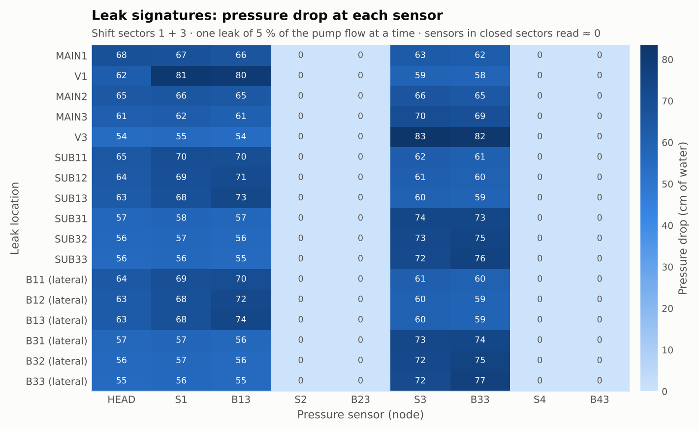
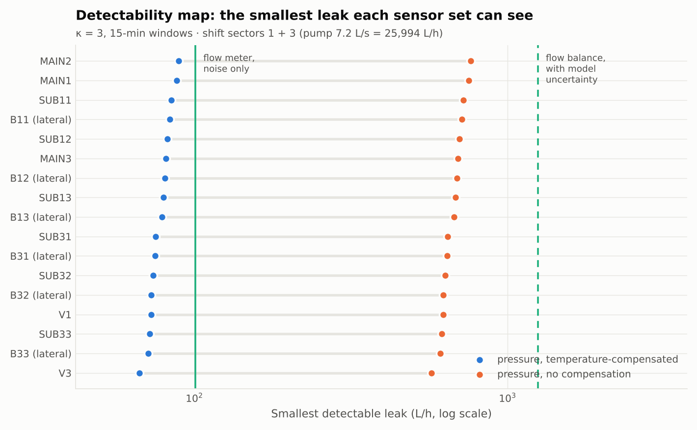
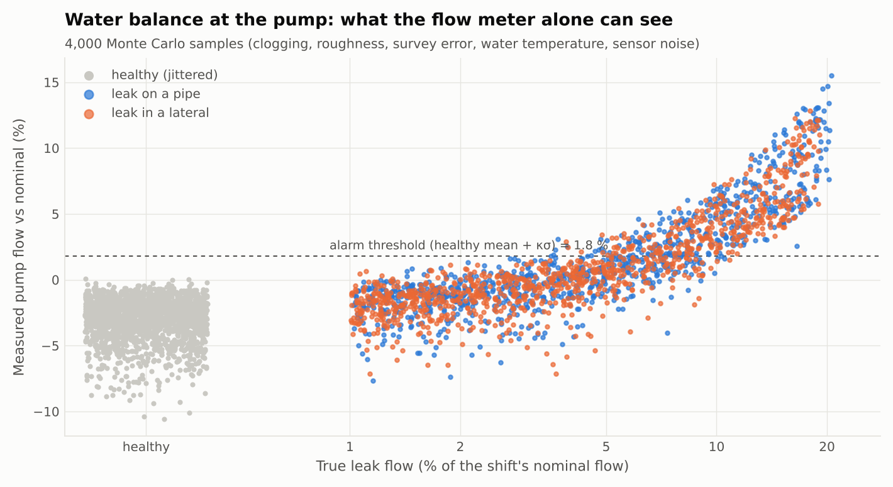

# Virtual sensors, scenarios and training dataset

> **✅ all checks pass (15/15)**  
> The twin now produces what the field will produce: noisy, drifting, quantised sensor readings with lost packets, for thousands of randomly perturbed irrigation shifts with and without leaks. It also says which leaks are detectable before any method is trained.

Back to the [overview](../../README.md) · Equations: [math](../../docs/math.md) · Design: [architecture](../../docs/architecture.md)

## 1. What was built

| Code | What it does | Math |
|---|---|---|
| `sensors/model.py` | Low-rate sensor (gain, bias, temperature and ageing drift, noise, ADC, packet loss), high-rate M3 sensor (lag, sampling, GPS offset), flow meter, σ_tot, detectability | §3, §2.7 |
| `steady/scenarios.py` | Monte Carlo sampler: shift, clogging, roughness, survey error, water temperature, one leak on a pipe or inside a lateral, only where water flows | §2.9 |
| `sensors/dataset.py` | Scenario → twin → sensors pipeline; `data/farm_dataset.npz` with 4,000 samples | §2.9, §3 |
| `sensors/stream.py` | Readings → MQTT messages in the exact ESP32 format (topic hydropin/<farm>/<node>) | contracts |
| `params.yaml + math note` | New: `N_AVG`, `TEMP_COMP_RESIDUAL`, `SIGMA_Q` (§0.6, §2.7, §3.3 updated) | §0.6 |

## 2. Checks

Each check compares the code with an analytical solution, a reference software or a physical law.

| # | Check | Expected | Obtained | Tolerance | Ref | Result |
|---|---|---|---|---|---|---|
| 1 | Sensor noise std = SIGMA_N × full scale | 0.030591 m | 0.030621 m | ± 2 % | §3.1 | ✅ |
| 2 | Packet-loss rate = LOSS_RATE (± 3σ binomial) | 0.02 | 0.0198 | ± 9.3915e-04 | §3.1 | ✅ |
| 3 | Every reading is a whole number of ADC steps | yes | yes | – | §3.1 | ✅ |
| 4 | Bias spread across devices = ACC × F_S / 2 | 0.076477 m | 0.076629 m | ± 3 % | §3.1 | ✅ |
| 5 | Daily temperature drift amplitude = TEMPCO × F_S × T_AMP | 0.18355 m | 0.18353 m | ± 2 % | §3.1 | ✅ |
| 6 | Averaging 15 readings divides the noise by √15 | 0.0078986 m | 0.007833 m | ± 5 % | §3.3 | ✅ |
| 7 | σ_tot (compensated) = hand calculation of math note §3.3 | 0.015193 m | 0.015193 m | ± 1e-10 % | §3.3 | ✅ |
| 8 | Same seed → identical scenarios (reproducibility) | yes | yes | – | §2.9 | ✅ |
| 9 | Every Monte Carlo draw stays inside its declared range | yes | yes | – | §2.9 | ✅ |
| 10 | Every sampled leak actually loses water (placed where water flows) | yes | yes | – | §2.9 | ✅ |
| 11 | Healthy samples have zero leak flow | 0 m³/s | 0 m³/s | ± 1.0000e-12 m³/s | §2.9 | ✅ |
| 12 | Mass balance closes in every dataset sample (worst relative error) | 1.0000e-05 | 1.8149e-07 | ≤ expected | §2.1 | ✅ |
| 13 | Unperturbed healthy farm = nominal twin (H_TRUE = H_MODEL) | 0 m | 0 m | ± 1.0000e-06 m | §4.2 | ✅ |
| 14 | MQTT JSON round trip gives the same message; lost packet not sent | yes | yes | – | contracts | ✅ |
| 15 | Message pressure in bar × 10.197 = reading in m | 15 m | 15 m | ± 0.001 % | §3 | ✅ |

## 3. Figures

**Figure 1.** One sensor, one day, constant true pressure: noise, lost packets, and the daily drift caused by the sun on the box.

**Figure 2.** Leak signatures: which sensor sees which leak, and how strongly.

**Figure 3.** Detectability map: smallest detectable leak per location, for the pressure sensors (with/without temperature compensation) and for the flow meter.

**Figure 4.** Water balance over the whole dataset: pump flow vs the twin's nominal flow.

## 4. What the figures tell us

- Temperature compensation is the single most important sensor-side feature: it brings σ_tot from **13.0 cm** to **1.5 cm**. Measuring the box temperature in every node is a cheap must-have for the hardware team.
- With compensation, the smallest detectable leak by pressure is **67–89 L/h** depending on location. Without it, **572–762 L/h**. For comparison, one 80 m lateral carries ≈ 400 L/h, so a split lateral is clearly detectable.
- The flow meter is precise (noise-only limit ≈ 101 L/h), but comparing the pump flow with the twin is limited by **model uncertainty** (clogging, roughness, water temperature): healthy samples scatter by ±1.6 %, so the water balance alone only flags leaks above ≈ **1248 L/h**. Pressure patterns (M1/M2) are needed below that, and calibration on the real farm will tighten this band.
- Every leak drops **all** open-sector sensors by 54–83 cm: most of that is the pump sliding down its curve (common to all sensors). The part that differs between sensors, which localises the leak, is at most ≈ 29 cm. So detection is easy and localisation is the hard part. M2 must work on the *pattern* (removing the common part), and M3 is needed for the last metres.
- Sensors in closed sectors read ≈ 0 and see nothing. Detection is **per shift**, and a leak in a sector is only visible while that sector irrigates.
- Dataset for M1 and M2: **4,000 samples**, 2,008 with a leak (half on pipes, half inside laterals), 6 shifts, 9 pressure sensors + 1 flow meter, 60 one-minute readings each.

## 5. Assumptions

- Sensor parameters (`ACC`, `TEMPCO`, `T_AMP`, `DRIFT_YR`, `SIGMA_N`, `LOSS_RATE`, `TEMP_COMP_RESIDUAL`, `SIGMA_Q`) are placeholders (`verify`); replace them with the chosen sensor's datasheet and the bench measurements.
- Bias and gain are removed by zeroing at installation; a leak is judged as a change (math note §3.3).
- Monte Carlo ranges: clogging 0–30 % (mostly clean), roughness ×0.8–3, survey error σ = 5 cm, water 15–35 °C, leak 1–20 % of the shift flow (log-uniform).
- Default sensor set (9 pressure sensors: pump outlet, every sector head, every sector's last block) until sensor placement optimises it.
- Each sample is entirely healthy or entirely leaky (no leak starting mid-window yet).

## 6. Open points

- Hardware team: add a temperature sensor in every node box (needed for compensation).
- Confirm the Monte Carlo ranges with the agricultural engineer (typical clogging, water temperature in pipes).
